# Sepsis-GRU V2 Master Research Handbook

**Research title:** Treatment-Response Coupling in GRU-Based Sepsis Prediction: A Calibrated, Explainable, and Counterfactual Framework  
**Version:** 1.1 — team-review draft with proposed post-training demonstrator  
**Last updated / source reviewed:** 2026-10-23 (Asia/Katmandu)  
**Owner:** Research lead / documentation maintainer — person to be assigned  
**Source Git commit:** `1e6914c13089c783baecde95715caef545cd403d`  
**Execution status:** NOT AUTHORIZED; checked-in execution-v2 remains `DRAFT_NOT_APPROVED`  
**Scientific status:** **SCIENTIFICALLY AGREED / SUPERVISOR VERBALLY SUPPORTED**, as reported by the project owner. Written/version-bound approval details and separate execution authorization are not present in the reviewed repository.

This is the team's operating and learning manual, not a replacement for source code, immutable scientific records or approvals. It explains the V2 baseline and the finite work remaining through submission. Numerical examples outside attributed audit tables are fictional. No clinical-model performance has been invented.

## Table of contents

- [START HERE — project recovery and quick start](#start-here)
- [What should I do next?](#next-action)
- [Status labels and evidence precedence](#evidence-precedence)
- [1. Project overview](#chapter-1)
- [2. Necessary foundations](#chapter-2)
- [3. Data sources and cohort construction](#chapter-3)
- [4. Hourly prediction and target construction](#chapter-4)
- [5. Complete feature engineering](#chapter-5)
- [6. BigQuery and SQL architecture](#chapter-6)
- [7. Dataset integrity and audit results](#chapter-7)
- [8. Model architecture](#chapter-8)
- [9. All six experiments](#chapter-9)
- [10. Repository architecture and file guide](#chapter-10)
- [11. Development environment and onboarding](#chapter-11)
- [12. Secure research data handling](#chapter-12)
- [13. Retention, frozen snapshots and arrays](#chapter-13)
- [14. Training GRU-A step by step](#chapter-14)
- [15. Remaining model training](#chapter-15)
- [16. Evaluation and test protection](#chapter-16)
- [17. Calibration](#chapter-17)
- [18. Explainability](#chapter-18)
- [19. Model-based counterfactual analysis](#chapter-19)
- [20. Sensitivities and limitations](#chapter-20)
- [21. Quality assurance and troubleshooting](#chapter-21)
- [22. Completion roadmap](#chapter-22)
- [23. Research reporting and defense](#chapter-23)
- [24. Team collaboration](#chapter-24)
- [25. Glossary, references and appendices](#chapter-25)
- [PART VI — Post-training system development and research demonstration](#part-vi)
- [26. System scope and requirements](#chapter-26)
- [27. Proposed software architecture and data flow](#chapter-27)
- [28. Proposed technology decisions](#chapter-28)
- [29. Proposed future repository structure](#chapter-29)
- [30. Post-training artifact packaging contract](#chapter-30)
- [31. Model-serving implementation plan](#chapter-31)
- [32. Frontend development and user experience](#chapter-32)
- [33. Explainability integration](#chapter-33)
- [34. Coherent counterfactual demonstration](#chapter-34)
- [35. Entirely fictional demonstration cases](#chapter-35)
- [36. Step-by-step system implementation and verification](#chapter-36)
- [37. Local demonstration and viva presentation](#chapter-37)
- [38. Security and deployment boundaries](#chapter-38)
- [39. End-to-end research-to-system integration](#chapter-39)
- [40. Returning-team system execution checklist](#chapter-40)
- [Open questions / evidence gaps](#open-questions)
- [Verification and maintenance](#maintenance)

<a id="start-here"></a>
## START HERE — If You Are Returning to This Project After a Long Break

> **Last updated: 2026-10-23.** Last completed committed milestone: **Step 82**, preserving the GRU-A runbook and supervisor-review package at the source commit above. The later conversation reports supervisor verbal support for the methodology; it does not supply signed approval metadata or authorize clinical execution. No V2 real-data model training has been recorded. Do not infer progress from elapsed time.
>
> **Single next recommended action:** arrange a supervisor/institutional execution-and-retention decision: record the supported methodology version and approval reference, nominate an authorized storage/compute environment and an owner for preserving the expiring V2 snapshot. Do this before transferring data or launching training. Complete this decision record rather than reopen broad source audits.

**Step 83 documentation status:** this handbook and its system-development addendum are prepared for review and remain uncommitted. The last completed committed milestone is still Step 82. [Part VI](#part-vi) proposes a local fictional-input demonstrator; neither its implementation nor its scope is approved by this design. If research training/analysis has since finished, use [the system checklist](#chapter-40) to find the next software task and [local presentation guidance](#chapter-37) before trying to launch an app. No application startup command exists yet.

### Recover the working state

Open a terminal in the code-only project directory. These are read-only checks:

```text
git rev-parse --show-toplevel
git rev-parse HEAD
git status --short
git log -5 --oneline
git diff --stat
git diff --cached --stat
```

Compare HEAD with the source commit above. A newer commit may be legitimate, but read its change record before using old instructions. Do not reset, clean or overwrite local work. A clean Git status does not mean no local files exist: this repository uses a strict allowlist and ignores most new files. Root recovery ZIPs and current-source diagnostic copies are local ignored artifacts. This handbook is intentionally uncommitted at Step 83.

**Required materials:** the nine root Python modules in [Chapter 10](#chapter-10); the feature manifest, ablations, frozen statistics and execution-v2 protocol; five test modules; source-evidence schema; `provenance/v2/recovery-1/`; two tracked SQL ZIPs; methodology freeze, R2A readiness, source-integrity closure, supervisor review and [GRU-A runbook](docs/sepsis_gru_v2_gru_a_execution_runbook.v1.md). The [source index](#source-index) lists exact filenames. Do not reconstruct missing source from memory.

The **complete provenance test** additionally requires four original SQL-only recovery ZIPs listed in [Chapter 11](#chapter-11). They exist locally but are not tracked. Obtain reviewed copies and authenticate them against the inventory. A clone without them will fail that test; this is a packaging prerequisite, not evidence of a model defect.

### Confirm the environment safely

With existing dependencies and the archive prerequisites available:

```text
python -B -m unittest discover -s tests -v
python -B sepsis_gru_v2_production.py --demo --preflight-only --experiments A
python -B sepsis_gru_v2_production.py --demo --experiments A
```

These commands use internally generated fictional data. The last recorded complete suite passed **119 tests** at Step 75; the A-only production demo returned COMPLETE at Step 81. These historical records do not certify a restored environment today. Record new results and runtime versions. Tests/demo remove temporary fictional files. Never give clinical inputs a synthetic marker or pass them to a smoke runner.

### Determine whether real training is ready

The checked-in execution-v2 has `status=DRAFT_NOT_APPROVED`, scientific status awaiting approval, `execution.approved=false`, empty storage roots and null input paths/hashes. Therefore **real execution is blocked**. A separately versioned protocol needs genuine scientific and execution approval, verified storage, source/statistics/input hashes, review dispositions and `evaluate_test=false`. Satisfying these fields cannot itself authenticate the human attestations.

Continue through [Training GRU-A](#chapter-14), use [troubleshooting](#chapter-21) for failures and [the completion roadmap](#chapter-22) for subsequent work. If returning after December 9–10, 2026, the authorized custodian must confirm whether the reportedly expiring objects were preserved. Do not assume they survived.

**Return-after-a-break checklist:**

- [ ] Compare handbook date, Git version and local changes.
- [ ] Locate required source, configurations, reviewed recovery archives and approvals.
- [ ] Verify runtime compatibility; rerun synthetic tests and record outcomes.
- [ ] Determine whether verbal support now has a version-bound record; distinguish institutional execution permission.
- [ ] Confirm snapshot retention, dependency coverage and statistics provenance.
- [ ] Verify authorized arrays and final protocol before real execution.
- [ ] Resume a matching run or start the next approved experiment; never overwrite existing outputs.
- [ ] If the optional demonstrator is in scope, check bundle/service/UI status in [chapter 40](#chapter-40); proposed paths are not existing software.
- [ ] Update this status box, roadmap, evidence gaps and source commit together after completion.

Status updates must include date, reviewer role, evidence reference and acceptance criterion. A scheduled task is not completed work. Preserve historical draft protocols; create new approval records rather than rewriting history.

<a id="next-action"></a>
### What should I do next? — decision tree

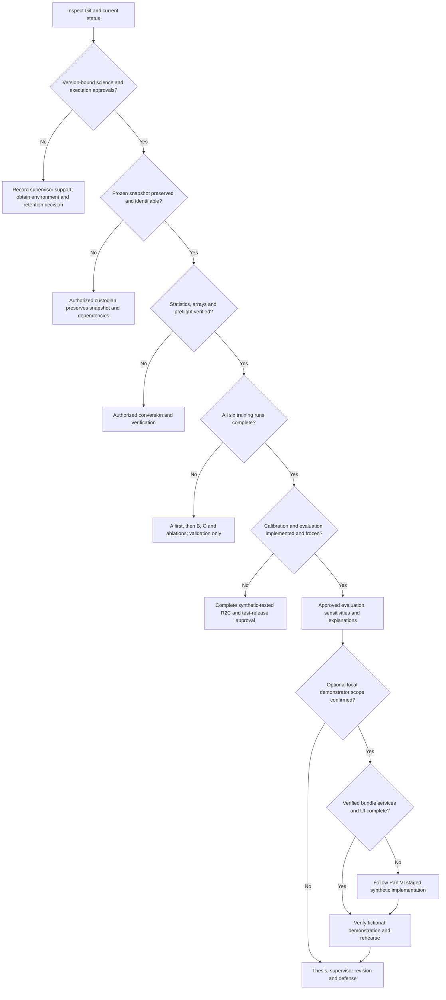

Urgent retention planning can proceed while approval details are recorded; actual transfers require permission. Inconsistent evidence sends work to bounded review, not to a bypass branch.

<a id="evidence-precedence"></a>
### Status labels and evidence precedence

| Label | Meaning |
|---|---|
| **IMPLEMENTED AND VERIFIED** | Source/test evidence on synthetic inputs or verified local archive integrity; not clinical performance |
| **IMPLEMENTED, REAL-DATA VERIFICATION PENDING** | Mechanism exists; the particular clinical input/environment still needs authorized checks |
| **SCIENTIFICALLY AGREED / SUPERVISOR VERBALLY SUPPORTED** | Reported methodological support; written metadata and execution authorization cannot be invented |
| **PLANNED** | Later work without a current verified implementation/output |
| **BLOCKED — AUTHORIZATION OR RESOURCE** | Stated permission or capacity requirement is unmet |
| **OPTIONAL / CONDITIONAL** | Separate decision/specification required |
| **KNOWN LIMITATION** | Constraint to disclose, not silently correct in the baseline |

Use current code/tests for implementation, the [freeze](docs/sepsis_gru_v2_methodology_freeze.v0.1-provisional.md) for scientific definitions, and [closure v1](docs/sepsis_gru_v2_source_integrity_closure.v1.md) for the supplied current-source investigations. Preserve older documents. A disagreement requires explicit reconciliation; this handbook does not authorize a change. Checksums prove byte identity, not clinical validity or permission.

<a id="chapter-1"></a>
## 1. Project overview

**Status: SCIENTIFICALLY AGREED / SUPERVISOR VERBALLY SUPPORTED; clinical experiments PLANNED.**

This Computer Engineering project combines temporal data engineering, recurrent neural networks and careful evaluation. It asks whether treatment exposure and treatment–physiology co-change improve prediction of a retrospectively selected suspected-infection reference beyond physiological/laboratory measurements. Three nested models progressively receive measurements (A), flat treatments (B), and engineered temporal changes (C). Ablations separate antibiotic information and the explicit interaction term.

ICU records are repeated, irregular observations. Treatments reflect clinicians' assessments, and documentation can surround the event used as a label. A model may recognize that documentation rather than discover biological onset. Timestamp rules, patient isolation and restrained claims therefore matter as much as architecture.

The research gap is a study question: whether incremental treatment information is predictive, calibrated and interpretable in this fixed benchmark. It is not a verified claim that previous literature never used treatment variables. A publication-grade novelty claim requires the literature verification described in Chapter 25. TRC is not a new causal estimator.

Objectives are to preserve reproducible lineage; compare six arms under one training policy; quantify discrimination/calibration; explain inputs; examine coherent hypothetical dose changes; and report target/availability limitations. Engineering contributions include deterministic conversion, lazy disk-backed sequences, evidence contracts and resumable runs.

Hypotheses are that B may improve on A, C may improve on B, and C may differ from C_no_TRC. Assess paired differences on identical held-out endpoints after freezing evaluation. A positive result is a credible qualified increment; a neutral result is no clear increment; a negative result may show worse calibration or unnecessary complexity. All can support a defensible thesis. Statistical improvement alone does not establish clinical utility.

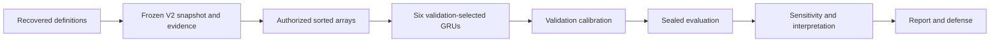

**Verify / next:** describe the target without claiming biological onset; identify the comparison isolating TRC; read the supervisor package before proposing a new study arm.

<a id="chapter-2"></a>
## 2. Necessary foundations

**Status: educational explanation grounded in the frozen project; external bibliography needs verification.** Project-specific source interpretation is in the [addendum](docs/sepsis_gru_v2_methodology_addendum.v1.md) and [freeze](docs/sepsis_gru_v2_methodology_freeze.v0.1-provisional.md).

Sepsis describes life-threatening organ dysfunction associated with a dysregulated response to infection. Sepsis-3 is a clinical framework; a retrospective database algorithm operationalizes it rather than directly observing onset. SOFA summarizes respiratory, coagulation, liver, cardiovascular, neurological and renal dysfunction. Cardiovascular treatment can enter that score. The recorded source concept links antibiotic prescriptions with culture sampling to identify suspected infection; a positive culture is not required. Treatment predictors and the reference are therefore not independent clinical measurements.

An ICU EHR mixes observations, orders, derived scores and administrative events. Charttime need not equal electronic availability. Lab storetime supplies an additional availability proxy. Patient IDs connect encounters, admission IDs connect hospital episodes, and stay IDs delimit ICU histories. These identifiers support joins and isolation, never model features. A derived table is a computation over source records; public concept code and its historical deployed table are separate provenance objects.

A history window contains past inputs; a prediction horizon defines the future label. Here they are up to 24 consecutive hourly rows and six future hours, respectively. Retrospective label adjudication may use future evidence without being predictor leakage. Leakage occurs when forbidden future information enters inputs or model development. Target coupling means the definition itself depends on information related to predictors. The project must disclose both concepts without conflating them.

Positive prevalence is about 0.766% at the prediction-hour level. Always-negative classification can have high accuracy while detecting nothing. AP, calibration and alert burden are more useful. Hourly rows within a patient are correlated: millions of rows are not millions of independent people. Random hour-level splits would place related histories across partitions.

A recurrent neural network updates a state as it reads observations. A basic RNN can struggle to retain information; LSTMs add cell-state gates; GRUs use reset/update gates with a compact hidden-state structure. Our GRU choice supports a fixed, manageable temporal comparison. It is not proof of superiority over all alternative architectures. No architecture search is part of the six-arm baseline.

PyTorch-style GRU equations, with elementwise products, are:

```text
r_t = sigmoid(W_ir x_t + b_ir + W_hr h_(t-1) + b_hr)
z_t = sigmoid(W_iz x_t + b_iz + W_hz h_(t-1) + b_hz)
n_t = tanh(W_in x_t + b_in + r_t * (W_hn h_(t-1) + b_hn))
h_t = (1 - z_t) * n_t + z_t * h_(t-1)
logit = w_out h_last + b_out
probability = sigmoid(logit)
```

Reset controls the previous-state contribution; update balances retained state with the candidate. The reset placement follows the PyTorch convention, which should not be assumed identical to every textbook formulation. Our code delegates recurrence to `nn.GRU`.

A logit is an unbounded score. Sigmoid converts it to a probability. Unweighted BCEWithLogitsLoss trains without manually upweighting positive examples. Ranking and calibration differ: a model can rank cases correctly while assigning probabilities that are too high. If calibrated, predictions around 0.10 correspond to roughly 10% positives in a comparable population. This does not establish prospective validity.

Interpretability attributes model outputs to inputs, not disease mechanisms. A model-input counterfactual changes an artificial input and measures the model's response; a causal effect asks what would happen to a patient under a changed treatment. Observational predictive training alone cannot answer the latter. For example, a risk reduction after artificially lowering dose is not evidence that lowering medication improves outcomes.

**Verify / next:** explain horizon versus history, logits versus probabilities, calibration versus ranking, and model sensitivity versus causal effect before interpreting any results.


<a id="chapter-3"></a>
## 3. Data sources and cohort construction

**Status: recovered SQL IMPLEMENTED AND VERIFIED for local integrity; final training inputs IMPLEMENTED, REAL-DATA VERIFICATION PENDING.** Definitions: [cohort](provenance/v2/recovery-1/recovered/cohort_split_recovery/cohort_aug11.sql), [patient split](provenance/v2/recovery-1/recovered/cohort_split_recovery/patient_split_aug11.sql).

`eligible_stays` joins `physionet-data.mimiciv_3_1_icu.icustays` and `physionet-data.mimiciv_3_1_hosp.patients` by subject. Eligibility is `anchor_age >= 18` and `DATETIME_DIFF(outtime,intime,HOUR) >= 24`. Preserve this exact boundary-count expression rather than silently replacing it with fractional elapsed duration. Anchor age is not a recomputed exact admission age. The minimum stay rule uses future knowledge and limits generalization to short stays.

`sepsis_info` reads derived `sepsis3` where `sepsis3=TRUE`, renaming `suspected_infection_time` to `sepsis_time`. The cohort LEFT JOIN preserves eligible stays with no selected non-null reference, assigning `sepsis_positive=0`; a non-null reference assigns 1. Rows with reference at/before admission are excluded. Null reference means negative under this construction, not independently adjudicated absence of infection.

No MIN or ROW_NUMBER in the cohort resolves multiple source episodes: it relies on upstream sepsis3 selection/cardinality. The public-concept interpretation recorded in the addendum selects earliest qualifying suspicion per stay, but historical deployed-version correspondence remains unresolved. Later zero duplicate-key results support the audited downstream population; they do not reconstruct historical upstream version history.

Splitting occurs **after cohort selection** on distinct patients. `MOD(ABS(FARM_FINGERPRINT(CAST(subject_id AS STRING))),100)` maps to buckets: below 70 train, below 85 validation, otherwise test. The training seed is unrelated to this hash. Hash collisions group patients into a split rather than cause cross-split duplication. Multiple stays retain a patient's allocation. The signed-minimum ABS case is a theoretical arithmetic limitation of the expression, not an observed failure in the successful construction; do not modify the preserved split rule.

| Partition | Expected hours | Positive hours | Patients | Stays |
|---|---:|---:|---:|---:|
| Train | 2,865,300 | 21,881 | 29,545 | 37,587 |
| Validation | 587,708 | 4,377 | 6,281 | 7,973 |
| Test | 600,353 | 4,786 | 6,454 | 8,168 |
| Total | 4,053,361 | 31,044 | 42,280 | 53,728 |

These expected audited counts are enforced by [contracts](sepsis_gru_v2_contracts.py), not proof that a future export passes. A stay is not a patient; a positive hour is not an independent event. Original/V1 counts (4,169,659 hours in the handoff) must not be substituted for V2 counts. The freeze records 5,934 positive-reference stays without an eligible completed pre-reference hour; this is selection, not missing rows to invent.

**Verify / next:** reconcile actual counts and all pairwise subject/stay intersections in the authorized environment. Never randomly re-split to balance classes or recover excluded cases without a new scientific decision.

<a id="chapter-4"></a>
## 4. Hourly prediction and target construction

**Status: IMPLEMENTED AND VERIFIED predicates and synthetic boundaries.** Sources: [original timeline](provenance/v2/recovery-1/recovered/timeline_sql_recovery/hourly_timeline_aug11_1256.sql), [V2 timeline](provenance/v2/recovery-1/recovered/recovered_v2_sql/hourly_timeline_v2.sql).

The successful August construction generates hourly timestamps from truncated admission through the truncated earlier-of-discharge/reference. It assigns split and originally labels relative to **hour start**, excluding hour starts at/after a reference. Partial boundary hours can occur. V2 filters the recovered timeline to `hour >= intime` and `hour+1h <= outtime`, defines prediction as hour+1h and requires prediction strictly before reference. It then recomputes labels; original labels are not silently reused.

```text
for each recovered timeline row joined to its ICU stay:
    prediction = hour + 1 hour
    keep if hour >= admission and prediction <= discharge
    keep if reference is null or prediction < reference
    label = 1 if prediction < reference <= prediction + 6 hours else 0
```

This is explanatory pseudocode, not a replacement construction query. Prediction exactly at discharge is allowed. The baseline does not require six further ICU hours for every negative endpoint.

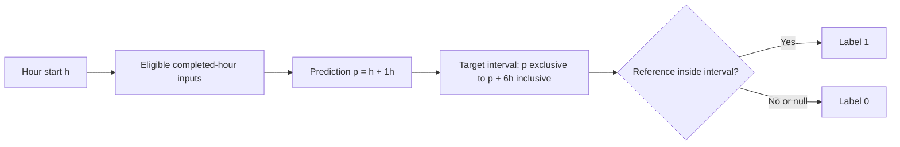

Fictional admission at 08:20 makes the 08:00 bucket ineligible. The 09:00 bucket supports prediction 10:00 if discharge is no earlier. Reference 16:00 yields label 1; 16:01 yields 0; reference 10:00 excludes the endpoint entirely. End-of-hour prediction prevents the future target from including the completed input hour, but does not prove every input was electronically available by that time.

The mandatory strict-six-hour-follow-up sensitivity evaluates frozen primary models on a predefined restricted held-out subset. The freeze reports removal of 275,358 negative endpoints without complete six-hour ICU follow-up across the whole V2 population, retaining 31,044 positives: 3,778,003 remaining endpoints overall. These are **not test-only counts** or an existing mask. Freeze the rule before seeing test performance and verify split-specific counts. Different prevalence can change AP, so compare models on common subsets.

SOFA-reference and suspicion times are distinct. The freeze records earlier/equal/later SOFA in 4,728/158/2,949 of 7,835 included positive-reference stays. In a specifically restricted 123,141-hour subset, 13,807 labels differed; that denominator is not all V2 hours. Report discordance without redefining the primary target. An alternate SOFA-target model is optional and separately specified.

**Verify / next:** review [temporal regressions](tests/test_r2b.py), bind the verified snapshot and retain the prospective-availability qualification. Do not reopen label design merely because training has not started.

<a id="chapter-5"></a>
## 5. Complete feature engineering

**Status: IMPLEMENTED AND VERIFIED definitions; final snapshot/statistics linkage pending.** Authorities: [core](sepsis_gru_v2_core.py), [manifest](sepsis_gru_v2_manifest.json), [ablations](sepsis_gru_v2_ablations.json). Every model-array column is float32, including binary flags. Raw SQL types are inherited/cast; no complete physical BigQuery schema export is present.

### Canonical order

One-based positions below define C. A uses 1–22 and B 1–26. Continuous/count fields are standardized; binary indicators retain 0/1. These positional references are reused in Chapter 9 to avoid ambiguous feature lists.

| Position | Exact feature name | Processing |
|---:|---|---|
| 1 | `heart_rate` | Continuous/count; standardized |
| 2 | `map` | Continuous/count; standardized |
| 3 | `spo2` | Continuous/count; standardized |
| 4 | `temperature` | Continuous/count; standardized |
| 5 | `resp_rate` | Continuous/count; standardized |
| 6 | `gcs` | Continuous/count; standardized |
| 7 | `heart_rate_missing` | Binary; unscaled |
| 8 | `map_missing` | Binary; unscaled |
| 9 | `spo2_missing` | Binary; unscaled |
| 10 | `temperature_missing` | Binary; unscaled |
| 11 | `resp_rate_missing` | Binary; unscaled |
| 12 | `gcs_missing` | Binary; unscaled |
| 13 | `lactate` | Continuous/count; standardized |
| 14 | `wbc` | Continuous/count; standardized |
| 15 | `creatinine` | Continuous/count; standardized |
| 16 | `bilirubin` | Continuous/count; standardized |
| 17 | `platelet` | Continuous/count; standardized |
| 18 | `lactate_missing` | Binary; unscaled |
| 19 | `wbc_missing` | Binary; unscaled |
| 20 | `creatinine_missing` | Binary; unscaled |
| 21 | `bilirubin_missing` | Binary; unscaled |
| 22 | `platelet_missing` | Binary; unscaled |
| 23 | `norepinephrine_equivalent_dose` | Continuous/count; standardized |
| 24 | `vasopressor_active` | Binary; unscaled |
| 25 | `active_antibiotic_count` | Continuous/count; standardized |
| 26 | `antibiotic_active` | Binary; unscaled |
| 27 | `valid_hourly_transition` | Binary; unscaled |
| 28 | `delta_map` | Continuous/count; standardized |
| 29 | `delta_dose` | Continuous/count; standardized |
| 30 | `antibiotic_initiation` | Binary; unscaled |
| 31 | `antibiotic_addition` | Binary; unscaled |
| 32 | `antibiotic_count_increase` | Binary; unscaled |
| 33 | `treatment_response_interaction` | Continuous/count; standardized |

### Physiology, GCS and LOCF

[Hourly vitals](provenance/v2/recovery-1/recovered/vitals_treatment_recovery/hourly_vitals_aug11.sql) reads derived vitalsign; [GCS](provenance/v2/recovery-1/recovered/vitals_treatment_recovery/hourly_gcs_aug11.sql) reads derived gcs. `mbp` becomes `map`. Each variable independently takes its latest non-null charttime value per hour, **not an arithmetic hourly mean**. MAP means mean arterial pressure clinically, not a time-average imposed by this SQL. Source charttime must be admission-inclusive and earlier-of-reference/discharge-exclusive. Equal charttime ties have no additional recovered tie-breaker.

Expected interpretations are HR beats/min, MAP mmHg, SpO2 percent, temperature Celsius, RR breaths/min and GCS score. The wrapper relies on upstream cleaning/units; it does not contain raw vital item mappings. Public concept interpretation is not proof of the historical deployed revision. The addendum records upstream GCS component carry/default/ETT behavior, so a fresh total can include older/default components.

[LOCF](provenance/v2/recovery-1/recovered/vitals_treatment_recovery/hourly_vitals_gcs_locf_aug11.sql) uses LAST_VALUE IGNORE NULLS through CURRENT ROW, partitioned by stay, ordered by hour. Bucket-distance limits are four hours for HR/MAP/SpO2/RR and six for temperature/GCS. No future row or other stay is used. It can cross missing eligible-hour gaps within that distance, unlike the model's sequence reset.

Flags record current-hour derived missingness **before LOCF**. Fictional MAP recorded in bucket 09:00 can carry to empty bucket 13:00 while `map_missing=1`. At prediction 14:00 the reading may be almost five hours old. GCS missing=0 does not prove every component was freshly assessed. These semantics must remain explicit in interpretation.

A's view fills residual null physiology with HR 83, MAP 79, SpO2 97, temperature 36.89, RR 19 and GCS 15. The V2 physiological median query uses PERCENTILE_CONT over training V2 endpoints; the older median table uses APPROX_QUANTILES over original hourly data. Do not interchange them. Preserve literals and verify their provenance against the chosen training snapshot.

### Laboratory selection

[lab_events_v2](provenance/v2/recovery-1/recovered/recovered_v2_sql/lab_events_v2.sql) joins raw labevents by subject/admission and measurement within `[intime,outtime)`. It requires non-null storetime at/after charttime and preserves these item mappings:

| Feature | Item ID | Existing numeric filter | Conventional unit interpretation, subject to source metadata |
|---|---:|---|---|
| lactate | 50813 | 0 to 10000 inclusive | mmol/L |
| wbc | 51301 | greater than 0 | commonly K/uL |
| creatinine | 50912 | greater than 0, at most 150 | mg/dL |
| bilirubin | 50885 | greater than 0 | mg/dL |
| platelet | 51265 | greater than 0 | commonly K/uL |

These are historical filters, not new clinical recommendations. The SQL selects valuenum without enforcing valueuom. Actual unit correspondence must not be inferred from a CSV header alone.

At prediction p, [as-of selection](provenance/v2/recovery-1/recovered/recovered_v2_sql/lab_asof_selected_v2.sql) requires charttime and storetime <=p and charttime>=p-24h. It orders charttime, storetime, specimen_id descending: latest **collected** eligible result. The sparse grain is `(stay_id,hour,prediction_time,lab_name)`; STRUCT fields are lab_value, measurement_time, available_time, specimen_id. No eligible result means no row. The wide table LEFT JOINs timeline, sets missing flags, and the imputation view fills training medians (reported 1.5/10.4/0.9/0.7/198 in feature order). No qualifying result in the lookback is a different missingness meaning from no fresh vital in this hour.

A fictional result collected 09:30, stored 10:20 is unavailable at 10:00 and eligible at 11:00 if no newer qualifying collection wins. Exactly 24-hour age and storetime exactly at prediction are allowed. Passing these rules is retrospective proxy compliance, not proof of live-system latency.

### Treatment exposure and dynamics

[Hourly treatment](provenance/v2/recovery-1/recovered/vitals_treatment_recovery/hourly_treatment_aug11.sql) computes `D_h = SUM(dose_i * overlap_seconds_i)/3600`, with overlap `max(0,min(end_i,h+1h)-max(start_i,h))`. Start must precede hour end and end follow hour start. A fictional 0.12-equivalent rate for 30 minutes contributes 0.06. This is a whole-hour average, not instantaneous end-of-hour rate.

The addendum records public NEeq as norepinephrine + epinephrine + phenylephrine/10 + dopamine/100 + vasopressin(units/hour)*2.5/60, in norepinephrine-equivalent mcg/kg/min. Source rows can be combined exposure intervals, not independent infusions; overlaps do not automatically prove inflated doses. Historical deployed equivalence is unresolved. B fills absent/null dose with zero and defines vasopressor_active iff that filled hourly dose>0. Zero is a representation, not proof of clinical absence.

[Antibiotic SQL](provenance/v2/recovery-1/recovered/recovered_v2_sql/hourly_antibiotics.sql) counts DISTINCT non-null names with start before hour end and COALESCE(stop,start)>=hour. The inclusive stop differs from vasopressor end. B fills count with zero and defines active iff count>0. Prescription overlap does not establish administration, spectrum, appropriateness or escalation.

C applies LAG by stay/hour. Let v mean previous_hour=hour-1h. Delta-MAP and delta-dose equal current minus previous only when v; otherwise zero. Initiation is v and previous_count=0 and current_count>0. Addition is v and previous_count>0 and current_count>previous_count. Count-increase is v and current_count>previous_count. These are binary flags, not increment magnitudes. First/post-gap dynamics are zero. TRC is the **raw-feature** delta_MAP*delta_dose product, then independently standardized.

Fictional consecutive MAP 70→76, dose 0.05→0.08 and antibiotic count 0→2 give delta_MAP=6, delta_dose=0.03, TRC=0.18, initiation=1, addition=0, increase=1. With a gap, dynamics are zero. Imputation or interval coverage can create changes without a physiological response to medication.

### Standardization

[FrozenV2Scaler](sepsis_gru_v2_core.py) checks exactly 16 continuous/count fields, training_rows_per_feature=2,865,300 and finite positive population standard deviations. It applies `(x-mean_train)/std_population_train`; 17 binary fields remain 0/1. p01/p99/zero-percentage statistics are descriptive, **not clipping rules**. A fictional mean 80/std 10 maps raw 90 to 1. Feeding that 1 through scaling again would be wrong.

The writer rejects null/nonfinite inputs; it does not impute. Export frozen-imputed, unscaled values and standardize once. Labels are uint8; subject/stay/prediction-hour arrays are int64. Verify ordering, binary values and snapshot-linked statistics before real conversion. No silent threshold, median or feature changes are permitted.


<a id="chapter-6"></a>
## 6. Complete BigQuery and SQL architecture

**Status: IMPLEMENTED AND VERIFIED preserved definitions/integrity; historical source equivalence KNOWN LIMITATION.** [Inventory](provenance/v2/recovery-1/inventory.json), [dependency map](provenance/v2/recovery-1/dependency_map.json) and [verification](provenance/v2/recovery-1/verification.json) separate bytes, recorded job metadata and unproven historical continuity. SQL below is evidence, not a deployment order to execute blindly: archived definitions include replacement and expiration clauses.

All project objects belong to `sepsis-gru-mimic.sepsis_gru` unless otherwise identified. Physical constructions use CREATE TABLE/CREATE OR REPLACE TABLE. The four backup view members contain SELECT bodies; their view classification is recorded in the handoff, not independently authenticated against current BigQuery metadata.

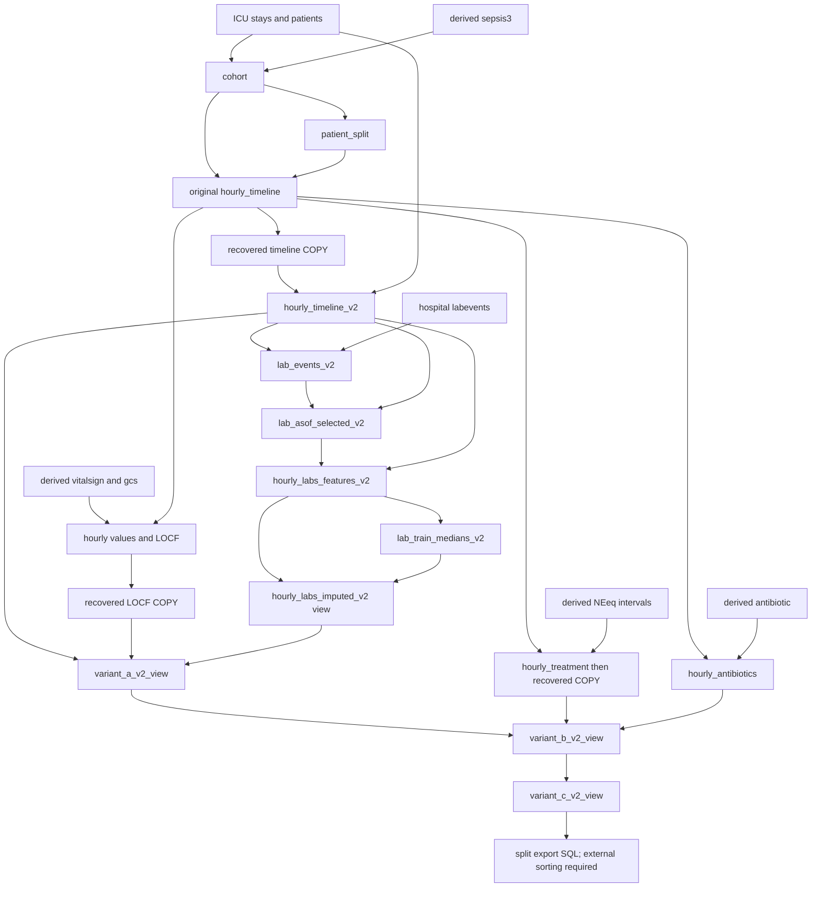

### Recovered constructions and essential outputs

The links name all 16 preserved SQL definitions. Dependencies shown are logical, not assertions of current table availability.

| Definition / type | Inputs and essential output | Role |
|---|---|---|
| [cohort_aug11](provenance/v2/recovery-1/recovered/cohort_split_recovery/cohort_aug11.sql), original table | icustays + patients + sepsis3; subject/admission/stay, boundaries, age, reference, positivity | Eligibility/reference |
| [patient_split_aug11](provenance/v2/recovery-1/recovered/cohort_split_recovery/patient_split_aug11.sql), original table | distinct cohort subjects; subject and split | Stable allocation |
| [hourly_timeline_aug11_1256](provenance/v2/recovery-1/recovered/timeline_sql_recovery/hourly_timeline_aug11_1256.sql), original table | cohort + split; hour, reference and original label | Original candidate grid |
| [hourly_timeline_v2](provenance/v2/recovery-1/recovered/recovered_v2_sql/hourly_timeline_v2.sql), V2 table | recovered timeline + icustays; prediction time and recomputed label | Completed-hour contract |
| [hourly_vitals_aug11](provenance/v2/recovery-1/recovered/vitals_treatment_recovery/hourly_vitals_aug11.sql), original table | derived vitalsign + cohort; latest five values by stay/hour | Physiological buckets |
| [hourly_gcs_aug11](provenance/v2/recovery-1/recovered/vitals_treatment_recovery/hourly_gcs_aug11.sql), original table | derived gcs + cohort; latest GCS by stay/hour | GCS buckets |
| [hourly_vitals_gcs_locf_aug11](provenance/v2/recovery-1/recovered/vitals_treatment_recovery/hourly_vitals_gcs_locf_aug11.sql), original table | timeline + vitals + GCS; six carried values/current missing flags | Recovered source for A |
| [vitals_gcs_train_medians_aug11](provenance/v2/recovery-1/recovered/vitals_treatment_recovery/vitals_gcs_train_medians_aug11.sql), original table | original LOCF training rows; approximate medians | Historical, not V2 median provenance |
| [physiological_train_medians_query](provenance/v2/recovery-1/recovered/recovered_v2_sql/physiological_train_medians_query.sql), SELECT only | V2 train endpoints + recovered LOCF; exact median aggregates | Supports A's fixed literals |
| [lab_events_v2](provenance/v2/recovery-1/recovered/recovered_v2_sql/lab_events_v2.sql), V2 table | V2 cohort stays + icustays + labevents; lab/value/measurement/availability/specimen | Filtered event source |
| [hourly_lab_results_v2](provenance/v2/recovery-1/recovered/recovered_v2_sql/hourly_lab_results_v2.sql), V2 table | lab events grouped by storetime hour; latest result | Auxiliary, not the active as-of input |
| [lab_asof_selected_v2](provenance/v2/recovery-1/recovered/recovered_v2_sql/lab_asof_selected_v2.sql), V2 table | timeline + lab events; sparse lab selection STRUCT | Availability-aware selection |
| [hourly_labs_features_v2](provenance/v2/recovery-1/recovered/recovered_v2_sql/hourly_labs_features_v2.sql), V2 table | as-of selections + timeline; wide labs/flags/metadata | Dense hourly lab rows |
| [lab_train_medians_v2](provenance/v2/recovery-1/recovered/recovered_v2_sql/lab_train_medians_v2.sql), V2 table | training wide lab rows; one median row | Lab imputation source |
| [hourly_treatment_aug11](provenance/v2/recovery-1/recovered/vitals_treatment_recovery/hourly_treatment_aug11.sql), original table | original timeline + derived NEeq; hourly weighted dose | Recovered treatment source for B |
| [hourly_antibiotics](provenance/v2/recovery-1/recovered/recovered_v2_sql/hourly_antibiotics.sql), original table | original timeline + derived antibiotic; distinct-name count | Antibiotic source for B |

### Backed-up views and export plans

[sepsis_v2_sql_backup.zip](sql/sepsis_v2_sql_backup.zip) contains exactly four SQL members:

- `hourly_labs_imputed_v2.sql`: wide labs CROSS JOIN training medians; keeps original fields and adds five imputed aliases. Median-table cardinality matters because multiple rows would multiply results.
- `variant_a_v2_view.sql`: V2 timeline INNER JOIN recovered LOCF and imputed labs, CROSS JOIN a one-row physiological-median CTE. Outputs six identifiers/time/split fields, 22 features and the target. Inner joins can drop missing endpoints; the temporal assembly audit checks final alignment.
- `variant_b_v2_view.sql`: `a.*`, LEFT JOIN recovered hourly treatment and antibiotics by stay/hour; adds four zero-filled/derived flat fields.
- `variant_c_v2_view.sql`: `b.*` with temporary LAG columns removed, then transition/deltas/antibiotic flags and TRC. It inherits labels/keys rather than redefining them.

[sepsis_gru_v2_optimized_sql.zip](sql/sepsis_gru_v2_optimized_sql.zip) contains `source_plan.json`, `source_C_train.sql`, `source_C_validation.sql`, `source_C_test.sql`. The three queries select five metadata plus 33 features from C and filter split. They **do not ORDER BY**. Partitioned export order is not a sequence guarantee; the external sorter supplies global stay/prediction ordering. These archived SELECTs are not permission to run extraction and do not pin changing view dependencies.

### Historical recovery boundaries

Four root ZIPs contain 8+1+2+5 SQL definitions and original manifests. Their byte-identical copies live under `provenance/v2/recovery-1/recovered/`; local CRC and hash checks verify preservation. The August 11 12:54 construction reportedly failed partition limits; the archive preserves the successful 12:56 construction, not a recovered failed statement. The October timeline `hourly_timeline@0` COPY relationship is user-reported; its job record is not in the one-entry timeline manifest.

The vitals/treatment manifest does preserve three COPY records: LOCF, hourly treatment and original medians, each from its `@0` source to the corresponding `_recovered` destination. These establish recorded relationships, not that August construction bytes exactly describe the October restored contents. Public concept comparison commit `303d26c623dcc9c49cc0f204468d4acc2f063797` is an inspection reference, not a historical deployment assertion.

Original/V1 materialized `variant_a_recovered`, `variant_b_recovered`, surviving `variant_c`, older lab LOCF and antibiotic_intensification appear in the old handoff. They are not the V2 nested views. Their full construction is not recovered in these two view/export ZIPs; do not fabricate it or train from them under the V2 protocol. No active V2 lineage step is replaced with an older similarly named object.

**Verify / next:** use inventory hashes and named members, not memory of filenames. Record actual snapshot/dependency identity in the authorized environment. Preserve originals and append future evidence as a new version.

<a id="chapter-7"></a>
## 7. Dataset integrity and audit results

**Status: completed current-source investigations per supplied authorized aggregates; KNOWN LIMITATIONS remain.** [Closure v1](docs/sepsis_gru_v2_source_integrity_closure.v1.md) is authoritative for results. Codex did not run clinical queries. Query job IDs, execution timestamps, executed SQL hashes and authenticated snapshot bindings remain pending. Header/manifest NOT_EXECUTED describes preserved proposals, not a denial of the later operator-reported executions.

### Antibiotics

The overlap predicate can logically admit a reversed interval: fictional start 10:40, stop 10:20 still satisfies start<11:00 and stop>=10:00. Whether this changes COUNT DISTINCT depends on drug name and other retained prescriptions. The diagnostic therefore compares actual count, active flag, initiation, addition and increase, including consecutive-hour effects, rather than equating predicate hits with feature changes.

| Supplied antibiotic result | Count/band |
|---|---|
| All five antibiotic-feature change metrics | 0 |
| Predicate-matched reversed-interval hours | 0 |
| Baseline count and feature replay mismatches | 0 |
| Duplicate V2 keys | 0 |
| Reversed source records within V2 stays | 9530–9539 |

No feature correction is indicated for the audited current-source baseline. The logical predicate weakness and historical equivalence limitation remain documented. The earlier handoff's categorical assertion that overlap excludes reversed intervals is too broad; its specific historical aggregates do not establish a universal predicate guarantee.

### Vasopressors

| Supplied result | Count/band |
|---|---|
| Baseline dose/delta/TRC and activity replay mismatches | 0 |
| Direct overlap hours | 790–799 |
| Repeated-signature hours | 170–179 |
| Diagnostic dose-change hours | 170–179 |
| Diagnostic delta-dose-change hours | 160–169 |
| Diagnostic TRC-change hours | 150–159 |
| Potential B sequence endpoints | 9210–9219 |
| Potential C sequence endpoints | 9530–9539 |
| Invalid source rows, invalid numeric hours and duplicate V2 keys | 0 |

Repeated identical stay/start/end/dose signatures can change an hourly sum when collapsed. That proves the hypothetical arithmetic differs, not that the repeated rows are erroneous clinical duplicates. Preserve baseline provisionally. A source-dose change at hour j can alter delta-dose at j and j+1; C propagation may therefore reach one further endpoint than B in uninterrupted 24-hour histories. At gaps/stay boundaries propagation resets. Counts describe potentially touched inputs, not altered predictions or measured performance bias.

The earlier evidence (1,189 source rows, 617 source stays, 798 intersected hours, 9,214 endpoints, 376 V2 stays, 81 positive endpoints) is a separate supplied aggregate record with incomplete query provenance. Do not convert later bands into exact numbers or treat the older endpoint scope as the final C count.

### Temporal integrity

All nine returned 0: `duplicate_timeline_keys`, `duplicate_icu_keys`, `duplicate_v2_c_keys`, `missing_icu_boundaries`, `chronology_violation_hours`, `target_mismatch_hours`, `lab_asof_violations`, `lab_timeline_mismatches`, `assembly_timeline_mismatches`.

The lab relationship is many selections to one prediction hour. Absent selections create no row and are not violations; null times in an existing selection are malformed. These checks support completed-hour eligibility, label boundaries and implemented recorded lab availability. They do not prove source completeness, biological onset, correct deployment version, or live availability of every vital/GCS/treatment input.

[Diagnostics 01](sql/proposed_r2b/01_antibiotic_impact.sql), [02](sql/proposed_r2b/02_vasopressor_impact.sql), [03](sql/proposed_r2b/03_temporal_integrity.sql) release global count bands, suppress 1–9 and retain disclosure-policy review. They do not release row IDs or event times. No new broad investigation is needed simply to proceed; link the accepted dispositions to the intended frozen input snapshot and obtain the remaining execution authorization.

<a id="chapter-8"></a>
## 8. Model architecture

**Status: IMPLEMENTED AND VERIFIED synthetically.** See [SepsisGRU](sepsis_gru_v2_core.py), [disk dataset](sepsis_gru_v2_disk_dataset.py) and [production execute](sepsis_gru_v2_production.py).

For batch size B and selected feature count F, input is float32 `[B,24,F]`, labels `[B]` and true lengths int64 `[B]`. Each endpoint takes its current hour plus up to 23 preceding consecutive hours in its stay segment. Early endpoints have shorter histories. A fictional sequence of hours 08,09,11 gives lengths 1,2,1; no invented 10:00 row bridges the gap.

Padding is zero on the right. The model uses `pack_padded_sequence(..., batch_first=True, enforce_sorted=False)` so hidden-state selection ignores padding and batch items need not be sorted by length. `nn.GRU(input_size=F,hidden_size=64,batch_first=True)` is one layer, unidirectional with default no dropout. A `Linear(64,1)` head on `hidden[-1]` produces logits. There is no attention, extra dense stack or probability layer inside forward. Sigmoid is used by metric evaluation; logits go directly to BCEWithLogitsLoss.

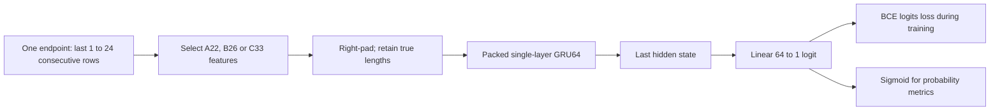

Core helper functions accept a device argument, but **production currently enforces CPU only** and creates CPU model/batches. A CUDA-capable runtime does not automatically accelerate this runner. CPU settings are one Torch thread, deterministic algorithms and zero loader workers. GPU support would need separately authorized engineering/synthetic verification, with frozen scientific settings preserved. There is no GPU flag to recommend now.

**Verify / next:** check forward shapes, padding/gap tests, selected features and checkpoint metadata. Do not change hidden size or batch size to make a demo faster and then report it as the approved production configuration; historical small smoke tests use different settings deliberately.

<a id="chapter-9"></a>
## 9. All six experiments

**Status: feature selection IMPLEMENTED AND VERIFIED; real comparisons PLANNED.** [Ablation JSON](sepsis_gru_v2_ablations.json) must equal `expected_ablations()` in the [adapter](sepsis_gru_v2_ablation_adapter.py), including order. Positions refer to the exact names in Chapter 5.

| CLI name / order | Exact ordered selection | Comparison and legitimate question |
|---|---|---|
| `A` — 1 | positions 1–22 | Physiological/lab reference model |
| `B` — 2 | positions 1–26 | B versus A: incremental flat treatment information |
| `C` — 3 | positions 1–33 | C versus B: complete dynamic feature package |
| `B_no_antibiotics` — 4 | positions 1–24 | B versus this arm: two flat antibiotic features |
| `C_no_antibiotics` — 5 | positions 1–24, 27–29, 33 | C versus this arm: all five antibiotic-related fields |
| `C_no_TRC` — 6 | positions 1–32 | C versus this arm: explicit TRC product given other dynamics |

B_no_antibiotics removes active_antibiotic_count and antibiotic_active. C_no_antibiotics additionally removes antibiotic_initiation, antibiotic_addition and antibiotic_count_increase. C_no_TRC removes only treatment_response_interaction. No alternative masks are implicit in prose.

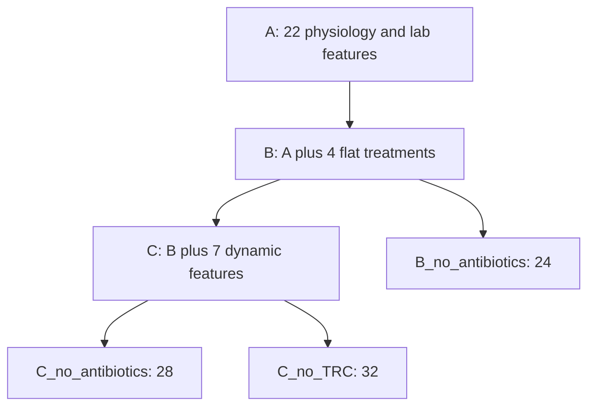

Every arm receives the same 33-column source arrays and selects its own ordered columns. Labels, patient assignments, histories and preprocessing policies remain identical. Train each independently under the fixed policy and seed. Different input dimensions mean equal seeds do not make initialized weight tensors identical across architectures; controlled settings do not imply paired random weights.

Expected outputs are validation-selected inference and resume checkpoints, history, validation metrics and run manifests. No clinical results exist in this handbook. The C–B difference cannot isolate TRC because C adds seven fields. Removing antibiotics does not remove cardiovascular-SOFA or clinical-action coupling. None of these comparisons estimates treatment efficacy.

**Verify / next:** use the adapter's label/sequence alignment regressions and the experiment table in Chapter 15; preserve all six intended comparisons even when validation results disappoint.

<a id="chapter-10"></a>
## 10. Repository architecture and file-by-file guide

**Status: current tracked-file inventory inspected.** This is a modular Python repository, not an installed application package. Modules live at root and import each other. The following tree contains every tracked file at the source commit plus this untracked handbook; local ignored clinical files are neither searched nor listed.

```text
Sepsis-GRU-V2-Research/
|-- .gitattributes
|-- .gitignore
|-- SEPSIS_GRU_V2_MASTER_HANDBOOK.md
|-- docs/
|   |-- sepsis_gru_v2_codex_reconciliation_plan.v0.1.md
|   |-- sepsis_gru_v2_gru_a_execution_runbook.v1.md
|   |-- sepsis_gru_v2_methodology_addendum.v1.md
|   |-- sepsis_gru_v2_methodology_freeze.v0.1-provisional.md
|   |-- sepsis_gru_v2_r2a_readiness.md
|   |-- sepsis_gru_v2_r2b_disposition.md
|   |-- sepsis_gru_v2_research_handoff.md
|   |-- sepsis_gru_v2_source_integrity_closure.v1.md
|   |-- sepsis_gru_v2_step62_verification.md
|   |-- sepsis_gru_v2_supervisor_review.v1.md
|   `-- sepsis_gru_v2_training_readiness.v1.md
|-- provenance/
|   `-- v2/
|       `-- recovery-1/
|           |-- README.md
|           |-- dependency_map.json
|           |-- evidence/
|           |   `-- overlap_summary.json
|           |-- inventory.json
|           |-- recovered/
|           |   |-- cohort_split_recovery/
|           |   |   |-- cohort_aug11.sql
|           |   |   |-- manifest.json
|           |   |   `-- patient_split_aug11.sql
|           |   |-- recovered_v2_sql/
|           |   |   |-- hourly_antibiotics.sql
|           |   |   |-- hourly_lab_results_v2.sql
|           |   |   |-- hourly_labs_features_v2.sql
|           |   |   |-- hourly_timeline_v2.sql
|           |   |   |-- lab_asof_selected_v2.sql
|           |   |   |-- lab_events_v2.sql
|           |   |   |-- lab_train_medians_v2.sql
|           |   |   |-- physiological_train_medians_query.sql
|           |   |   `-- recovery_manifest.json
|           |   |-- timeline_sql_recovery/
|           |   |   |-- hourly_timeline_aug11_1256.sql
|           |   |   `-- manifest.json
|           |   `-- vitals_treatment_recovery/
|           |       |-- hourly_gcs_aug11.sql
|           |       |-- hourly_treatment_aug11.sql
|           |       |-- hourly_vitals_aug11.sql
|           |       |-- hourly_vitals_gcs_locf_aug11.sql
|           |       |-- manifest.json
|           |       `-- vitals_gcs_train_medians_aug11.sql
|           `-- verification.json
|-- schemas/
|   `-- sepsis_gru_v2_source_evidence.v1.schema.json
|-- sepsis_gru_v2_ablation_adapter.py
|-- sepsis_gru_v2_ablations.json
|-- sepsis_gru_v2_array_writer.py
|-- sepsis_gru_v2_contracts.py
|-- sepsis_gru_v2_core.py
|-- sepsis_gru_v2_disk_dataset.py
|-- sepsis_gru_v2_experiment_runner.py
|-- sepsis_gru_v2_export.py
|-- sepsis_gru_v2_manifest.json
|-- sepsis_gru_v2_overlap_sensitivity.v1.json
|-- sepsis_gru_v2_production.py
|-- sepsis_gru_v2_resume.py
|-- sepsis_gru_v2_train_statistics.json
|-- sepsis_gru_v2_training_protocol.execution-v1.json
|-- sepsis_gru_v2_training_protocol.execution-v2.json
|-- sepsis_gru_v2_training_protocol.json
|-- sepsis_gru_v2_training_protocol.phase1.json
|-- sepsis_gru_v2_training_protocol.pre_phase1.json
|-- sql/
|   |-- proposed_r2b/
|   |   |-- 01_antibiotic_impact.sql
|   |   |-- 02_vasopressor_impact.sql
|   |   |-- 03_temporal_integrity.sql
|   |   `-- manifest.json
|   |-- sepsis_gru_v2_optimized_sql.zip
|   `-- sepsis_v2_sql_backup.zip
`-- tests/
    |-- test_existing_synthetic.py
    |-- test_phase1.py
    |-- test_production.py
    |-- test_r2a.py
    `-- test_r2b.py
```

### Runtime modules and dependency matrix

| File / main responsibility | Invoked by / dependencies | Editing policy |
|---|---|---|
| [core](sepsis_gru_v2_core.py): feature constants, FrozenV2Scaler, in-memory lazy dataset, SepsisGRU, metrics, helper train_model | Writer, datasets, runners; NumPy/pandas/Torch/sklearn | Scientific core: explicit reviewed changes only |
| [disk_dataset](sepsis_gru_v2_disk_dataset.py): mmap validation, segment starts, lazy padding, close_memmaps | Adapter and writer tests; core | Reusable production component; synthetic CLI |
| [array_writer](sepsis_gru_v2_array_writer.py): sorted batches to staged arrays; unit-safe timestamps; cleanup | Exporter; scaler and disk cleanup | Do not use low-level API to bypass production authorization |
| [export](sepsis_gru_v2_export.py): authorized CSV shards, SQLite ordering, evidence/array publication | Public converter CLI; contracts, writer, production validation | Current production preparation boundary |
| [contracts](sepsis_gru_v2_contracts.py): populations, evidence, SHA, canonical local paths, storage gates | Exporter and production | Never weaken gates to make a run pass |
| [resume](sepsis_gru_v2_resume.py): RNG capture/restore and checkpoint compatibility | Production; Torch/NumPy/Python random | Current resume implementation |
| [ablation_adapter](sepsis_gru_v2_ablation_adapter.py): exact six masks, ordered mmap selection | Production and synthetic runner; disk/core | Model input contract; no silent reorder |
| [experiment_runner](sepsis_gru_v2_experiment_runner.py): historical six-arm synthetic smoke logging | Standalone smoke CLI, tests | Synthetic only; not a real-data entry point |
| [production](sepsis_gru_v2_production.py): explicit protocol, preflight, fixed training, manifests/checkpoints | CLI --demo or --protocol; all supporting modules | Current real-mode gate, still awaiting authorized inputs |

`production` imports the internal exporter for demos; the public exporter lazily imports production validation. This avoids executing clinical work on import. Internal functions are developer mechanisms, not an adversarial security sandbox. Do not invoke private helpers with real inputs to circumvent policy checks.

### Configuration and evidence

The [manifest](sepsis_gru_v2_manifest.json) describes scientific schema, ordered features, populations and pending reviews; it is not a run approval. [Ablations](sepsis_gru_v2_ablations.json) is the exact six-mask contract. [Statistics](sepsis_gru_v2_train_statistics.json) stores aggregate training means/population standard deviations and descriptive quantiles, not raw records. It never authorizes refitting.

[Original protocol](sepsis_gru_v2_training_protocol.json) and [pre-phase1 copy](sepsis_gru_v2_training_protocol.pre_phase1.json) are historical; [phase1](sepsis_gru_v2_training_protocol.phase1.json) adds revised fingerprints. [Execution-v1](sepsis_gru_v2_training_protocol.execution-v1.json) is historical and rejected for execution by current code. [Execution-v2](sepsis_gru_v2_training_protocol.execution-v2.json) is the current unapproved template. Its source_hashes, not inherited historical file_hashes, identify the runtime. A new version-bound approved artifact is required; do not edit the historical drafts.

[Overlap sensitivity](sepsis_gru_v2_overlap_sensitivity.v1.json) is PREPARED_NOT_EXECUTABLE with null mask path/hash. Its listed model comparisons are a conditional design, not an implemented training mode. The [source-evidence schema](schemas/sepsis_gru_v2_source_evidence.v1.schema.json) describes generated evidence; runtime checks are implemented directly in contracts, not by an added jsonschema dependency.

Provenance files: README explains immutability; inventory records archive/member hashes; dependency_map describes edges/job metadata; verification records CRC/hash review and unresolved equivalence; overlap_summary preserves earlier supplied aggregates. Four recovered manifests stay byte-identical. Chapter 6 describes every recovered SQL member. The proposed diagnostic manifest fingerprints three templates and historical sources; current-source working copies remain ignored and are not new frozen data snapshots.

### Tests and research documents

| Test file | Count at this review | Focus |
|---|---:|---|
| [test_existing_synthetic](tests/test_existing_synthetic.py) | 5 | Original module smoke tests |
| [test_phase1](tests/test_phase1.py) | 23 | Timestamp resolutions, validation, cleanup, fractional labels, failures |
| [test_production](tests/test_production.py) | 21 | Authorization, schema, split isolation, manifests, six arms, provenance |
| [test_r2a](tests/test_r2a.py) | 25 | External sort, evidence/populations, storage, synthetic bypass prevention, resume |
| [test_r2b](tests/test_r2b.py) | 45 | Synthetic SQL predicates/replays, temporal boundaries and propagation |

The 119 tests are local synthetic/software/provenance tests, not clinical validation. Tests emulate diagnostic CTEs with fictional SQLite data and dialect adaptations; that is not BigQuery compilation.

The [handoff](docs/sepsis_gru_v2_research_handoff.md) records V1→V2 history; [addendum](docs/sepsis_gru_v2_methodology_addendum.v1.md) records recovered semantics; [training readiness v1](docs/sepsis_gru_v2_training_readiness.v1.md) and [Step 62](docs/sepsis_gru_v2_step62_verification.md) describe an older implementation. [Freeze](docs/sepsis_gru_v2_methodology_freeze.v0.1-provisional.md) is the ten-decision scientific record; [reconciliation plan](docs/sepsis_gru_v2_codex_reconciliation_plan.v0.1.md) is historical work sequencing. [R2A readiness](docs/sepsis_gru_v2_r2a_readiness.md) documents current sort/resume/restrictions. [R2B disposition](docs/sepsis_gru_v2_r2b_disposition.md) is pre-execution preparation; [closure](docs/sepsis_gru_v2_source_integrity_closure.v1.md) records supplied results. [Runbook](docs/sepsis_gru_v2_gru_a_execution_runbook.v1.md) provides A commands; [supervisor review](docs/sepsis_gru_v2_supervisor_review.v1.md) summarizes pending decisions at Step 82, before later verbal support.

`.gitignore` is a strict allowlist; new files can be invisible to ordinary status. `.gitattributes` preserves recovered evidence, selected scientific documents and fingerprinted Python bytes. Do not normalize archived line endings. Add future code through reviewed branches and versioned protocols, not edits to recovered SQL or copied evidence. This handbook is the entry point; its descriptions must follow the underlying authorities.


<a id="chapter-11"></a>
## 11. Development environment and team onboarding

**Status: synthetic workflow IMPLEMENTED AND VERIFIED historically; new-machine qualification pending.** Start with code only. No remote URL is configured or assumed by this handbook. If the team has an approved reviewed code-only remote, clone it with the actual URL; otherwise use the local repository/package supplied by the maintainer. Cloning does not grant PhysioNet or execution access.

**Environment-setup templates, not commands executed for this handbook:**

```powershell
# Windows PowerShell; replace placeholders, use a code-only working location.
git clone '<APPROVED_CODE_ONLY_REPOSITORY_URL>' '<NEW_CODE_DIRECTORY>'
Set-Location -LiteralPath '<NEW_CODE_DIRECTORY>'
py -3.13 -m venv .venv
.\.venv\Scripts\python.exe --version
```

```bash
# Linux code-only checkout; equivalent workflow, separately qualify the platform.
git clone '<APPROVED_CODE_ONLY_REPOSITORY_URL>' '<NEW_CODE_DIRECTORY>'
cd '<NEW_CODE_DIRECTORY>'
python3.13 -m venv .venv
.venv/bin/python --version
```

No `requirements.txt`, lock file or container image is tracked. Step 62 records Python 3.13.8, NumPy 2.2.6, pandas 2.3.2, PyTorch 2.10.0+cpu and scikit-learn 1.8.0. This is a known tested Windows environment record, not a complete transitive lock or a cross-platform wheel guarantee. Resolve approved artifacts before installation, preserve their provenance and run the suite. Example **offline installation template** for that recorded stack, only if compatible reviewed wheels and all transitive dependencies are available:

```powershell
.\.venv\Scripts\python.exe -m pip install --no-index --find-links '<REVIEWED_WHEEL_DIRECTORY>' numpy==2.2.6 pandas==2.3.2 torch==2.10.0+cpu scikit-learn==1.8.0
```

Linux uses `.venv/bin/python` instead. Do not invent a requirements-file command or claim Linux/Colab compatibility has been tested solely because Python imports work. All subsequent `python` examples mean the qualified environment interpreter; use its absolute path if necessary. No packages are installed by Step 83.

**Safe environment checks:**

```text
python -B -c "import sys,sqlite3,numpy,pandas,torch,sklearn; print(sys.version); print(sqlite3.sqlite_version); print(numpy.__version__,pandas.__version__,torch.__version__,sklearn.__version__); print('CUDA available:',torch.cuda.is_available())"
python -B sepsis_gru_v2_export.py --help
python -B sepsis_gru_v2_production.py --help
```

CUDA availability is informational: current production rejects non-CPU devices. R2B's SQLite replays use FULL JOIN and IS DISTINCT FROM; a different embedded SQLite must support their syntax. A failure is an environment compatibility issue to investigate, not reason to drop tests.

### Archive prerequisite and synthetic commands

Full-suite provenance checks require these exact root files: `recovered_v2_sql.zip`, `timeline_sql_recovery.zip`, `cohort_split_recovery.zip`, `vitals_treatment_recovery.zip`. They are **not Git-tracked**, while their extracted SQL/manifests are. Obtain the reviewed non-sensitive originals separately; check SHA-256 against [inventory](provenance/v2/recovery-1/inventory.json). Do not regenerate ZIPs from extracted text because the test checks original archive bytes. This is a confirmed fresh-clone reproducibility gap, documented without changing packaging.

```text
python -B -m unittest discover -s tests -v
python -B sepsis_gru_v2_production.py --demo --preflight-only --experiments A
python -B sepsis_gru_v2_production.py --demo --experiments A
python -B sepsis_gru_v2_production.py --demo
```

The last command demonstrates all six arms; it is not needed every time a paragraph changes. For a narrow source-integrity regression run, `python -B -m unittest discover -s tests -p test_r2b.py -v` is valid. Temporary-file permissions must permit local test creation/cleanup; seek the appropriate permission rather than changing production authorization flags.

Historical smoke CLIs remain available:

```text
python -B sepsis_gru_v2_core.py
python -B sepsis_gru_v2_disk_dataset.py
python -B sepsis_gru_v2_array_writer.py sepsis_gru_v2_train_statistics.json
python -B sepsis_gru_v2_ablation_adapter.py sepsis_gru_v2_ablations.json
python -B sepsis_gru_v2_experiment_runner.py sepsis_gru_v2_ablations.json sepsis_gru_v2_training_protocol.json
```

They generate fictional data and often use smaller hidden sizes/epochs. The production `--demo` exercises the frozen production settings on small fixtures. External inputs cannot invoke its process-local synthetic capability; no public synthetic conversion flag exists. **Verify / next:** record the qualified environment, distinguish a missing archive from a failing behavioral test, and never claim synthetic AP represents clinical accuracy.

<a id="chapter-12"></a>
## 12. Secure research data handling

**Status: BLOCKED — AUTHORIZATION OR RESOURCE for real execution.** The [freeze's governance requirements](docs/sepsis_gru_v2_methodology_freeze.v0.1-provisional.md) and [contracts](sepsis_gru_v2_contracts.py) are the project's operational boundaries. This chapter is not a substitute for the applicable current data-use agreement or institutional decision.

Every collaborator who accesses credentialed records needs their own applicable authorization. Code collaboration and shared institutional affiliation do not transfer someone else's credentials. Confirm dataset credentialing, training and agreement requirements through the authorized custodian. Never paste credentials, access tokens or individual records into chat to demonstrate access.

Separate four decisions: permission to access MIMIC, permission to process it on a particular machine/service, permission to retain/transfer outputs, and permission to execute this frozen protocol. Supervisor methodological support is not all four. No laptop, personal Drive, hosted Colab or institutional server is automatically approved by this handbook. Local runtime checks establish a path contract, not legal/institutional compliance. A mounted cloud directory can appear as a filesystem path; that does not make it approved local storage.

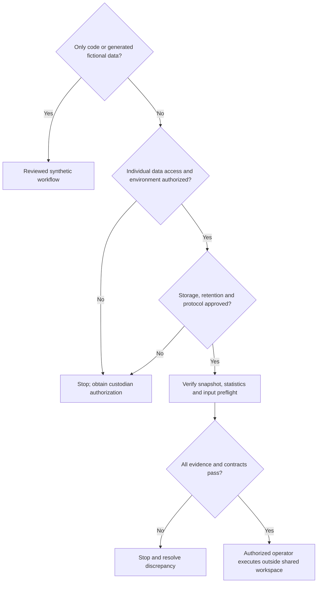

Real CSVs, arrays, identifier lists, patient-hour predictions, exclusion masks, checkpoints and potentially identifying logs remain restricted. The repository is currently a OneDrive-backed code workspace: do not place records there. Git ignores are a guardrail, not an encryption or disclosure mechanism; forcing a file into Git defeats them. Do not use Codex to inspect restricted inputs or ordinary synced services to solve a storage shortage.

Safe Git content includes reviewed code, synthetic tests, SQL definitions without records, non-sensitive methodology/configuration templates, archive hashes and permitted global aggregate evidence. Real paths can disclose user/account details; public examples use placeholders. Even aggregate tables need applicable disclosure-policy review, especially small cells or combinations that permit inference.

Before processing, the institutional operator should document account access, least-privilege permissions, encryption in transit/at rest, backup/restore, retention/deletion rules, approved temporary directories and access revocation. Keep notebooks free of patient-level outputs and do not share notebook state containing credentials. BigQuery access to a public-derived dataset does not authorize unrestricted exports.

If accidental exposure is suspected, stop transfers, restrict access using authorized incident procedures, notify the institutional data custodian/security contact and preserve appropriate audit evidence without spreading the data. Credential owners revoke exposed tokens; dataset access is removed through authorized administrators. Do not paste secrets into issue trackers or claim deletion of a local file removes remote Git history/caches. Follow institutional remediation, not improvised public history rewriting.

**Team checklist:** verify individual access; separate code and data roots; use approved accounts; review staged content; redact logs; document who can access outputs; revoke access when roles end. **Next:** obtain the exact environment/storage decision, not a general claim that a cloud provider is acceptable.

<a id="chapter-13"></a>
## 13. BigQuery retention and the frozen data snapshot

**Status: BLOCKED — AUTHORIZATION OR RESOURCE; converter IMPLEMENTED, REAL-DATA VERIFICATION PENDING.** Project-owner-reported context: project `sepsis-gru-mimic`, dataset `sepsis_gru`, billing disabled, approximately **6.03 GiB physical-table storage**, twelve V2 objects expiring **December 9–10, 2026**. No live metadata was accessed for this handbook. Exact per-object expiry/timezone and retention completion remain to be recorded.

Preserving SQL preserves a recipe; it does not preserve the ingredient versions or materialized output. A view alone does not preserve underlying tables. Upstream versions, old COPY snapshots and expired dependencies can prevent identical reconstruction. The 6.03 GiB figure is not the required disk space for CSV exports, SQLite staging, arrays, checkpoints and backups.

Choose through the authorized owner: funded BigQuery retention with explicit expiry/dependency management; an explicitly approved alternative storage/transfer/restore plan; or documented acceptance of reconstruction risk. Enabling billing must not be assumed to change existing expirations automatically. Record the owner, decision date, object inventory, permitted locations and verification before the earliest deadline. No preservation query or transfer command is executed or authorized here.

The training snapshot must identify source objects and dependencies, extraction job/query hashes, split membership and frozen statistics origin. Identical table names or agreeing current-source audit aggregates are not snapshot identity. Evidence records contain actual job references when known; unknown fields stay pending outside execution rather than being filled with plausible strings.

### Conversion contract

[convert_exports](sepsis_gru_v2_export.py) accepts multiple CSV shards under exact approved paths/hashes and an approved execution-v2 protocol. Required columns are `subject_id`, `stay_id`, `prediction_time`, `dataset_split`, `sepsis_next_6h` plus all 33 C features. Extra columns are preserved in sorted_source.csv; header order can differ across shards but column sets must match. Duplicate names or malformed rows are rejected. Labels are literal 0/1; IDs are positive integer strings up to 2**53; if present, admission identity must remain consistent within stays.

Prediction times are timezone-naive, whole-hour ISO datetimes. CSV timestamps with offsets, nonzero fractional parts or malformed values are rejected. Do not shift MIMIC timestamps into local time or use hour-start in place of prediction time. Inputs must be **frozen_imputed_unscaled_v2**, not raw missing measurements and not already normalized data.

SQLite stores rows keyed by stay/prediction-hour, rejecting duplicates across shards/chunk boundaries; rows are then streamed in order. Source hashes are checked around conversion. `_convert_shards` uses default 10,000-row chunks, permits 1–100,000, bounds payload batches around 8 MiB and uses an 8 MiB SQLite cache. These are component limits, not a global RAM guarantee. All original column values survive in the sorted CSV. The lower-level writer validates chronology across batches, normalizes once, flushes/closes maps and publishes only completed output. Existing destinations are never intentionally overwritten.

| Per-split file | Contract |
|---|---|
| features.npy | float32, N x 33, canonical C order |
| labels.npy | uint8, N, binary |
| subject_ids.npy / stay_ids.npy / hour_ids.npy | int64, N each; prediction hours since epoch for hour IDs |
| feature_names.json | exact ordered 33 names |
| conversion_summary.json | rows, split, feature order/count, scaling description |
| sorted_source.csv | all source columns, deterministically sorted |
| evidence_manifest.json | source/sort/normalization/validation evidence |
| input_manifest.json | v2-arrays-2 metadata, observed counts, hashes of the other nine files |

The [source-evidence schema](schemas/sepsis_gru_v2_source_evidence.v1.schema.json) and `validate_evidence` require common snapshot identity, extraction time with timezone, extraction job and SQL SHA-256, unscaled-imputed representation, shard fingerprints, sorting method/keys/count/hash, frozen normalization and verified temporal/imputation evidence. Required check labels are completed_icu_hour, reference_label, source_availability, train_only_imputation_and_scaling, antibiotic_interval_disposition and vasopressor_overlap_disposition. Source availability refers to the documented retrospective contract; do not turn that label into an unsupported live-availability claim.

The converter generates shard/header, sorting and normalization fields; the authorized protocol supplies the factual seed. Evidence schemas cannot independently establish that source verification occurred. Preflight recounts populations and isolates patients/stays, rather than trusting self-reported counts. **Next:** complete the evidence and authorized paths, then use the staged commands below. Do not create actual clinical manifests in this code workspace.

<a id="chapter-14"></a>
## 14. Training GRU-A step by step

**Status: infrastructure IMPLEMENTED AND VERIFIED synthetically; real run BLOCKED — AUTHORIZATION OR RESOURCE.** This chapter reconciles the [GRU-A runbook](docs/sepsis_gru_v2_gru_a_execution_runbook.v1.md) with `validate_protocol`, `preflight` and `execute` in [production](sepsis_gru_v2_production.py). It is the primary execution reference. Real commands are templates for the authorized operator, never immediate instructions for this chat.

### 14.1 Approvals, protocol and inputs

Retain the checked-in execution-v2 unchanged. Prepare a separately versioned conversion protocol only after actual approval, and later freeze a final training protocol with generated manifest hashes. Required values:

| Field group | Required meaning/value |
|---|---|
| schema_version | `v2-execution-2` |
| status / scientific_status / pending | APPROVED / APPROVED / empty list only after recorded dispositions and approval |
| execution | mode real; approved true; actual approved_by and approval_reference |
| authorized_data_paths | exact canonical absolute train/validation/test destination directories |
| authorized_output_path | new exact run directory, disjoint and non-nested with inputs |
| execution.storage | approved, local_only, cloud_sync_disabled_verified true only after verification; approval_reference; existing bounded roots |
| device / evaluate_test | cpu / false |
| sensitivity.mode | baseline |
| source_hashes / statistics_sha256 | complete current reviewed source and frozen-statistics byte hashes |
| conversion per split | exact shard paths/SHA-256 and factual evidence seed |
| input_manifest_hashes | actual generated split manifest hashes before preflight/training |

Canonical paths reject symlinks/reparse points, network aliases, checkout-contained data, known sync folders and unapproved roots. Windows requires a fixed local volume. Do not set booleans to imply authorization that was not granted. The human signs off the exact environment and scope; the gate checks consistency, not signatures.

The frozen statistics file used by code is `sepsis_gru_v2_train_statistics.json` beside the modules, SHA-256 `48a13c4f37347e743271afe65b98ab6d88a3a34e2a5284156f00b52821c5b516`. A different preprocessing.statistics path alone does not override that implementation. Source_hashes must match all root sepsis_gru_v2 Python modules plus ablations/statistics. Historical file_hashes is not the active fingerprint. No silent refresh of mismatching hashes.

Evidence seed structure is shown in the runbook. It supplies snapshot_id; extraction.job_reference/extracted_at/sql_sha256/feature_representation; temporal_validation and imputation_validation with status VERIFIED_IN_AUTHORIZED_ENVIRONMENT, matching snapshot, reference and artifact hash; and the exact ordered check labels in Chapter 13. All three splits share the same frozen cohort snapshot identity. The converter fills observed metadata and schema_version v2-source-evidence-1. Neither the seed nor signed approval is fabricated here.

### 14.2 Convert in the authorized environment

**PowerShell command templates — replace placeholders only after approval.** Run from the reviewed code checkout; clinical paths remain external. Stop on every nonzero exit.

```powershell
$conversionProtocol = '<ABSOLUTE_APPROVED_CONVERSION_PROTOCOL_JSON>'
python -B sepsis_gru_v2_export.py --protocol "$conversionProtocol" --split train --chunk-rows 10000
if ($LASTEXITCODE -ne 0) { throw 'Train conversion failed' }
python -B sepsis_gru_v2_export.py --protocol "$conversionProtocol" --split validation --chunk-rows 10000
if ($LASTEXITCODE -ne 0) { throw 'Validation conversion failed' }
python -B sepsis_gru_v2_export.py --protocol "$conversionProtocol" --split test --chunk-rows 10000
if ($LASTEXITCODE -ne 0) { throw 'Test conversion failed' }
```

The public converter has no real-data bypass or synthetic flag. Input-manifest hashes can be null during conversion because files do not yet exist; approval/storage/source validation still runs. After conversion obtain actual hashes:

```powershell
$conversion = Get-Content -LiteralPath $conversionProtocol -Raw | ConvertFrom-Json
foreach ($split in @('train','validation','test')) {
    $manifestPath = Join-Path $conversion.execution.authorized_data_paths.$split 'input_manifest.json'
    $manifestHash = (Get-FileHash -LiteralPath $manifestPath -Algorithm SHA256).Hash.ToLowerInvariant()
    Write-Output "$split $manifestHash"
}
```

Record them in a separately versioned final training protocol, preserving the conversion protocol and approved scientific/settings/evidence fields. Have the final artifact accepted under the authorization. The converter does not edit protocols. Freeze final bytes before training; resume binds their SHA-256.

### 14.3 Preflight and first run

```powershell
$trainingProtocol = '<ABSOLUTE_APPROVED_FINAL_GRU_A_PROTOCOL_JSON>'
python -B sepsis_gru_v2_production.py --protocol "$trainingProtocol" --preflight-only --experiments A
if ($LASTEXITCODE -ne 0) { throw 'Preflight failed; do not train' }
python -B sepsis_gru_v2_production.py --protocol "$trainingProtocol" --experiments A
if ($LASTEXITCODE -ne 0) { throw 'Incomplete run; review authorized artifacts' }
```

The CLI syntax is also usable on Linux with shell-appropriate variable assignment and exit handling, after platform qualification; the PowerShell wrappers above are not bash. `--experiments A` selects 22 features from full C arrays. Omitting it runs all six arms. Preflight always checks all three splits: source/statistics and file hashes, populations, dtype/shape/order, finite and binary values, labels, identity consistency, chronology, common snapshot, evidence and all pairwise patient/stay intersections. Test integrity checks do not calculate test performance.

The enforced configuration is single-layer GRU64, up-to-24 consecutive hours, batch256, Adam 0.001, unweighted BCEWithLogitsLoss, clip norm1.0, max30 epochs, patience5, seed42. These are fixed code/protocol fields, not CLI tuning flags. Improvements require validation AP > previous best+1e-8. AUROC/Brier/prevalence are validation summaries, not selection alternatives. The loop re-evaluates the best restored checkpoint and repeats preflight before declaring COMPLETE.

### 14.4 Monitor and resume

Output contains run_manifest.json and A/best_model.pt, A/resume.pt, A/history.json, A/metrics.json. History is published at completed epochs; absence of batch console output does not prove a hang. Inspect authorized process activity and storage without exposing records or paths to shared logs. Nonfinite loss or failed integrity check stops the run. Preserve FAILED/RUNNING evidence; do not rename it COMPLETE manually.

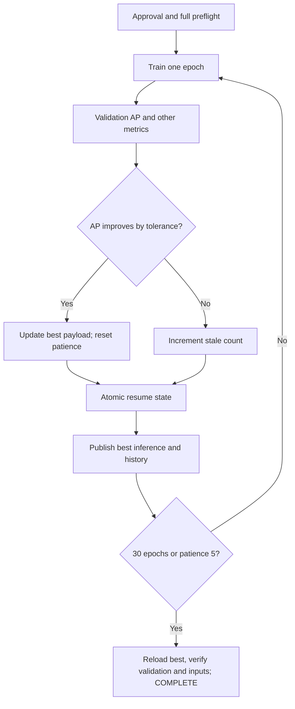

Resume with the same final protocol bytes, environment, input hashes and experiment selection:

```powershell
python -B sepsis_gru_v2_production.py --protocol "$trainingProtocol" --experiments A --resume
if ($LASTEXITCODE -ne 0) { throw 'Resume rejected; stop for review' }
```

resume.pt includes model/Adam state, completed epoch, best AP, stale count, history, best inference payload, Python/NumPy/Torch RNG and shuffle-generator RNG. It is atomic at **epoch boundaries**, not batches. An interrupted epoch repeats from the last complete state. Best_model.pt alone is inference-only and cannot resume. Resume checks experiment/features, protocol/data/statistics/source hashes, settings and recorded environment. It repairs lagging best/history files from the authoritative resume state after interrupted publication. Stale temporary files are not checkpoints. Before any completed checkpoint, a matching run manifest permits seeded restart; an orphan inference checkpoint is rejected. One process per output directory; no concurrent writers.

**Never evaluate the test set here.** `evaluate_test` must be exactly false; true is rejected. Training loaders include only train/validation. Final calibration/test release is later R2C work. The ready-to-run synthetic equivalent is `python -B sepsis_gru_v2_production.py --demo --experiments A`, already demonstrated in Step 81, with no persistent clinical artifact or approval changes.

<a id="chapter-15"></a>
## 15. Remaining model training

**Status: PLANNED real experiments.** After verifying A completion, continue B, C, B_no_antibiotics, C_no_antibiotics, C_no_TRC with the same inputs/science. Either preauthorize all six under one new run directory from the beginning, or use separate approved run protocols/directories per arm. Do not add B to an A-only output by editing the experiment list and pretending it is a compatible resume: the manifest binds that list.

A single approved all-arm execution template is:

```powershell
$allArmsProtocol = '<ABSOLUTE_APPROVED_SIX_ARM_PROTOCOL_JSON>'
python -B sepsis_gru_v2_production.py --protocol "$allArmsProtocol" --experiments A B C B_no_antibiotics C_no_antibiotics C_no_TRC
```

Alternatively select one name with its own approved output/protocol. Resume uses the identical original list plus `--resume`. The runtime validates all masks and uses shared array labels/sequence boundaries. Record experiment names exactly; prose hyphens are not CLI underscores.

| Arm | Input manifest hashes | Protocol / environment reference | Run status | Best epoch | Validation AP | Checkpoint hash |
|---|---|---|---|---|---|---|
| A | | | NOT RUN | | | |
| B | | | NOT RUN | | | |
| C | | | NOT RUN | | | |
| B_no_antibiotics | | | NOT RUN | | | |
| C_no_antibiotics | | | NOT RUN | | | |
| C_no_TRC | | | NOT RUN | | | |

Store operational details in the authorized environment; publish only reviewed summaries. Blank results mean unmeasured, not zero. Record incomplete/failed runs as well as successful ones.

All-split feature matrices alone occupy about 535 MB decimal; adding labels and three int64 identity/time arrays yields about 636 MB, excluding headers. These are disk sizes, not peak RAM. Lazy windows avoid allocating N x 24 x F histories, but segment indices, split uniqueness, training shuffle, metrics arrays, batches, autograd and page cache use RAM. Sorting retains original shards plus SQLite staging/indexes, sorted CSV and arrays concurrently. An 8 GB laptop/35 GB free disk is not certified sufficient by small demos. Require an approved capacity assessment before full conversion and record actual runtime/resource use.

Colab/GPU remains an environment proposal, not supported production acceleration. If approved, make a narrowly reviewed device/checkpoint adaptation and synthetic benchmark before real use, preserving scientific parameters. Do not promise a runtime from CPU extrapolation. Temporary runtimes also require authorized durable checkpoints and exact resume environment; storage approval is separate from compute availability.

Poor validation performance is a research result to investigate without test access: verify loss curves, class presence, feature alignment, provenance and checkpoint selection first. Do not search many unreported configurations and retain only the best. A changed loss, architecture, seed schedule or cohort needs a predefined separate experiment and disclosure. **Next:** complete the original six arms, then freeze calibration/evaluation; do not seek favorable test scores to decide which models to report.

<a id="chapter-16"></a>
## 16. Evaluation and test protection

**Status: IMPLEMENTED AND VERIFIED for synthetic core metrics; PLANNED for final clinical evaluation.** Sources: [core metric implementation](sepsis_gru_v2_core.py), [production runner](sepsis_gru_v2_production.py), and [freeze §6](docs/sepsis_gru_v2_methodology_freeze.v0.1-provisional.md).

A model can rank positive hours well while giving misleading probabilities. We therefore need discrimination, calibration and prevalence together. The existing metric function validates original labels before integer conversion, rejects fractional labels, nonfinite logits, shape mismatches and evaluation partitions missing a class, then applies sigmoid and calculates AP, AUROC, Brier score and prevalence. Its existence does not supply a governed final-test pipeline. Production selects on validation AP and rejects test evaluation; R2C final evaluation remains unfinished.

For labels y_i and probabilities p_i over N eligible endpoints:

- **Average precision:** AP = sum over thresholds k of `(R_k - R_(k-1)) * P_k`, using scikit-learn's non-interpolated `average_precision_score`. It is not trapezoidal integration of a precision–recall curve. Higher is better, but prevalence and cohort composition strongly affect comparisons.
- **AUROC:** discrimination across positive/negative pairs, with tied-score handling. It can appear favorable despite poor precision in an imbalanced cohort. A cohort with only one class has no meaningful AUROC; never report an arbitrary zero as a replacement.
- **Brier score:** mean `(p_i - y_i)^2`. Lower is better. Rare outcomes permit low scores from almost-always-low probabilities, so interpret alongside prevalence and reliability.
- **Prevalence:** mean y_i, reported separately for each primary or restricted evaluation population. A constant prevalence predictor provides a useful reference, not a substitute for model evaluation.

Current validation scores are for model selection. They must not be presented as independent estimates of a selection-free final model. The same caution applies when the validation split later fits a calibrator. No clinical performance results are available yet.

### Freeze before opening test performance

The final release must bind exact dataset/protocol hashes, all model checkpoints, per-model calibrators, metrics and numerical procedures, bootstrap seed and CI construction, optional threshold policy, strict-follow-up rule, explanation sampling and reporting templates. Test input schema, population counts and split disjointness can be validated earlier. Using test AP to choose an epoch, dose perturbation, threshold, feature mask or model is prohibited.

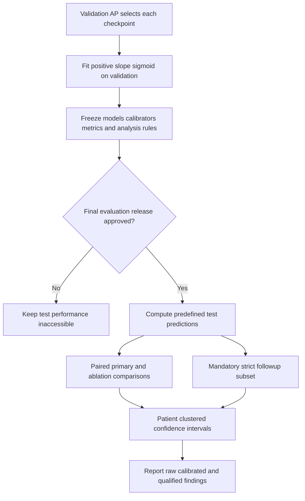

This diagram is an analysis plan, not a callable command. Do not try `evaluate_test: true` to implement it: production deliberately fails closed. Build and review the separate final-evaluation implementation under a later authorization.

### Correlation, uncertainty and comparison

Hourly rows from one patient are correlated through shared physiology, treatments and overlapping GRU windows. The frozen proposal uses **1,000 patient-clustered bootstrap replicates and 95% confidence intervals**. Sample patient clusters with replacement, include all their eligible hours, and use the identical replicate membership for both models in a paired difference. A patient appearing twice contributes their cluster twice. Resampling individual hours would underrepresent dependence.

The point estimate remains hour-weighted: patients with more eligible hours contribute more endpoints. Clustered uncertainty does not silently convert it into a patient-weighted estimand. Specify the bootstrap seed, percentile or other agreed CI procedure, and handling of class-degenerate replicates before release. Report discarded/undefined replicates rather than quietly retrying until an attractive interval appears. These procedures are planned; no bootstrap implementation is present.

Threshold-dependent measures are secondary. If used, select a threshold using validation only under a declared objective, then lock it for test. Report sensitivity, specificity, precision and an explicit alert-burden denominator. Counting hourly threshold exceedances is not the same as counting clinical alerts with suppression/refractory periods; any such alert policy requires its own specification. Do not invent an operating threshold in this handbook.

| Arm / frozen cohort | N / prevalence | Raw AP, 95% CI | AUROC, 95% CI | Raw Brier | Calibrated Brier | Calibration slope/intercept |
|---|---|---|---|---|---|---|
| A / primary | | | | | | |
| B / primary | | | | | | |
| C / primary | | | | | | |
| B_no_antibiotics / primary | | | | | | |
| C_no_antibiotics / primary | | | | | | |
| C_no_TRC / primary | | | | | | |
| Frozen models / strict follow-up | | | | | | |

For each comparison, give paired AP difference with CI, common population, and whether the comparison was prespecified. Empty cells are intentional. **Verification/next:** implement synthetic checks for clustering, pairing, class-degenerate samples, threshold freezing and release enforcement before any final test access.

<a id="chapter-17"></a>
## 17. Calibration

**Status: SCIENTIFICALLY AGREED / SUPERVISOR VERBALLY SUPPORTED; implementation PLANNED.** The [freeze §6](docs/sepsis_gru_v2_methodology_freeze.v0.1-provisional.md) defines the method. No calibration CLI or fitted clinical calibrator exists in the inspected source.

Calibration asks whether predicted probabilities correspond to observed frequencies in the defined population. Among many comparable predictions near 0.02, approximately 2% would be positive for a well-calibrated model. This concerns the retrospective reference label, not the probability of independently observed biological onset. Calibration can vary across hospitals, populations and time even with unchanged discrimination.

For each selected model logit z, fit `p_cal = sigmoid(a*z + b)` on validation only, with **a > 0**. The positive slope preserves ranking in exact arithmetic, so discrimination should remain unchanged except for numerical ties/saturation. The intercept adjusts overall risk; the slope adjusts spread. A separate transform belongs to each arm and selected checkpoint. Do not fit one calibrator on test or share it across different arms without justification.

The implementation specification still needs a stable positive-slope parameterization, optimization settings, convergence criteria, and explicit degenerate-case behavior. For example, a positive transform of an unconstrained parameter can enforce a > 0, but this handbook does not choose a new fitting algorithm. Use numerically stable log-loss operations rather than taking logs of rounded zeros/ones. Handle constant logits, absent classes, nonfinite inputs, nonconvergence and very large coefficients as reportable failures; do not silently return an unverified transform.

After fitting, save slope, intercept, checkpoint hash, validation-input identity, fitting configuration, software versions and convergence status. Freeze these before final test evaluation. Raw and calibrated probabilities must remain distinguishable in the analysis artifacts.

A reliability diagram groups predictions into prespecified bins and compares mean predicted probability against observed frequency. Report bin sample and positive counts: a bin with very few events is uncertain. Bin policy must be frozen before choosing the most flattering picture. Calibration intercept/slope are assessment statistics requiring a declared regression procedure; they are not automatically identical to the fitting parameters a and b. Assess raw and calibrated Brier scores on the same held-out endpoints.

Using validation both for checkpoint selection and calibration fitting is a practical frozen choice with optimistic validation assessment. The untouched final test can assess the fully specified process. Do not fix this limitation by silently repartitioning patients or fitting against test labels. If resources prevent a stable calibrator, document the failure and obtain a disposition before test-driven changes.

**Verification/next:** implement the agreed fit and serialization, test monotonicity and finite extremes with synthetic logits, test checkpoint/data binding, and lock reliability/assessment procedures. Calibration is necessary downstream work; its absence does not require changing the GRU architecture.

<a id="chapter-18"></a>
## 18. Explainability

**Status: PLANNED.** [Decision 8](docs/sepsis_gru_v2_methodology_freeze.v0.1-provisional.md) selects Integrated Gradients (IG) for model logits. No IG implementation or clinical attribution output is present.

IG attributes the difference between a model's output on an input x and a reference x' to the input coordinates. For coordinate j:

`IG_j(x; x') = (x_j - x'_j) * integral from 0 to 1 of d f(x' + alpha*(x-x')) / d x_j d alpha`.

The integral is approximated numerically. Here coordinates span both time and feature. A positive logit attribution means that coordinate contributes toward a higher logit relative to the selected reference along this integration path. It does not mean that increasing the feature would cause sepsis or that clinicians should change it.

The reference must be defined from training information and recorded before analysis. Zero in standardized space corresponds to a training mean for continuous features, but binary flags and treatment-derived dependencies require explicit handling; an all-zero tensor is not automatically a clinically coherent patient. Explain the chosen reference and its limitations. Attribution is reference-dependent, so report that dependence rather than calling the output a unique explanation.

Implementation should use the frozen best-validation checkpoint in evaluation mode and explain its logit. Keep the real sequence length unchanged along the integration path, use the same packed-sequence interface, and exclude padded positions from attribution summaries. Padding does not represent an observed zero-valued hour. Verify that trailing padding changes do not affect the valid sequence's prediction or attributions when lengths are respected.

Missingness indicators are features in their own right. Along an ordinary IG path, a binary flag may take fractional intermediate values; those are mathematical interpolation points, not clinical records. Document this and avoid presenting the interpolated path as a feasible intervention. Derived features, correlated inputs and median-filled values also complicate independent attribution claims.

The frozen initial explanation sample is up to **100 positive and 100 negative endpoints**, no more than one endpoint per ICU stay, fixed selection seed, and distinct patients where feasible. A balanced explanation sample is not prevalence-representative. Do not use it to estimate population risk or overall clinical feature importance. If several stays belong to one patient, identify the dependence in the authorized analysis environment and avoid independent-patient claims.

A focused implementation sequence is:

1. Freeze sample policy, reference construction, integration rule and convergence/completeness tolerances using synthetic development cases.
2. Load the exact model, feature mask and frozen scaler; preserve identity/time alignment without exporting identifiers to shared documents.
3. Calculate feature-by-hour logit attributions for the fixed sample, masking padding.
4. Check approximate completeness: `sum(IG) ≈ f(x) - f(x')`; increase integration resolution only under a predefined numerical rule.
5. Report signed and absolute attributions separately, grouped into physiology, laboratories, treatments and dynamics, with sample counts and selection limitations.
6. Review aggregate figures and illustrative outputs for disclosure before sharing.

Computational cost grows with samples, integration steps and sequence length; batching integration points trades memory for speed. A small fixed sample limits work without making it representative. **Next:** implement and synthetic-test this narrow method after model/evaluation interfaces are frozen; no new explanation methods are required to complete the agreed project.

<a id="chapter-19"></a>
## 19. Model-based counterfactual input analysis

**Status: PLANNED, non-causal.** The title's counterfactual component is bounded model-input sensitivity, not estimation of potential clinical outcomes. The [freeze §7](docs/sepsis_gru_v2_methodology_freeze.v0.1-provisional.md) focuses on frozen GRU-C.

Observed treatment is selected by clinicians in response to patient state and is related to the retrospective target construction. We cannot infer the outcome under another treatment simply by editing the input. The supported question is: **how does this frozen model's estimated reference risk change when specified inputs are perturbed coherently?** Physiology held fixed is an artificial modeling assumption, not a forecast of the physiological response to a dose change.

Candidate scenarios are ±10% and ±25% changes to positive hourly NEeq values, bounded by training-derived plausible limits and fixed eligibility rules. These are proposed analysis settings, not already validated clinical interventions or active executable configurations. Bounds and handling of boundary cases must be specified before test use. Preserve zero-dose handling deliberately; a percentage of zero does not initiate a treatment.

### Worked synthetic example

The following numbers are invented arithmetic examples in the source NEeq numeric scale, not patient data or dose recommendations. Three consecutive hourly buckets have MAP `[70, 72, 71]` and hourly dose `[0.10, 0.20, 0.15]`. For the second and third buckets, original delta-MAP is `[+2, -1]`, delta-dose `[+0.10, -0.05]`, and TRC `[+0.20, +0.05]`.

Increase only the middle bucket's dose by 10%, to 0.22. Its delta-dose becomes `0.22 - 0.10 = +0.12`, and the following bucket's becomes `0.15 - 0.22 = -0.07`. The corresponding TRC values become `2*0.12 = 0.24` and `(-1)*(-0.07) = 0.07`. Updating only the edited hour would leave the next delta and TRC inconsistent.

Vasopressor-active remains one in this example because all doses remain positive. If an allowed scenario changes positivity, its active flag must change coherently. Antibiotic features, true labels and other physiology remain unchanged under this particular scenario. At an ICU-hour gap, transition-derived terms remain zero under the existing valid-transition rule; do not connect nonconsecutive buckets.

Recompute in the raw feature domain, then apply the original per-feature scaler exactly once. TRC has its own frozen scaling; multiplying standardized deltas does not reproduce the standardized raw interaction. Maintain all other canonical feature positions and binary flags. If a changed hour precedes a selected GRU window, recompute downstream deltas from the full eligible raw history before slicing the window, so its boundary dependence is not lost. Never fabricate an unavailable predecessor.

Run the original and perturbed coherent sequence through the same frozen model and, when reporting calibrated risk, the same frozen calibrator. Record original/perturbed probability, difference, scenario eligibility, bounds and failure counts in authorized storage. Use reviewed aggregate summaries for collaboration. Do not retune the model/calibrator for a perturbation or alter the reference labels.

**Verification/next:** synthetic-test adjacent transitions, gap resets, active flags, clipping rules and once-only scaling; freeze scenario selection and reporting. If a scenario cannot preserve internal consistency, narrow it or omit it with supervisor disposition. Antibiotic perturbations are optional and especially difficult because prescription exposure participates in target coupling. No claim that decreasing dose decreases actual sepsis risk is permitted.

<a id="chapter-20"></a>
## 20. Sensitivity analyses and scientific limitations

Sensitivity analyses ask how conclusions depend on a particular assumption. They are not an invitation to replace the baseline with whichever analysis produces a larger score. Sources: [freeze §§2, 4, 8](docs/sepsis_gru_v2_methodology_freeze.v0.1-provisional.md), [closure](docs/sepsis_gru_v2_source_integrity_closure.v1.md), and [prepared overlap configuration](sepsis_gru_v2_overlap_sensitivity.v1.json).

| Analysis | Priority | Data/model implication | Legitimate interpretation |
|---|---|---|---|
| Strict six-hour ICU follow-up | Mandatory evaluation | Freeze a common endpoint rule before test access; reuse already-frozen baseline predictions/models on eligible held-out subset | Sensitivity to incomplete negative follow-up and changed cohort prevalence |
| SOFA-reference alternative | OPTIONAL / CONDITIONAL | Separately verified labels, eligibility and cohort; separate model study if approved | Dependence on reference definition, not recovery of true biological onset |
| One-hour input lag | OPTIONAL / CONDITIONAL | Coherent history shift, valid transitions and dependent features; decide evaluation-only stress test versus separately trained lagged model in advance | Sensitivity to assumed delay; cannot establish live availability |
| Overlap-affected-stay exclusion | OPTIONAL / CONDITIONAL | Authorized evidence-derived common stay rule; no mask currently created; distinguish restricted evaluation from separately approved retraining | Dependence on potentially affected source subset, not proof of accidental duplication |
| Weighted BCE | OPTIONAL / CONDITIONAL | Separate training runs and loss specification, followed by separate calibration | Dependence on loss weighting, not improvement of the frozen unweighted baseline |
| Additional seeds | OPTIONAL / CONDITIONAL | Predefine seeds and repeat fits before final test comparison | Training variability beyond the initial seed 42 |

The mandatory strict-follow-up analysis removes negative endpoints lacking a full six hours of ICU follow-up. Previously reported counts remove 275,358 negative endpoints from all splits combined, retain 31,044 positives, and leave 3,778,003 endpoints. These are not the expected test-subset count. Confirm actual split-specific mask counts in the authorized environment. Report the changed prevalence and paired model comparisons on the same restricted endpoints; do not attribute all metric movement to better or worse modeling.

The overlap configuration is preparation, not an approved patient-level mask. Do not infer identifiers from published aggregate counts. If a common exclusion set is later authorized, apply it consistently across compared arms and report selection effects. The latest audit found diagnostic signature-collapse changes without demonstrating that repeated signatures are invalid. Correcting the baseline or recomputing statistics is not justified by those counts alone.

The principal limitations remain retrospective ≥24-hour stay selection, excluded early references, incomplete future follow-up in the primary baseline, treatment-conditioned reference construction, unknown prospective availability for some inputs, derived GCS carry/default behavior, whole-hour treatment aggregation, prescription rather than administration exposure, and unproven historical source equivalence. Single-source retrospective results and a single training seed also constrain generalization. Explainability and perturbations describe the fitted model, not causal mechanisms.

**Verification/next:** freeze the mandatory follow-up evaluation rule and mark optional studies explicitly completed, deferred or omitted with reasons. A focused, transparent primary study plus mandatory sensitivity is preferable to undocumented changes made in response to test results.

<a id="chapter-21"></a>
## 21. Quality assurance and troubleshooting

**Start with the failure message and the corresponding contract, not by weakening a gate.** Reproduce engineering failures with synthetic inputs. Clinical-data investigation belongs only in the authorized environment; bring back reviewed aggregate diagnostics, never patient rows. Source entry points: [contracts](sepsis_gru_v2_contracts.py), [export conversion](sepsis_gru_v2_export.py), [production](sepsis_gru_v2_production.py), [resume](sepsis_gru_v2_resume.py).

| Symptom | Likely cause / safe diagnosis | Appropriate resolution |
|---|---|---|
| BigQuery access denied | Identity, credentialing, project permission or billing context differs from the approved setup | Ask the authorized data custodian to verify access. Do not borrow credentials or move records to bypass restrictions. |
| Expired/missing V2 object | Retention deadline passed or binding points to a different project/version | Consult preservation inventory and authorized backups. Rebuilding SQL does not guarantee byte-equivalent historical data; record a new verified snapshot if needed. |
| Invalid source binding | A template token remains, object name is wrong, or current source is mistaken for historical snapshot | Match names against evidence metadata in the authorized environment. Keep current-source and authenticated historical-source claims separate. |
| Full test suite fails on missing ZIP | Fresh clone lacks the four locally retained recovery archives required by provenance tests | Obtain the exact reviewed non-sensitive archives through approved project handoff and verify their recorded hashes. Do not fabricate replacements or skip the provenance assertion silently. |
| Dependency/import error | Python environment differs or an unpinned transitive dependency is unavailable | Use the verified team environment, record actual versions, and resolve packaging reproducibly; there is no repository requirements lock to trust blindly. |
| Unsorted shards | SQL exports do not promise global order | Use the external sort converter on all shards for that split. Do not sort feature and identifier arrays separately. |
| Duplicate stay/hour key | Duplicate shards, repeated source rows or accidental rerun concatenation | Stop conversion, identify source/shard provenance, and resolve with the custodian. Never silently keep first/last or aggregate duplicates. |
| Malformed time / inconsistent identifier | Invalid hourly boundary, non-integer identity or conflicting subject for a stay | Inspect synthetic reproduction and authorized aggregate error counts; correct the extraction issue under review, not labels by guesswork. |
| Population mismatch | Wrong snapshot/filter, missing shard, duplicate rows or altered cohort | Compare all four frozen split counts and hashes with extraction evidence. Do not change expected counts merely to pass preflight. |
| Patient overlap | Re-splitting hours, mixing snapshots or incorrect split metadata | Stop; restore the frozen patient assignments and regenerate authorized exports if approved. Three pairwise intersections must be empty. |
| Normalization mismatch | Wrong statistics/hash, double scaling, incorrect feature order or unproven train-only origin | Restore original frozen preprocessing with verified provenance. Do not refit on validation/test or reverse unknown scaling heuristically. |
| NaN/Inf or invalid binary field | Incomplete imputation, source numeric issue or damaged conversion | Fail closed and trace the relevant contract in synthetic examples; do not blanket-fill without a scientific disposition. |
| Memory pressure during sort | Oversized chunks or concurrent processes | Reduce converter chunk size within supported bounds, free authorized scratch capacity, and retry with intact original shards. Do not load all exports into pandas. |
| Memory pressure during training | Batch/autograd, index arrays, shuffle and validation buffers exceed RAM | Profile synthetic representative runs and use adequate authorized hardware. Batch size is frozen at 256; changing it needs a separately reviewed protocol. |
| CUDA unavailable | CPU PyTorch build, absent supported hardware/driver, or current CPU-only runner | Current production deliberately uses CPU. A true CUDA result from a device check does not enable GPU support. Do not pretend changing a string is a validated migration. |
| GPU out of memory in a future adaptation | Unsupported extension or insufficient device capacity | Return to the approved implementation; validate a reviewed device adaptation separately. Do not silently shorten sequences or change batch/features. |
| CPU training too slow | Full data contain millions of endpoints; small demos hide cost | Benchmark approved hardware synthetically, preserve resumable epochs, and seek compute support. No unverified clinical-runtime promise follows from a laptop estimate. |
| Resume rejected | Changed protocol bytes, data/statistics/source hashes, feature mask, environment or experiment list | Use the exact original run configuration or start a separately identified new run. Do not edit checkpoint identity fields. |
| Interrupted write / incomplete run | Process stopped before atomic replacement or after best-state update | Resume through the supported checkpoint logic; it validates/restores the last committed epoch and repairs compatible artifacts. Preserve evidence before investigating corruption. |
| No resume checkpoint yet | Interruption occurred before a completed epoch | Supported same-run recovery may restart from the recorded seed; work from an incomplete epoch is not preserved. Never claim mid-batch continuation. |
| NaN/undefined validation AP or flat scores | Invalid predictions, absent classes in a synthetic sample, severe imbalance or model-learning issue | Verify label/prediction contracts and validation population first. Review training loss and validation only; do not consult test to debug model selection. |
| Best checkpoint metadata inconsistent | Wrong arm, stale output directory, manual file replacement or interrupted artifact update | Let supported resume checks verify identity; otherwise preserve failed run and create a clean, reviewed new run. Inference and resume files are not interchangeable. |
| Test-policy rejection | Attempted `evaluate_test: true` or unsupported final-test path | Keep it false. Implement the separately governed final-evaluation release later; never patch around the rejection. |
| Authorized path rejected | Empty/incorrect roots, cloud-sync component, symlink/reparse or unresolved path | Use explicitly approved resolvable storage outside restricted locations and verify evidence. Do not rename OneDrive folders to disguise storage. |
| Output directory already exists | Reused run name or partial prior conversion | Distinguish valid resume from a new conversion; preserve artifacts and use a new authorized output directory where required. Do not delete evidence to force success. |

### Safe diagnosis order

1. Record code commit, exact command shape, software versions and redacted error; do not paste clinical paths/rows or credentials into team chat.
2. Check whether failure is authorization, input integrity, numerical computation or output-state related.
3. Run the relevant synthetic test and then the complete synthetic suite in the prepared environment.
4. Compare against the [GRU-A runbook](docs/sepsis_gru_v2_gru_a_execution_runbook.v1.md) and [chapter 14](#chapter-14).
5. Resolve only the demonstrated issue, review a narrow change, and rerun the affected checks. Preserve baseline scientific definitions.

A failed integrity gate is evidence that execution is not ready. A poor but valid validation result is not necessarily an engineering defect. Keep those cases separate in the issue log. **Next:** if no failure is present, return to the [decision tree](#next-action), not a new broad audit.

<a id="chapter-22"></a>
## 22. Full project completion roadmap

This roadmap targets the **first week of Falgun 2083, approximately February 2027**. Confirm the exact institutional Gregorian deadline; this handbook does not assert a converted submission date. Dates below are planning windows, not completed milestones or runtime guarantees. Source status comes from the [closure](docs/sepsis_gru_v2_source_integrity_closure.v1.md), [R2A readiness](docs/sepsis_gru_v2_r2a_readiness.md), [runbook](docs/sepsis_gru_v2_gru_a_execution_runbook.v1.md) and [supervisor review](docs/sepsis_gru_v2_supervisor_review.v1.md).

### Completed foundation

- [x] Preserve V2 SQL constructions and manifests; distinguish hashes from historical equivalence.
- [x] Record ten provisional methodology decisions and prepare a supervisor-review package.
- [x] Complete synthetic-tested production infrastructure, bounded conversion, contracts and resumable checkpoints.
- [x] Close three routine source-integrity investigations using supplied authorized aggregate results with limitations retained.
- [x] Preserve a GRU-A execution runbook and documentation checkpoint at Step 82.
- [ ] Record written/version-specific supervisor and environment/execution approval. Verbal support is acknowledged; documentary and execution gates remain open.
- [ ] Verify a preserved clinical input snapshot and statistics provenance in the authorized environment.
- [ ] Train or evaluate any V2 model on clinical data.

### Stage 1 — Resolve the execution environment and preservation now

**Owner roles:** project lead, supervisor, institutional data/compute custodian. **Suggested window:** late October–November 2026, before the December retention deadlines.

Acceptance criteria:

- [ ] Select an authorized storage/compute environment with documented access, retention, backup and transfer permissions.
- [ ] Confirm preservation choice for twelve objects due December 9–10; record exact object list, current expiration values and responsible custodian outside this unverified summary.
- [ ] Record the supervisor's supported method version and any conditions without altering historical draft records.
- [ ] Identify the frozen snapshot, extraction evidence and train-only statistics lineage; retain actual job IDs when available.
- [ ] Establish a reproducible software environment and capacity estimate. Resolve clone portability of recovery ZIPs.

**Single immediate action:** obtain a documented institutional decision on authorized preservation and training infrastructure, linking the reported supervisor support to the exact frozen protocol. Do not begin another broad source audit; the existing diagnostic findings already have dispositions.

### Stage 2 — First real GRU-A run

**Owner roles:** ML engineer and data custodian; separate reviewer for gates. **Suggested window:** after Stage 1, ideally November/early December if resources permit.

- [ ] All authorized split shards and source-evidence files exist; external sorting/conversion succeeds atomically.
- [ ] Actual counts, identities, chronology, labels, canonical columns and normalization provenance pass preflight.
- [ ] A newly versioned approved execution protocol is complete; historical drafts remain intact.
- [ ] Synthetic suite/demo pass in the execution environment, then the exact approved A command runs.
- [ ] Best-validation and resumable checkpoints have consistent identities; test performance remains inaccessible.
- [ ] Run history and resource usage are reviewed without tuning against test.

Acceptance is a reproducible completed A run, not a minimum AP invented after the fact. If training fails, use [troubleshooting](#chapter-21), preserve evidence and resume safely.

### Stage 3 — Complete the frozen comparison

**Owner role:** ML engineer; scientific review by supervisor. **Suggested window:** December–January, subject to measured throughput.

- [ ] Train B and C on the same endpoints and frozen settings.
- [ ] Train B_no_antibiotics, C_no_antibiotics and C_no_TRC independently.
- [ ] Record all completed/failed runs, selected epochs, hashes and validation results.
- [ ] Predefine any extra seeds before final test comparisons; no favorable-run selection.

### Stage 4 — Finalize and release analysis

**Owner roles:** evaluation engineer and scientific reviewer. **Suggested window:** December–January, code can be developed synthetically while approved training runs.

- [ ] Implement calibration, final release gating, paired clustered uncertainty, strict-follow-up evaluation and reporting with focused synthetic tests.
- [ ] Freeze calibrators, bootstrap method/seed, thresholds if used, cohort rules and disclosure-safe outputs.
- [ ] Record approval for final test release; compute predefined primary, ablation and mandatory sensitivity results.
- [ ] Implement fixed-sample IG and coherent GRU-C input perturbations; validate numerical consistency before interpretation.
- [ ] Report optional/conditional sensitivities as performed or deferred, with reasons, without relabeling the primary analysis.

This is future R2C/analysis work, not functionality supplied by the present handbook. Test release should not occur merely because the first model has finished training.

### Optional system track — Local research demonstrator (PLANNED)

Confirm scope first; [Part VI](#part-vi) is a proposal, not a supervisor requirement or clinical deployment plan. Service/fixture/UI development can proceed with fictional inputs in parallel with approved research work, but must not delay snapshot preservation, the six-arm study or final evaluation. Suggested scheduling is after the core research environment is secured, with integration/rehearsal before submission if resources permit.

- [ ] Confirm the default Streamlit scope or explicitly choose the React/FastAPI alternative; assign an owner and effort limit.
- [ ] Implement deterministic fictional fixtures and trusted artifact contracts with no clinical uploads.
- [ ] Verify six-mask inference parity, shared calibration/IG/scenario adapters and stale-state handling.
- [ ] Package only reviewed permitted artifacts; keep clinical-trained weights outside public/synchronized repositories unless separately authorized for distribution.
- [ ] Complete local integration, privacy and presentation checks in [chapters 36–40](#chapter-36).

Acceptance is a reproducible, clearly labeled fictional-input demonstration. It is not clinical accuracy, bedside availability or treatment-effect evidence. If this optional track is deferred, record the scope decision and present the verified research workflow honestly.

### Stage 5 — Write, revise and defend

**Owner roles:** research lead and all assigned contributors. **Suggested window:** write methods now; results/revisions January–February 2027.

- [ ] Methods reproduce actual frozen implementation and disclose retrospective target coupling.
- [ ] Results tables/figures distinguish raw/calibrated, primary/restricted and prespecified/exploratory results.
- [ ] Statistical and interpretive claims survive supervisor review, including neutral or negative findings.
- [ ] Complete limitations, source references, reproducibility appendix and approved public-artifact review.
- [ ] Rehearse presentation/viva and check the exact submission format/deadline.

### Contingencies

If hardware is inadequate, seek authorized institutional compute or separately review a GPU adaptation; do not reduce frozen batch/window/features silently. If approval or retention is delayed, prioritize lawful dataset preservation and synthetic analysis tooling; no unapproved data transfer is a shortcut. If performance is poor, report the result and verify input/model contracts without looking at test for tuning. If time is insufficient, ask the supervisor to prioritize mandatory A/B/C, core ablations and strict-follow-up evaluation and explicitly revise scope; this handbook does not grant permission to omit agreed analyses.

If materialized data expire, reconstruction may change source versions, query behavior or statistics provenance. Treat recovered outputs as a newly verified snapshot, not automatically the historical baseline. Document the scientific consequences before training. **Next:** use these acceptance criteria as the project board, assigning actual people and dates through the team rather than inventing them here.

<a id="chapter-23"></a>
## 23. Research reporting and defense

The thesis should tell one defensible story: an explicitly retrospective benchmark, controlled feature comparisons, honest uncertainty and bounded interpretation. Software correctness and aggregate source checks support reproducibility; they do not constitute clinical prediction performance or deployment validation.

| Thesis section | Required content and evidence |
|---|---|
| Introduction | Clinical motivation, precise retrospective reference, central predictive question and limited contribution |
| Literature review | Verified primary references for sepsis definitions, dataset, GRUs, calibration, IG and treatment-related prediction; distinguish external work from this study |
| Dataset/cohort | Sources, access boundaries, eligibility, splitting, expected/actual counts and selection effects |
| Methodology | Completed-hour target, feature semantics, frozen scaler, six arms, loss, checkpoints and analysis freeze |
| Implementation | Actual modules, external sort, disk-backed windows, contracts, resume and authorization design |
| Experimental setup | Exact snapshot, protocol, environment, seed, hardware and output identities |
| Results | All predefined arms, prevalence, paired uncertainty, completed/failed runs; no synthetic-to-clinical inference |
| Calibration | Raw/calibrated scores, validation fitting limitations and reliability counts |
| Explainability | Sampling/reference/masking, completeness, feature/time attribution limitations |
| Input sensitivity | Scenario rules, coherent dependent features, frozen model/calibrator and non-causal interpretation |
| Limitations | Target coupling, retrospective availability, cohort selection, source equivalence, overlap interpretation and single-source generalization |
| Conclusion/future work | Answer supported by measured results, including neutral findings; prospective/external/causal studies remain future work |

Figures should state cohort, sample size, outcome prevalence, model version and whether data are validation or held-out test. Explain why C-vs-B measures the whole dynamic feature package, whereas C-vs-C_no_TRC isolates removal of the explicit interaction within that package. Do not infer a unique causal importance from either comparison. Patient-clustered CIs and a single initial training seed address different uncertainties.

### Likely viva questions

**What exactly are you predicting?** A selected retrospectively defined suspected-infection reference within `(prediction_time, prediction_time + 6 hours]`, among the frozen eligible ICU cohort. It is not directly observed biological onset.

**Is adding antibiotics leakage?** The target and cohort use treatment-related retrospective information, so coupling is a scientific limitation. Implemented temporal checks address specified timestamp violations; they do not remove definitional coupling. Antibiotic ablations quantify incremental predictive contribution under the same target, not proof of treatment-independent prediction.

**Why use GRU rather than an LSTM or transformer?** The project fixes a compact recurrent model suited to variable-length hourly histories and controlled feature comparisons. It does not claim architecture superiority without a separate matched comparison. Small architecture and disk-backed windows support feasibility, but hardware adequacy still needs measurement.

**Does TRC measure treatment response?** It is `delta_map * delta_dose`, simultaneous observed co-change in engineered hourly values. It may capture predictive association, coverage changes and documentation patterns. It is not an identified physiological or causal treatment effect.

**Did the vasopressor audit prove doses were doubled?** No. Baseline replay agreed, and a hypothetical signature collapse changed some outputs. Repeated signatures/overlap are evidence requiring interpretation, not proof that contributions should be removed.

**Why not use accuracy?** Positives are rare; predicting every hour negative can achieve high accuracy. AP with prevalence, AUROC, Brier and calibration give a more useful evaluation, still with dependence and retrospective limitations.

**Are you sure there is no leakage?** We enforce patient separation and specified chronology, use train-only frozen preprocessing and isolate test performance. Those guarantees do not establish real-time availability for every source or eliminate target coupling. State the scope of each check rather than claiming universal absence of leakage.

**Why are the source hashes not sufficient?** A hash proves exact bytes of a file, not that an unpinned historical table was generated from those bytes or that training statistics came from the intended population. Snapshot/job provenance and authorized data contracts provide different evidence.

**What if C does not outperform B?** That is a valid result for the fixed feature package under this benchmark. Report effect sizes and uncertainty; do not rename exploratory changes as the primary experiment.

**Are your counterfactuals treatment recommendations?** No. They compare outputs of a frozen model under specified coherent synthetic input perturbations while holding other inputs fixed. They do not estimate a patient's outcome under an intervention.

**What is still required for bedside use?** Prospective availability assessment, external/temporal validation, workflow and safety studies, and relevant institutional/regulatory evaluation, none supplied by this retrospective project. Avoid asserting a specific deployment approval path without evidence.

**Verification/next:** trace every thesis result to a reviewed artifact and every methodological claim to this handbook's source index. Replace planned wording with completed evidence only after the corresponding milestone passes.

<a id="chapter-24"></a>
## 24. Team collaboration guide

Assign roles explicitly; no actual member names or access permissions are established here. A **research lead** maintains decisions and deadlines; a **data custodian** handles authorized snapshots and retention; an **ML engineer** operates conversion/training; an **evaluation engineer** implements frozen analyses; a **scientific reviewer/supervisor** approves claims and deviations. One person may hold several roles, but a second reviewer should check irreversible scientific/execution decisions.

New members start with [START HERE](#start-here), then [environment setup](#chapter-11), [data handling](#chapter-12) and their assigned chapter. Code access is not clinical-data authorization. Run synthetic checks before changing code, and verify whether locally required recovery archives are available. Do not place a teammate's credentials in a shared configuration.

A useful task specifies one deliverable, permitted files, scientific invariants, synthetic acceptance tests, source references and whether it needs supervisor/environment approval. Separate engineering defects from methodological changes. Small reviews make it possible to see whether a feature order, label condition or approval gate changed accidentally.

For future authorized code work, create a branch such as `codex/<focused-task>` from a verified clean state. Before any commit, inspect `git status --short`, `git diff`, explicit staged paths and `git diff --cached`. Stage only named reviewed non-sensitive files. Avoid indiscriminate staging of outputs or recovered archives. The strict ignore policy may hide new documents; deliberate allowlisting or explicit staging requires a separate reviewed action. **This handbook is not committed or force-added during its creation.**

A local commit is not permission to push, publish data or share model artifacts. There is no remote operation in this task. If a future team repository is approved, use that approved sharing channel and review its contents; access-controlled Git still must not contain restricted clinical records or credentials.

### Review checklist

- [ ] Scope and baseline scientific invariants are explicit; no hidden cohort, target, feature or loss changes.
- [ ] Synthetic tests cover the material behavior and current complete suite passes in the prepared environment.
- [ ] CLI documentation matches actual arguments and authorization gates remain fail-closed.
- [ ] Hash/protocol updates are intentional, versioned and reviewed; historical artifacts remain unchanged.
- [ ] No patient data, identifiers, credentials, raw clinical paths, generated predictions or unreviewed checkpoints are staged.
- [ ] Documentation distinguishes tested software, supplied aggregate evidence and unverified clinical requirements.
- [ ] Approval evidence records the exact version, date, authorized action and responsible role/person in the appropriate private record.

Maintain separate records for scientific agreement, data-access permission, environment/storage authorization, execution approval and final-test release. Verbal support can be recorded as such; do not fabricate signatures. If a decision changes, preserve the previous record and add a dated version with rationale, expected impact and reviewer. Do not rewrite an old draft to imply it had always been approved.

**Next:** assign Stage 1 owners and use [maintenance](#maintenance) after each completed milestone. The handbook is the navigation layer; machine-readable contracts and immutable provenance remain the technical authorities.

<a id="chapter-25"></a>
## 25. Glossary, references and appendices

### Terminology and abbreviations

| Term | Meaning in this project |
|---|---|
| AP | Non-interpolated average precision; primary validation selection and planned discrimination metric |
| Array contract | Machine-readable metadata plus independently checked array schema, identity and preprocessing evidence |
| As-of selection | Selecting the latest eligible laboratory result using both measurement and availability cutoffs |
| AUROC | Area under the receiver-operating-characteristic curve; secondary discrimination measure |
| BCE / logits | Binary cross-entropy loss computed from unconstrained model scores using `BCEWithLogitsLoss` |
| Brier score | Mean squared difference between predicted probability and binary outcome |
| Calibration | Agreement of probability estimates with observed outcome frequencies in a stated population |
| Canonical order | Exact manifest column order, independent of the incidental CSV header order |
| Chart time | Recorded measurement/event time; not universally proof of live-system availability |
| Checkpoint | Saved state; best-model inference and resumable training checkpoints have different purposes |
| Cohort | Retrospectively selected eligible ICU stays and their eligible prediction-hour endpoints |
| Completed hour | Hourly bucket beginning no earlier than ICU admission and ending no later than discharge |
| Counterfactual input | Hypothetical coherent model input; not an identified clinical intervention outcome |
| CSV shard | One part of a split export; multiple shards need deterministic global ordering |
| Delta | Current minus preceding consecutive-hour value; zero at an invalid transition |
| Disk-backed dataset | Lazily reads memory-mapped arrays and forms bounded history windows |
| EHR | Electronic health record; observational documentation with timing and missingness limitations |
| Endpoint | One eligible prediction hour with one label and a preceding same-stay consecutive sequence |
| ETT | Endotracheal tube context relevant to upstream GCS substitutions |
| FARM_FINGERPRINT | BigQuery deterministic hash used by the preserved patient split expression |
| Frozen statistics | Immutable train-derived preprocessing parameters whose population provenance must be verified |
| GCS | Glasgow Coma Scale, obtained from a derived concept with upstream component processing |
| GRU | Gated recurrent unit; the single-layer recurrent model used here |
| ICU | Intensive care unit; one patient may have more than one ICU stay |
| IG | Integrated Gradients; planned input attribution method for selected logits |
| Label / target | Indicator that the selected reference occurs strictly after prediction and within six hours |
| LOCF | Last observation carried forward under stay-local bucket-distance constraints |
| LSTM | Long short-term memory network; background alternative, not an implemented study arm |
| MAP | Mean arterial pressure; SQL uses the derived mean blood pressure value |
| MIMIC-IV | Credentialed clinical database source; derived concepts are transformation code/tables on that source |
| Missingness flag | A feature indicating absence under its source-specific selection rule, not necessarily a null final input |
| NEeq | Norepinephrine-equivalent dose; here a duration-weighted hourly sum of source interval contributions |
| Padding | Non-observation tensor positions excluded by actual sequence lengths |
| Patient / subject | Unit of split isolation and planned bootstrap clustering; not interchangeable with ICU stay |
| Positive hour | Prediction endpoint within the target horizon; not one independent sepsis episode |
| Prediction time | End of the completed feature hour, `hour + 1 hour` |
| Preflight | Schema, evidence, counts, identity, chronology and authorization checks before training |
| Protocol | Versioned configuration and approval/evidence bindings; a draft is not execution permission |
| Replay | Recalculation under a specified source binding; agreement does not authenticate historical table versions |
| RNG | Random-number generator; state preserved for compatible deterministic resume |
| RNN | Recurrent neural network; GRU is a gated variant |
| SHA-256 | Cryptographic content hash proving byte identity relative to a reference, not scientific correctness |
| Snapshot | Identified source/data version; a current table name alone is not a historical pin |
| SOFA | Sequential Organ Failure Assessment; part of retrospective Sepsis-3-related classification |
| Split | Training, validation or test patient partition; never independently resplit hours |
| Store time | Laboratory recorded availability proxy used by V2 selection; source-specific semantics apply |
| TRC | Treatment-response coupling term, `delta_map * delta_dose`; simultaneous co-change, not causal effect |
| Validation | Data for checkpoint selection and planned calibration fitting, separate from final test |
| V2 | Frozen revised dataset/methodology in this repository; distinct from earlier materialized variants |
| Window | Up to 24 consecutive same-stay feature hours ending at an eligible prediction endpoint |

### Formula and schema reference

The single canonical feature table is in [chapter 5](#chapter-5); the six masks are in [chapter 9](#chapter-9). The clinical target is `1[p < reference <= p+6h]` on eligible endpoints. Hourly treatment is `sum(dose * overlap_seconds / 3600)`. Transition features require a preceding consecutive hour. Continuous scaling is `(x - train_mean) / train_std` with finite positive population standard deviations required (nonpositive standard deviations are rejected), whereas binary values remain binary. See the source implementation before reimplementing these expressions.

For exact serialized fields, use [manifest](sepsis_gru_v2_manifest.json), [array writer](sepsis_gru_v2_array_writer.py), [contracts](sepsis_gru_v2_contracts.py) and [source-evidence schema](schemas/sepsis_gru_v2_source_evidence.v1.schema.json). Exports carry all 33 features plus required identity, prediction-time, split and label columns. Disk arrays hold float32 features, uint8 labels and int64 identity/time values; normalization and column order are explicit evidence, not inferred from similar-looking values.

The evidence schema records snapshot identity, extraction/sort provenance, source and file hashes, frozen statistics and temporal evidence. Required attestation does not prove clinical facts by itself. The independently calculated counts, labels, identity separation and array hashes are separate safeguards. An authorized reviewer must verify the semantic link from source snapshot to training statistics and extraction.

### Command reference

Run from the project root with dependencies prepared. These are supported CLI shapes, not alternate ways to bypass gates:

```text
# Read-only repository/environment inspection
git rev-parse HEAD
git status --short
python --version
python -B sepsis_gru_v2_production.py --help
python -B sepsis_gru_v2_export.py --help

# Safe synthetic checks
python -B -m unittest discover -s tests -v
python -B sepsis_gru_v2_production.py --demo --preflight-only --experiments A
python -B sepsis_gru_v2_production.py --demo --experiments A B C B_no_antibiotics C_no_antibiotics C_no_TRC

# AUTHORIZED REAL-MODE TEMPLATES ONLY: replace placeholder with approved protocol
python -B sepsis_gru_v2_export.py --protocol <APPROVED_PROTOCOL_PATH> --split train --chunk-rows 10000
python -B sepsis_gru_v2_export.py --protocol <APPROVED_PROTOCOL_PATH> --split validation --chunk-rows 10000
python -B sepsis_gru_v2_export.py --protocol <APPROVED_PROTOCOL_PATH> --split test --chunk-rows 10000
python -B sepsis_gru_v2_production.py --protocol <APPROVED_PROTOCOL_PATH> --preflight-only --experiments A
python -B sepsis_gru_v2_production.py --protocol <APPROVED_PROTOCOL_PATH> --experiments A
python -B sepsis_gru_v2_production.py --protocol <APPROVED_PROTOCOL_PATH> --experiments A --resume
```

Angle-bracket paths above are explanatory tokens, not executable shell redirection or actual paths. Use the quoted PowerShell variable templates in [chapter 14](#chapter-14) after authorization. No final-test, calibration, IG or counterfactual CLI exists yet; do not invent one. `--demo` cannot consume arbitrary external data and is incompatible with resume.

### Pre-training acceptance checklist

- [ ] Exact scientific method version and genuine execution authorization are recorded separately.
- [ ] Processing/storage/backup paths are approved and outside prohibited synchronized or public locations.
- [ ] Snapshot retained, exports complete, evidence metadata authenticated, statistics origin verified.
- [ ] Three split population contracts and pairwise patient isolation pass on actual arrays.
- [ ] Feature order, labels, timestamps, stay mapping, duplicate keys, sequence resets and normalization pass.
- [ ] Versioned protocol hashes match current approved code, data and statistics; historical drafts are unchanged.
- [ ] Prepared environment passes synthetic tests/demo; capacity and checkpoint durability are sufficient.
- [ ] Frozen A settings are unchanged and test evaluation is disabled.

### Final-evaluation acceptance checklist

- [ ] All intended model checkpoints are selected by validation AP and frozen with provenance.
- [ ] Calibration is implemented, synthetic-tested, fitted on validation only and frozen per model.
- [ ] Metrics, paired patient bootstrap, CI method/seed, class-degenerate behavior and thresholds are fixed.
- [ ] Mandatory strict-follow-up subset rule is frozen; actual split-specific counts are verified.
- [ ] Explanation sample/reference and perturbation rules are specified before applicable test use.
- [ ] Separate test-release approval and fail-closed evaluation code are complete.
- [ ] Results/figures have disclosure review; no restricted outputs enter the shared repository.

Each checklist completion needs an evidence reference, responsible reviewer and date. See [chapter 22](#chapter-22) for milestone acceptance; ticks are not substitutes for evidence.

### Ten-decision register

These summaries preserve the [original decision record](docs/sepsis_gru_v2_methodology_freeze.v0.1-provisional.md). Current status for all ten is **SCIENTIFICALLY AGREED / SUPERVISOR VERBALLY SUPPORTED** as reported; the original file still records supervisor pending. No signatures, written dates or protocol-state changes are inferred.

| ID | Frozen choice | Current implementation / next evidence |
|---|---|---|
| D1 | Suspected-infection reference remains the primary six-hour retrospective target | SQL preserved; limitations reported; future export must match |
| D2 | Full V2 primary cohort; strict-follow-up sensitivity | Baseline contracts implemented; restricted final evaluation planned |
| D3 | Report SOFA timing audit; alternate SOFA model optional | Aggregate differences documented; no relabeling authorized |
| D4 | Retrospective baseline and focused source checks; lag optional | Three routine audits closed with qualifications; prospective availability unresolved |
| D5 | Six fixed arms and non-causal treatment-coupling interpretation | Six masks implemented; clinical comparisons not run |
| D6 | Unweighted BCE, fixed hyperparameters and validation AP | Production implemented and synthetic-tested |
| D7 | Monotone validation calibration, AP/AUROC/Brier and clustered CIs | Core metrics present; calibration/final evaluation planned |
| D8 | IG and coherent bounded input perturbations | Specifications recorded; implementation planned |
| D9 | Preserve preprocessing and verify snapshot/order/split/normalization | Software contracts present; actual clinical snapshot/statistics evidence pending |
| D10 | Staged execution, resume, conditional sensitivity and frozen release | Resume/gates implemented; environment, execution and final release approvals pending |

### Reference policy

Repository documents are primary sources for what this project implemented and decided; they are not substitutes for a peer-reviewed bibliography. No verified external research bibliography is supplied by the inspected repository; Part VI separately cites official technology documentation inspected for its proposed stack. Do not manufacture authors, DOIs, issue numbers or quotations. The local addendum records a public `mimic-code` comparison commit, but its description is not evidence of exact deployment equivalence to historical derived tables.

Before thesis submission, verify and cite the official Sepsis-3 definition and supporting methodology, the MIMIC-IV version/dataset documentation, the pinned public derived-concept code actually discussed, the original GRU work, matching PyTorch GRU documentation, scikit-learn AP definition, sigmoid calibration literature and the original Integrated Gradients publication. This is a clearly marked bibliography task, not a new clinical-data audit. Record the version/access date and claim supported by each source; formal research references have deliberately not been invented here.

<a id="source-index"></a>
### Source-document index

The following index lists every Git-tracked file at the inspected commit, using portable relative links. Chapters 5–10 explain their roles; archive members are described in chapter 6. Local root recovery ZIPs are additionally required by provenance tests but are not in this tracked list. The handbook itself is a new, intentionally uncommitted review artifact.

**Root configuration and implementation**

- [.gitattributes](.gitattributes)
- [.gitignore](.gitignore)
- [sepsis_gru_v2_ablation_adapter.py](sepsis_gru_v2_ablation_adapter.py)
- [sepsis_gru_v2_ablations.json](sepsis_gru_v2_ablations.json)
- [sepsis_gru_v2_array_writer.py](sepsis_gru_v2_array_writer.py)
- [sepsis_gru_v2_contracts.py](sepsis_gru_v2_contracts.py)
- [sepsis_gru_v2_core.py](sepsis_gru_v2_core.py)
- [sepsis_gru_v2_disk_dataset.py](sepsis_gru_v2_disk_dataset.py)
- [sepsis_gru_v2_experiment_runner.py](sepsis_gru_v2_experiment_runner.py)
- [sepsis_gru_v2_export.py](sepsis_gru_v2_export.py)
- [sepsis_gru_v2_manifest.json](sepsis_gru_v2_manifest.json)
- [sepsis_gru_v2_overlap_sensitivity.v1.json](sepsis_gru_v2_overlap_sensitivity.v1.json)
- [sepsis_gru_v2_production.py](sepsis_gru_v2_production.py)
- [sepsis_gru_v2_resume.py](sepsis_gru_v2_resume.py)
- [sepsis_gru_v2_train_statistics.json](sepsis_gru_v2_train_statistics.json)
- [sepsis_gru_v2_training_protocol.execution-v1.json](sepsis_gru_v2_training_protocol.execution-v1.json)
- [sepsis_gru_v2_training_protocol.execution-v2.json](sepsis_gru_v2_training_protocol.execution-v2.json)
- [sepsis_gru_v2_training_protocol.json](sepsis_gru_v2_training_protocol.json)
- [sepsis_gru_v2_training_protocol.phase1.json](sepsis_gru_v2_training_protocol.phase1.json)
- [sepsis_gru_v2_training_protocol.pre_phase1.json](sepsis_gru_v2_training_protocol.pre_phase1.json)

**docs**

- [docs/sepsis_gru_v2_codex_reconciliation_plan.v0.1.md](docs/sepsis_gru_v2_codex_reconciliation_plan.v0.1.md)
- [docs/sepsis_gru_v2_gru_a_execution_runbook.v1.md](docs/sepsis_gru_v2_gru_a_execution_runbook.v1.md)
- [docs/sepsis_gru_v2_methodology_addendum.v1.md](docs/sepsis_gru_v2_methodology_addendum.v1.md)
- [docs/sepsis_gru_v2_methodology_freeze.v0.1-provisional.md](docs/sepsis_gru_v2_methodology_freeze.v0.1-provisional.md)
- [docs/sepsis_gru_v2_r2a_readiness.md](docs/sepsis_gru_v2_r2a_readiness.md)
- [docs/sepsis_gru_v2_r2b_disposition.md](docs/sepsis_gru_v2_r2b_disposition.md)
- [docs/sepsis_gru_v2_research_handoff.md](docs/sepsis_gru_v2_research_handoff.md)
- [docs/sepsis_gru_v2_source_integrity_closure.v1.md](docs/sepsis_gru_v2_source_integrity_closure.v1.md)
- [docs/sepsis_gru_v2_step62_verification.md](docs/sepsis_gru_v2_step62_verification.md)
- [docs/sepsis_gru_v2_supervisor_review.v1.md](docs/sepsis_gru_v2_supervisor_review.v1.md)
- [docs/sepsis_gru_v2_training_readiness.v1.md](docs/sepsis_gru_v2_training_readiness.v1.md)

**provenance**

- [provenance/v2/recovery-1/README.md](provenance/v2/recovery-1/README.md)
- [provenance/v2/recovery-1/dependency_map.json](provenance/v2/recovery-1/dependency_map.json)
- [provenance/v2/recovery-1/evidence/overlap_summary.json](provenance/v2/recovery-1/evidence/overlap_summary.json)
- [provenance/v2/recovery-1/inventory.json](provenance/v2/recovery-1/inventory.json)
- [provenance/v2/recovery-1/recovered/cohort_split_recovery/cohort_aug11.sql](provenance/v2/recovery-1/recovered/cohort_split_recovery/cohort_aug11.sql)
- [provenance/v2/recovery-1/recovered/cohort_split_recovery/manifest.json](provenance/v2/recovery-1/recovered/cohort_split_recovery/manifest.json)
- [provenance/v2/recovery-1/recovered/cohort_split_recovery/patient_split_aug11.sql](provenance/v2/recovery-1/recovered/cohort_split_recovery/patient_split_aug11.sql)
- [provenance/v2/recovery-1/recovered/recovered_v2_sql/hourly_antibiotics.sql](provenance/v2/recovery-1/recovered/recovered_v2_sql/hourly_antibiotics.sql)
- [provenance/v2/recovery-1/recovered/recovered_v2_sql/hourly_lab_results_v2.sql](provenance/v2/recovery-1/recovered/recovered_v2_sql/hourly_lab_results_v2.sql)
- [provenance/v2/recovery-1/recovered/recovered_v2_sql/hourly_labs_features_v2.sql](provenance/v2/recovery-1/recovered/recovered_v2_sql/hourly_labs_features_v2.sql)
- [provenance/v2/recovery-1/recovered/recovered_v2_sql/hourly_timeline_v2.sql](provenance/v2/recovery-1/recovered/recovered_v2_sql/hourly_timeline_v2.sql)
- [provenance/v2/recovery-1/recovered/recovered_v2_sql/lab_asof_selected_v2.sql](provenance/v2/recovery-1/recovered/recovered_v2_sql/lab_asof_selected_v2.sql)
- [provenance/v2/recovery-1/recovered/recovered_v2_sql/lab_events_v2.sql](provenance/v2/recovery-1/recovered/recovered_v2_sql/lab_events_v2.sql)
- [provenance/v2/recovery-1/recovered/recovered_v2_sql/lab_train_medians_v2.sql](provenance/v2/recovery-1/recovered/recovered_v2_sql/lab_train_medians_v2.sql)
- [provenance/v2/recovery-1/recovered/recovered_v2_sql/physiological_train_medians_query.sql](provenance/v2/recovery-1/recovered/recovered_v2_sql/physiological_train_medians_query.sql)
- [provenance/v2/recovery-1/recovered/recovered_v2_sql/recovery_manifest.json](provenance/v2/recovery-1/recovered/recovered_v2_sql/recovery_manifest.json)
- [provenance/v2/recovery-1/recovered/timeline_sql_recovery/hourly_timeline_aug11_1256.sql](provenance/v2/recovery-1/recovered/timeline_sql_recovery/hourly_timeline_aug11_1256.sql)
- [provenance/v2/recovery-1/recovered/timeline_sql_recovery/manifest.json](provenance/v2/recovery-1/recovered/timeline_sql_recovery/manifest.json)
- [provenance/v2/recovery-1/recovered/vitals_treatment_recovery/hourly_gcs_aug11.sql](provenance/v2/recovery-1/recovered/vitals_treatment_recovery/hourly_gcs_aug11.sql)
- [provenance/v2/recovery-1/recovered/vitals_treatment_recovery/hourly_treatment_aug11.sql](provenance/v2/recovery-1/recovered/vitals_treatment_recovery/hourly_treatment_aug11.sql)
- [provenance/v2/recovery-1/recovered/vitals_treatment_recovery/hourly_vitals_aug11.sql](provenance/v2/recovery-1/recovered/vitals_treatment_recovery/hourly_vitals_aug11.sql)
- [provenance/v2/recovery-1/recovered/vitals_treatment_recovery/hourly_vitals_gcs_locf_aug11.sql](provenance/v2/recovery-1/recovered/vitals_treatment_recovery/hourly_vitals_gcs_locf_aug11.sql)
- [provenance/v2/recovery-1/recovered/vitals_treatment_recovery/manifest.json](provenance/v2/recovery-1/recovered/vitals_treatment_recovery/manifest.json)
- [provenance/v2/recovery-1/recovered/vitals_treatment_recovery/vitals_gcs_train_medians_aug11.sql](provenance/v2/recovery-1/recovered/vitals_treatment_recovery/vitals_gcs_train_medians_aug11.sql)
- [provenance/v2/recovery-1/verification.json](provenance/v2/recovery-1/verification.json)

**schemas**

- [schemas/sepsis_gru_v2_source_evidence.v1.schema.json](schemas/sepsis_gru_v2_source_evidence.v1.schema.json)

**sql**

- [sql/proposed_r2b/01_antibiotic_impact.sql](sql/proposed_r2b/01_antibiotic_impact.sql)
- [sql/proposed_r2b/02_vasopressor_impact.sql](sql/proposed_r2b/02_vasopressor_impact.sql)
- [sql/proposed_r2b/03_temporal_integrity.sql](sql/proposed_r2b/03_temporal_integrity.sql)
- [sql/proposed_r2b/manifest.json](sql/proposed_r2b/manifest.json)
- [sql/sepsis_gru_v2_optimized_sql.zip](sql/sepsis_gru_v2_optimized_sql.zip)
- [sql/sepsis_v2_sql_backup.zip](sql/sepsis_v2_sql_backup.zip)

**tests**

- [tests/test_existing_synthetic.py](tests/test_existing_synthetic.py)
- [tests/test_phase1.py](tests/test_phase1.py)
- [tests/test_production.py](tests/test_production.py)
- [tests/test_r2a.py](tests/test_r2a.py)
- [tests/test_r2b.py](tests/test_r2b.py)


### Post-training design source index — addendum

[Part VI](#part-vi) and [chapters 26–40](#chapter-26) are proposed design material within this handbook, not additional implemented repository files. They reuse the existing [core model/scaler](sepsis_gru_v2_core.py), [ablation definitions](sepsis_gru_v2_ablation_adapter.py), [disk dataset](sepsis_gru_v2_disk_dataset.py), [production checkpoint metadata](sepsis_gru_v2_production.py), [resume distinction](sepsis_gru_v2_resume.py), and [frozen analysis decisions](docs/sepsis_gru_v2_methodology_freeze.v0.1-provisional.md). The [future tree](#chapter-29) is explicitly non-existent; do not interpret it as the current source inventory.

Official technology sources inspected on 2026-10-23 for the proposal: [Streamlit execution concepts](https://docs.streamlit.io/get-started/fundamentals/main-concepts), [React component/state design](https://react.dev/learn/thinking-in-react), and [FastAPI validation features](https://fastapi.tiangolo.com/features/). These support framework descriptions, not a tested dependency version, application implementation or clinical authorization. [Chapter 28](#chapter-28) separates those facts from the project-specific recommendation.

<a id="part-vi"></a>
# PART VI — POST-TRAINING SYSTEM DEVELOPMENT AND RESEARCH DEMONSTRATION

**Status: PLANNED.** This part describes a proposed local research demonstrator, not an implemented application or an approved clinical system. Confirm whether the supervisor wants this deliverable and its minimum scope before allocating implementation time. It must not displace the frozen scientific experiments or loosen their data, approval or final-test gates. Chapters 1–25 remain the research baseline; these chapters add a software presentation layer around verified results and reusable inference components.

The source baseline remains the commit recorded at the top. No frontend, web backend, serving bundle exporter, calibration service or explanation service is currently implemented. Existing reusable model/scaler and feature definitions are identified below. Future file names, interfaces and pseudocode are design proposals, not commands or paths that already exist.

<a id="chapter-26"></a>
## 26. System scope and requirements

A reproducible pipeline, a usable demonstration and a clinical system solve different problems. The existing pipeline verifies input provenance, trains the six fixed arms, selects validation checkpoints and preserves resumable state. Planned research analysis adds calibration, final evaluation and interpretation. A demonstration makes selected functions understandable to a supervisor using **entirely fictional inputs**. A clinical system would require prospective evidence, integration, governance and operational controls beyond this project.

| System boundary | Intended user and input | Output and acceptance | Current state |
|---|---|---|---|
| Research pipeline | Authorized researcher; verified frozen clinical snapshot in its approved environment | Reproducible trained models and governed analyses | Training infrastructure implemented; clinical runs and later analysis pending |
| Local demonstrator | Team/supervisor; internally generated fictional histories and constrained fictional edits | Traceable model scores, coherent charts and qualified explanations | PLANNED; scope confirmation required |
| Clinical application | Healthcare workflow with actual patient inputs | Decisions/alerts assessed for clinical benefit and safety | Outside scope; not approved or claimed |

Minimum proposed demonstrator requirements are a visible synthetic-only banner, scenario selection, a validated history, a supported model selector, raw/calibrated score distinction, feature/time charts, artifact identity, and a limitations page. IG and coherent dose scenarios are enabled only after their shared services pass research verification. No patient database, hospital connection, BigQuery connector, clinician alert, treatment recommendation or arbitrary upload endpoint is needed.

Nonfunctional requirements are fail-closed artifact loading; deterministic input transformation; bounded memory and request sizes; usable local CPU inference; understandable validation errors; and no external telemetry carrying inputs. Measure latency with fictional histories on the intended presentation machine before setting a service target. Do not invent a latency guarantee from training benchmarks. A single-user loopback demonstration is the initial target, not a scalable hosted service.

Define two visibly different operating states. **Synthetic engineering mode** uses explicitly synthetic-trained or otherwise declared nonclinical test weights and demonstrates software only. **Research model demonstration mode** uses an authorized, reviewed trained artifact on fictional inputs; this still supplies no evidence of prospective clinical performance. A request field saying `synthetic=true` cannot authorize arbitrary external data. The application must control fixture generation and reject files/records imported from outside the approved demonstration workflow.

Acceptance requires an agreed scope record, approved artifact-handling location, documented exclusions and a demonstration script. Clinical result tables may be displayed only after the governed final evaluation and disclosure review; they must be visually separate from scores on fictional examples. **Next:** confirm this optional deliverable and its owner, without changing the immediate preservation/training priority.

<a id="chapter-27"></a>
## 27. Proposed software architecture and data flow

**Status: PLANNED.** Reuse [SepsisGRU and FrozenV2Scaler](sepsis_gru_v2_core.py), [feature masks](sepsis_gru_v2_ablation_adapter.py) and [sequence behavior](sepsis_gru_v2_disk_dataset.py) through a tested adapter. Do not call the production training loop from a web request or make the serving process require access to train/validation/test arrays.

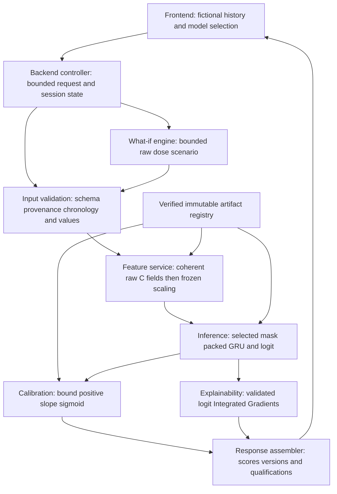

The frontend displays and edits synthetic case state. The backend controller owns request identity, validation and capability checks. These can be Python functions in Streamlit; a separate HTTP service is optional. Input validation distinguishes malformed values from unsupported features and never silently drops hours. The feature service is the only authority for deriving dynamics and scaling. Inference owns immutable model instances, feature masks and sequence lengths. Calibration consumes logits, not already-sigmoided probabilities. IG uses a separate gradient-enabled path. The what-if engine returns a new raw scenario through the same validation/preprocessing path, never directly patches a normalized tensor.

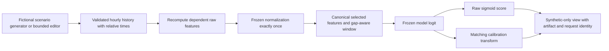

The presentation contract should use a single fictional stay and relative integer hour offsets, avoiding birth dates, names or hospital identifiers. It must still reproduce the research window and transition semantics. An endpoint after a missing-hour gap gets only its current consecutive segment, up to 24 hours. Precomputed dynamics may depend on a preceding raw hour outside the model window; preserve that context in the fixture service rather than invent a predecessor.

Every displayed result binds to a canonical request digest, selected arm, bundle version and computation status. Editing a history invalidates its old scores, explanations and scenario comparison. A slow explanation from a previous request must not overwrite a newer case. No mutable model weights or calibrator parameters are stored in session state.

**Verification/next:** freeze service contracts and synthetic equivalence cases before UI work. A layered design makes the same inference test usable under either frontend without duplicating scientific formulas.

<a id="chapter-28"></a>
## 28. Proposed technology decisions

**Status: PLANNED recommendation, not an installed stack.** Default to a **local Streamlit application with framework-independent Python services**. This is a project-specific engineering recommendation: the existing code is Python/PyTorch, the team needs a small research demonstration, and maintaining two runtimes would add work before the scientific deliverables are complete.

Streamlit runs a Python app with a rerun-based interaction model; forms can batch edits before submission. That suits a bounded fictional-history editor, provided expensive inference/explanations are triggered deliberately rather than on every edit. [Official Streamlit concepts](https://docs.streamlit.io/get-started/fundamentals/main-concepts).

React organizes UI into components with explicit state and data flow. It is a reasonable alternative for a richer independent frontend. FastAPI supplies typed request validation and API documentation support, but project-specific chronology, evidence and feature checks still need explicit code. [React design guidance](https://react.dev/learn/thinking-in-react), [FastAPI features](https://fastapi.tiangolo.com/features/).

| Decision | Streamlit + Python services | React + FastAPI |
|---|---|---|
| Initial effort | Smaller: one language/runtime and an in-process service boundary | Larger: frontend build, typed HTTP contracts, backend and cross-process error handling |
| UI control | Suitable forms, charts and small research workflows | More flexible component layout and interaction control |
| State risks | Reruns and cached results need careful request identity and invalidation | Browser/server state and asynchronous responses need coordinated versioning |
| Testing | Pure-service tests plus app interaction tests | Same service tests plus API contract and browser integration tests |
| Operations | One local process for the default single-user design | At least two development components or a reviewed bundled serving arrangement |
| Best fit here | Focused supervisor/viva demonstration | Explicit requirement for a richer application and sufficient team capacity |

Neither option confers data authorization, clinical validity or security by itself. The recommendation is not a claim that Streamlit is a production medical-device platform or that React is necessary for academic quality. Prefer standard existing plotting capabilities and a minimal new dependency set; package versions and a lock strategy must be selected and tested during implementation. No Streamlit, React, FastAPI, plotting or IG package is installed by this addendum.

Keep the initial runtime on CPU to match the existing production implementation. Train offline; load a frozen artifact once. Caching must bind immutable model/scaler objects to bundle hashes and isolate per-session histories/results. If React is chosen, keep FastAPI loopback-only by default, set explicit allowed origins, validate all request bodies and do not expose filesystem-path parameters.

**Decision gate:** supervisor/project lead confirms minimal demonstration scope; implementer records stack and resource estimate. Do not build both frontends. **Next:** implement reusable services first so choosing a frontend does not change scientific behavior.

<a id="chapter-29"></a>
## 29. Proposed future repository structure

**Status: PLANNED; none of the following paths is created by this task.** This tree is deliberately separate from the verified existing tree in [chapter 10](#chapter-10). Preserve current modules and import them through adapters. Adding root `sepsis_gru_v2_*.py` files would affect the production source-hash contract; avoid accidental expansion of that contract for UI-only work.

```text
demonstration/                         # PROPOSED code-only application package
  README.md                            # scope, reviewed local startup and fixture workflow
  app.py                               # default Streamlit frontend entry; not present yet
  pages/
    overview.py                        # study purpose, status and artifact information
    history.py                         # fictional fixture chooser and bounded editor
    prediction.py                      # selected arm, score and time-series view
    explanations.py                    # feature/time logit attribution display
    scenarios.py                       # coherent hypothetical input comparison
    limitations.py                     # target, data and non-causal interpretation
  services/
    contracts.py                       # typed input/output and bundle schema validation
    artifact_loader.py                 # trusted registry, hashes and strict model loading
    feature_adapter.py                 # reuse canonical definitions; derive before scaling
    sequence_adapter.py                # same-stay/gap reset and lengths parity
    inference.py                       # frozen forward path; no training/data-array access
    calibration.py                     # adapter to reviewed future calibration implementation
    explanations.py                    # adapter to reviewed future IG implementation
    scenarios.py                       # approved bounded scenario construction
  config/
    demo.example.json                  # non-sensitive example; no real paths or approvals
    bundle.schema.json                 # proposed artifact-contract schema
  fixtures/
    generate.py                        # deterministic fictional cases, no dataset sampling
    catalog.json                       # case descriptions, seeds and generator version
  tests/
    test_artifact_contract.py
    test_inference_parity.py
    test_temporal_history.py
    test_scenario_coherence.py
    test_explanation_contract.py
    test_demo_workflow.py
  backend/                             # ALTERNATIVE ONLY if React + FastAPI selected
    api.py                             # thin HTTP adapter over the same services
  frontend/                            # ALTERNATIVE ONLY; do not also build by default
    src/
      components/                      # history editor, score card and attribution charts
      pages/                           # same user workflows as the Streamlit proposal
      api/                             # typed request/response client
    package.json                       # future reviewed dependency/build metadata
```

This layout is a plan, not a new authoritative package architecture. Calibration/IG/scenario mathematics should have one reviewed implementation shared with research analysis; the app service files wrap it rather than creating competing formulas. That future shared location must be decided during R2C implementation. Do not refactor the existing repository merely to make it resemble this diagram.

Actual trained weights, bundle files, local artifact registry, logs and runtime output directories belong **outside Git and this synchronized workspace**, in an approved location. A synthetic-only distributable fixture may be committed after review; a model trained on credentialed data is not automatically safe to publish. A local `.example` configuration describes field names, not actual credentials or storage authorization.

**Verification/next:** review the selected subset of this structure, dependency lock and test discovery plan before creating files. Future paths in this chapter are intentionally not Markdown links because they do not exist. The existing source index remains a list of real files.

<a id="chapter-30"></a>
## 30. Post-training artifact packaging contract

**Status: PLANNED exporter/serving contract.** Current [production](sepsis_gru_v2_production.py) saves `best_model.pt` with `model_state_dict`, ordered `feature_names`, model settings, `best_epoch`, `validation_average_precision`, protocol/statistics/input-manifest hashes, `synthetic`, and `resumable=False`. It does not already produce a complete serving bundle. A resume checkpoint includes optimizer/RNG/training state and is not the application artifact.

The proposed package contains an immutable manifest, selected weights, exact canonical/selected feature lists, the unchanged frozen statistics, approved calibration parameters where available, inference semantics and software metadata. A separate approved registry identifies trusted package hashes. Hashes detect substitution relative to that trusted record; a self-generated manifest beside arbitrary weights is not authentication.

| Proposed manifest field/group | Required content and rejection rule |
|---|---|
| `schema_version`, `bundle_id` | Versioned schema and immutable package identity; unknown schema rejected |
| `experiment`, `selected_features`, `canonical_features` | One of six masks with exact names/order/dimension; reject mismatch even if tensor shape loads |
| `model` | GRU architecture, input count, hidden size 64, one layer and compatible head; strict state-dict loading |
| `sequence` | Maximum 24, right padding, true lengths and stay/gap reset; document preceding-context needs for dynamics |
| `input_representation` | Frozen-imputed unscaled V2-equivalent synthetic features; reject already-scaled or incomplete source-event input |
| `preprocessing` | Frozen statistics SHA-256, continuous/binary sets, train-only provenance reference; no serving-time refit |
| `checkpoint` | Relative package path, SHA-256, best epoch, source protocol/run identity and declared synthetic/research origin |
| `calibration` | State absent/validated; if validated, positive slope, intercept, fit procedure/version and matching checkpoint/validation provenance |
| `scenario_and_explanation` | Reviewed capability/configuration versions or unavailable; never enabled merely by an installed library |
| `software` | Source commit, approved dependency versions and runtime/device qualification |
| `release` | Intended local synthetic-input use, handling location and real approval reference when granted; not invented in templates |
| `files` | Allowed relative file names, sizes and SHA-256; reject traversal, unexpected files and incomplete packages |

An illustrative field list is not a generated manifest: no real bundle ID, trained weights, calibrator coefficients, approval reference or patient hash is populated here. Keep detailed private provenance in authorized storage. Public documentation can refer to a reviewed bundle release identifier; it should not expose extraction rows, validation predictions, identity lists, local user paths or secrets.

Packaging stages are: identify the validation-selected checkpoint; verify its run/protocol/statistics/mask identity; copy only permitted inference assets into a new staging directory; add the already-fitted matching calibrator; generate file hashes and manifest; compare direct-model and loaded-bundle outputs on deterministic fictional fixtures; then atomically publish the completed bundle in the approved artifact root. Never overwrite an existing release or select a checkpoint based on a demonstration's attractive output.

Final test metrics are not needed for loading a model. The formal research demonstration release follows the frozen evaluation/reporting process so the displayed study results are settled. Earlier engineering can use an explicitly synthetic model; neither mode may expose held-out patient predictions. Distribution of clinical-trained weights requires a separate artifact-handling decision even when UI inputs are fictional.

**Acceptance:** tampered, wrong-arm, wrong-statistics, partial and untrusted packages fail before inference. A missing calibrator disables calibrated output rather than substituting made-up coefficients. The original checkpoint remains untouched. No bundle-export command exists yet.


<a id="chapter-31"></a>
## 31. Model-serving implementation plan

**Status: PLANNED.** Serving should be a pure inference operation: no training, no clinical table access, no fitting statistics, and no automatic test-set evaluation. Initialize trusted artifacts at application startup, map weights to CPU, construct the existing GRU for the exact selected feature count, strictly load parameters and call evaluation mode. Follow the existing restricted weight-loading practice (`weights_only=True`) where compatible; do not load user-uploaded checkpoints or arbitrary serialized objects.

The proposed service accepts only internally generated fictional histories, optionally edited through bounded typed controls. It validates a single fixture-local stay, unique ordered whole-hour offsets, finite values, binary flags and exact required fields. Malformed or duplicate hours fail with a useful error rather than being silently dropped. A legitimate gap is preserved and resets the model sequence. Histories exceeding the fixture limit should be rejected or explicitly cropped under a documented rule, never silently consume unbounded memory.

The minimum demonstration does **not** reproduce BigQuery event processing from bedside measurements. Its input contract starts with fictional hourly values equivalent to the V2 frozen-imputed/unscaled representation. Do not label a text box accepting six vital signs as sufficient to reproduce all 22 A features. Missingness flags and laboratory age/availability semantics require a controlled fixture generator; the model itself does not impute raw nulls. Editing a base value keeps missingness semantics explicit and recomputes all dependent dynamics.

**Illustrative pseudocode — not an existing function or runnable command:**

```text
startup(trusted_registry_entry):
    bundle = verify_allowed_files_hashes_and_release(trusted_registry_entry)
    assert bundle.features == canonical_mask(bundle.experiment)
    model = existing_SepsisGRU(input_count, hidden_size=64)
    strictly_load_trusted_weights(model, bundle.checkpoint)
    model.eval()
    scaler = existing_FrozenV2Scaler(bundle.frozen_statistics)
    verify_matching_optional_calibrator(bundle)
    return immutable_service(model, scaler, bundle)

predict(registered_fixture, bounded_edits, selected_endpoint):
    raw_history = construct_fictional_history(registered_fixture, bounded_edits)
    validate_identity_order_hours_values_and_representation(raw_history)
    recompute_valid_transitions_and_dependent_C_features(raw_history)
    # Derive before cropping: the earliest window row may have a predecessor.
    segment = consecutive_same_stay_history_ending_at(selected_endpoint)
    raw_window = last_at_most_24_rows(segment)
    scaled = frozen_scale_once(raw_window, canonical_C_features)
    selected = select_ordered_mask(scaled, bundle.experiment)
    tensor, actual_length = right_pad_with_lengths(selected)
    with ordinary_inference_gradients_disabled:
        z = model(tensor, actual_length)
    assert finite(z)
    raw_score = stable_sigmoid(z)
    calibrated_score = stable_sigmoid(a*z+b) if validated_calibrator else absent
    return scores_with_request_digest_bundle_identity_and_synthetic_warning
```

Only score computation disables gradients. IG needs evaluation mode with gradients enabled on inputs, so a global inference-mode wrapper must not encompass the explanation path. Keep model parameters frozen; clear request-local gradient buffers. Failures must leave the service's immutable model state unchanged.

### Illustrative API contract, if the HTTP option is selected

No routes below currently exist. The in-process Streamlit implementation should use equivalent typed service calls rather than introduce HTTP solely for appearance.

| Proposed interface | Request | Response / behavior |
|---|---|---|
| `GET /v1/capabilities` | None | Available reviewed bundle IDs, supported fixture IDs, enabled analyses and input limits; no private paths |
| `POST /v1/predict` | Registered `fixture_id`, selected arm/bundle, relative endpoint hour and bounded edits | Raw score, optional calibrated score, true history length, canonical request digest, bundle identity and synthetic status |
| `POST /v1/explain` | Valid request identity and supported explanation configuration | Logit attribution matrix, feature/time labels, completeness residual and status |
| `POST /v1/scenario` | Valid baseline request plus an allowed scenario ID/parameter | Baseline/scenario results, dependent-field change summary and interpretation qualification |

Disallow extra fields such as uploaded file paths, SQL, subject IDs, patient names, model URLs or label overrides. A forged fixture ID or uncontrolled history payload must fail even if marked synthetic. Return no score on invalid input. Distinguish invalid request, unavailable capability, integrity failure and computation failure; the UI should explain the corrective action without a raw traceback or data values. For the HTTP alternative, choose explicit status codes and timeout behavior in its tested contract.

**Acceptance:** direct and wrapped logits agree within a predefined numerical tolerance on short/full/gapped fictional histories for all six masks. Reject double scaling, wrong feature order and wrong calibrator. Repeated identical requests are stable on the qualified CPU environment; different sessions do not share edited histories. No existing training authorization path is reused as a serving bypass.

<a id="chapter-32"></a>
## 32. Frontend development and user experience

**Status: PLANNED.** The application should explain a research workflow, not resemble an approved bedside monitor. Every page carries “Synthetic research demonstration — not for clinical decisions,” and identifies whether the loaded weights are synthetic engineering weights or an approved research artifact. Do not display patient names, admission numbers, real timestamps or a clinical alarm.

| Page / component | User task | Required behavior |
|---|---|---|
| Project overview | Understand the question and completed/planned work | Summarize retrospective target, six arms, status and reviewed artifact version; link limitations |
| Fictional history editor | Choose an internally generated scenario and inspect/edit allowed values | Relative hours, units, flags, gap markers and explicit Submit/Reset; no file upload or patient-record paste field |
| Model selector | Choose A/B/C or a supported ablation | Show exact feature count and artifact availability; do not offer an untrained arm as available |
| Prediction view | See the selected endpoint's model output | Raw/calibrated labels, history length, endpoint and bundle; never call raw output calibrated |
| Time-series view | Understand the preceding fictional history | Separate appropriate axes/units, visible gaps and missingness flags; distinguish imputed from fresh values |
| Explanation view | Inspect validated feature/time attributions | Signed/absolute views, reference description, logit units, completeness status; no causal importance label |
| Scenario comparison | Compare a permitted dose-input change | Before/after histories, dependent deltas/TRC, raw/calibrated differences and non-causal qualification |
| Limitations/artifact details | Assess what the display supports | Target coupling, retrospective availability, synthetic input origin, model provenance and unavailable capabilities |

A score card should say “model-estimated retrospective reference probability” when probabilities are shown, not “sepsis diagnosed” or “treatment needed.” If presenting a percentage difference, distinguish percentage points from relative percent. Do not invent low/medium/high risk thresholds or color-coded action recommendations. No claim of uncertainty intervals for an individual fictional prediction follows from the research's population-level bootstrap CIs.

Input widgets need units and finite numeric bounds appropriate to the reviewed fixture specification. Bounds are validation limits, not clinical treatment guidance. Error messages identify the field/rule and preserve safe edits. Derived fields such as TRC should be read-only displays; users manipulate allowed base inputs and the service recomputes dependents. Changing a fixture, endpoint or arm clears or visibly invalidates previous output until recalculation completes.

Provide keyboard navigation, readable labels, sufficient contrast and non-color cues for missingness or errors. Use explicit loading/error/empty states. Expensive IG requires an explicit action and bounded workload; ordinary page navigation should not recompute it. Show an unavailable explanation/calibration panel with its reason rather than fabricated content. Comparing arms requires the same fictional endpoint and history, with differences in selected feature masks made clear.

**Acceptance:** a new team member can complete the guided fictional scenario, identify the model/version and explain what the score does not mean. UI screenshots cannot contain clinical records. Content and accessibility review are separate from model accuracy claims.

<a id="chapter-33"></a>
## 33. Explainability integration

**Status: PLANNED; depends on validated research IG in [chapter 18](#chapter-18).** Integrate a single reviewed logit-attribution service; the UI must not implement a different explanation algorithm. Store the reference construction, integration rule, step policy and numerical tolerances with the analysis configuration and bind results to the checkpoint and request digest.

For a selected fictional endpoint, the service retrieves the exact inference tensor and length, uses the matching training-derived reference policy, and calculates feature-by-time IG with the model in evaluation mode. Padding remains excluded throughout integration and display. Keep missingness flags visible: a positive attribution on a missing flag is an association learned by the model, not proof a measurement was clinically unnecessary. Intermediate fractional binary values on the integration path are mathematical points, not valid patient records.

Recommended views are a signed time-by-feature heatmap, a ranked absolute-attribution bar chart, and a selected-feature time plot. Explain that absolute values show magnitude while signed values show direction relative to the reference. Aggregate physiology/lab/treatment/dynamic groups only using a declared sum or absolute-sum convention. Avoid renaming a heatmap “causes of sepsis.” The UI should state that it explains a **logit difference**, even if the adjacent prediction panel displays calibrated probability.

Completeness requires the attribution sum to approximate `f(x)-f(reference)` within the frozen numerical policy. Show the residual/status. On failure, mark the explanation unreliable and do not display it as verified; keep the prediction separate if its ordinary inference checks passed. Tests cover a known differentiable toy function, short sequences, full 24-hour histories, padding invariance, feature labels and output stability under repeated calls. Do not require any particular feature to rank highest; that would encode an unsupported clinical expectation.

Bound sample count/integration work and expose no arbitrary batch endpoint. For a presentation, a cached attribution is acceptable only if generated by the current verified bundle/configuration for the exact fictional fixture; label it cached and invalidate it on edits. A mock visualization without calculated attributions must be labeled a UI mockup and never passed off as an explanation.

**Next:** implement the research IG contract first, then the app adapter and visualization. Explainability is disabled until those acceptance tests pass.

<a id="chapter-34"></a>
## 34. Coherent counterfactual demonstration

**Status: PLANNED; uses the non-causal specification in [chapter 19](#chapter-19).** Call the UI “Hypothetical input scenario,” not “Optimize treatment.” It compares a frozen model's response to coherent fictional input changes. It must not recommend a medication, dose, escalation or withdrawal.

The default proposed scope is GRU-C with a positive recorded hourly NEeq value. Candidate changes of ±10% and ±25% remain subject to the analysis specification and supervisor scope confirmation; they are not already active application settings. Select an allowed hour and bounded scenario, check training-derived plausibility constraints without refitting them, and report when a scenario cannot be formed. Do not search dose changes to minimize predicted risk.

Construct a copy of the raw fictional history, change the selected dose, preserve the unedited case, and recalculate `vasopressor_active`, `delta_dose` and `treatment_response_interaction` for every affected valid transition, including the following hour. Keep gap resets and other flags coherent. If other base inputs are editable, recompute all their mathematical descendants too. An hour outside the displayed 24-row window may still affect a window-edge delta, so use the fixture's validated predecessor context before slicing. Do not invent a next-hour observation merely to show propagation.

Reapply the same frozen normalization once and use the same checkpoint and calibrator. The UI shows base changes, recomputed terms, baseline/scenario scores, and their arithmetic difference. It must explicitly say physiology was held fixed as an artificial model-input assumption. The underlying outcome labels are not modified; ordinary serving does not need labels at all.

For example, use the three-hour arithmetic in chapter 19 to show why changing the middle dose also changes the next delta/TRC. A coherent example does not need to show decreasing risk. Zero or opposite-direction score movement is legitimate. No monotonic-dose/risk assertion should appear in tests because the GRU is not constrained to learn one.

**Acceptance:** test unchanged-input identity, adjacent-hour propagation, gaps, window boundaries, positivity flags, bounds, once-only scaling and comparison on the same artifact. No causal language, recommendations or patient-level exports appear. Reject an incoherent or out-of-scope request rather than patch only TRC to obtain an attractive score.

<a id="chapter-35"></a>
## 35. Entirely fictional demonstration cases

**Status: PLANNED fixture library.** Construct cases from explicit rules and fixed generator seeds, never by sampling, perturbing, de-identifying or paraphrasing actual MIMIC-IV rows. Do not use a clinical patient record as a hidden template. Fixture provenance records generator version, seed, case purpose and content hash, with fictional relative-time identifiers such as a case slug rather than a numeric patient ID.

The generator should emit V2-equivalent hourly raw/imputed features with internally consistent flags and dynamics. It is not a replacement SQL reconstruction. For simple approved demonstrations, start with complete physiological/laboratory values and zero missingness flags. Separate missingness cases explicitly show a fictional observation schedule, the permitted carry/lookback behavior and fixed median fallback. Verify their transformations against the frozen semantics using synthetic tests. Bound raw ranges for software examples without implying that the selected values are clinical decision thresholds.

| Proposed case | Purpose | Required assertion, not a performance expectation |
|---|---|---|
| One completed hour | Shortest valid history | Length1; first-segment transition fields zero; padding ignored |
| Steady 24-hour history | Full history and simple chart | Length24; stable base features yield zero deltas where appropriate |
| Missing-hour gap | Temporal reset | Endpoint history excludes the earlier segment; no cross-gap delta |
| Missing fresh vital with permitted carry | Flags versus filled values | Missing flag remains1 while a carried/imputed value is finite |
| Laboratory arrival after an earlier endpoint | Availability explanation | Synthetic result appears only after its synthetic availability cutoff |
| Positive-dose middle-hour change | Scenario coherence | Recomputed current/following delta-dose and TRC match arithmetic |
| Antibiotic count sequence 0→1→2 | Dynamic feature interpretation | Consecutive initiation/addition/count-increase flags match frozen formulas |
| Invalid duplicate hour / nonfinite / bad flag | Failure demonstration | Rejected with no score; invalid cases cannot enter ordinary inference |
| Same valid history across six masks | Feature routing | Each arm receives its exact ordered subset and own matching artifact |

Do not name cases “true sepsis” or “healthy patient” to suggest adjudication. Fictional scenario labels, if needed for engineering tests, are not outcomes and cannot support accuracy/AP/calibration claims. Random synthetic-trained weights may produce arbitrary scores; label them accordingly. A fictional “deteriorating” input is not guaranteed to receive a higher score from a frozen model.

A reviewed small fixture catalog can be public code-only material. Actual trained artifacts and detailed private provenance remain separate. In the UI, retain the synthetic banner in screenshots, downloads and presentation slides. Prefer no file export initially; if later needed, allow only reviewed fictional inputs and outputs with version/qualification metadata.

**Acceptance:** deterministic regeneration matches recorded hashes, fixtures contain no real identifiers/timestamps, all valid cases satisfy the representation/transition contract and all invalid cases fail as intended. This task creates neither fixture files nor a patient-level exclusion mask.


<a id="chapter-36"></a>
## 36. Step-by-step system implementation and verification

**Status: every application development stage below is PLANNED.** Existing research software tests do not prove a web app works. Build services with fictional inputs before UI polish, and require each stage's acceptance evidence before enabling its capability. No application installation or startup command is source-verified yet, so none is presented as executable.

| Stage / role | Dependency and work | Acceptance evidence |
|---|---|---|
| S0 — project lead / supervisor | Confirm optional demonstrator scope, default stack, excluded clinical functionality and effort budget | Dated scope decision; training/evaluation priorities unchanged |
| S1 — inference engineer | Define typed request, bundle and response contracts; choose trusted local registry | Schema tests reject wrong masks, unknown fields, untrusted paths and incomplete artifacts |
| S2 — fixture owner | Implement deterministic fictional catalog and bounded edits | Hash-repeatability and feature/chronology tests; non-sensitive content review |
| S3 — inference engineer | Implement loader, canonical transformation, sequence adapter and raw inference | Direct-model parity for all six masks and lengths/gaps; immutable-state and failure tests |
| S4 — evaluation engineer | Complete research calibration/IG/scenario functions, then adapters | Existing research numerical tests plus checkpoint/config binding; unavailable features stay disabled |
| S5 — frontend owner | Implement minimal pages and stale-result handling around services | Guided synthetic workflow, accessibility check and no arbitrary input import |
| S6 — independent reviewer | Package a reviewed bundle and run complete local integration | Tamper rejection, restart/repeatability, resource measurements and privacy review |
| S7 — research lead | Rehearse with approved synthetic materials and freeze demonstration version | End-to-end script, fallback presentation and honest status/limitations |

S1–S3 and a UI skeleton can use a synthetic engineering artifact before real training. A formal research-artifact demonstration depends on the authorized trained model and later research analysis. S4 cannot be bypassed by inventing calibrator coefficients or random heatmaps. A reduced raw-score-only prototype may be shown only if its omitted capabilities and synthetic weights are explicit and the scope permits it.

### Focused test plan

Unit tests should exercise the contract rather than reproduce implementation line for line: reordered feature names with identical dimensions must fail; transformed inputs cannot be scaled twice; an unknown categorical/extra field must fail; a gap resets history; right padding cannot change the valid output; and a matching checkpoint/calibrator pair loads while a wrong hash/arm fails. Test extreme finite logits, missing calibrator behavior and finite output handling without constructing clinical examples.

Integration tests call the same service used by the UI and compare its logits to the existing GRU forward pass on identical tensors. Use a declared numerical tolerance based on the qualified device/dtype; do not assert cross-platform bitwise identity. Include all six masks, one-hour and 24-hour histories, a longer fixture requiring an explicit window crop, gaps and predecessor-dependent deltas. Check scalar-versus-batched inference where batching is implemented. Verify the service never loads clinical arrays or training labels to answer a prediction request.

Explanation tests require an independently understood toy function and completeness/masking tests; scenario tests require arithmetic expected deltas/TRC, not an expected probability direction. App tests cover submit/reset, model switching, stale asynchronous responses, disabled capabilities and sensitive error redaction. Two independent browser sessions must not share case edits or cached request results. Bound work so repeated clicks cannot queue unlimited IG jobs.

Before an application change is accepted, rerun the existing verified research command:

```text
python -B -m unittest discover -s tests -v
```

This covers the **current** root test suite only, with the archive/environment prerequisites in chapter 11. It does not discover future `demonstration/tests/` automatically. During implementation, add and verify a separate application test invocation and document its exact command in the future demo README and this chapter. Do not claim that the historical 119 passing tests include application coverage.

### Demonstrator troubleshooting

| Symptom | Safe diagnosis and resolution |
|---|---|
| Model will not load | Check trusted bundle identity, mask, architecture and file hashes; reject mismatch rather than load partially |
| Unexpected score versus direct Python call | Compare raw representation, once-only scaling, feature order, length and endpoint; use fictional parity fixtures |
| Calibrated score absent | Matching validated calibrator is unavailable; show raw-only status rather than identity or guessed calibration |
| Heatmap is blank or inconsistent | Check gradient-enabled IG path, actual lengths, reference and completeness; do not apply ordinary inference-mode context to IG |
| Changing middle dose leaves next delta unchanged | Scenario service failed to recompute dependents before windowing; block scenario output and fix with arithmetic regression |
| Old score persists after editing | Request digest/version or state invalidation is wrong; clear display and recompute |
| App feels slow | Measure fictional inference versus IG separately, bound work and cache immutable artifacts by hash; do not change the research architecture |
| A second user sees another case | Session/cache isolation defect; stop demonstration sharing until isolated-state tests pass |
| Startup appears to require cloud/data credentials | Scope violation: a frozen synthetic-input demonstrator should not query clinical sources; remove the dependency under review |
| A missing proposed path causes an error today | The app is not implemented; use current synthetic research CLI rather than inventing a startup command |

**Next:** after scope confirmation, create one focused implementation task at a time with acceptance evidence. No application code is implemented by this addendum.

<a id="chapter-37"></a>
## 37. Local demonstration and viva presentation

**Status: PLANNED operational procedure, not a current launch instruction.** After implementation, the demonstrator maintainer must supply a reviewed dependency lock, local-only startup entry point, shutdown procedure and exact tested commands. This handbook intentionally does not provide `streamlit run`, frontend build or API-server commands against nonexistent files. Tool syntax alone is not an implemented application.

Future local launch sequence:

1. Verify the approved code/demo release, qualified environment and clean intended configuration. Confirm no clinical records are present in the demonstration workspace.
2. Select a trusted permitted bundle from the approved artifact root; verify its hashes and declared synthetic/research origin before deserialization.
3. Run the documented research and application synthetic checks. Validate fictional fixture hashes and available capabilities.
4. Use the future tested launch command with loopback binding; confirm no public tunnel, cloud upload or unintended network exposure. Keep credentials out of environment dumps and browser output.
5. Open the local interface, verify the visible synthetic banner and bundle identity, then rehearse the selected fictional scenario. Stop the process with its documented shutdown procedure and clear request state.

Until that application exists, the verified software demonstration remains:

```text
python -B sepsis_gru_v2_production.py --demo --experiments A
```

This command demonstrates the research training infrastructure using temporary fictional data. It is **not** an application launcher, persistent model-package exporter or demonstration of clinical accuracy.

### Suggested presentation sequence

Begin with the research question and exact retrospective target. Show the end-to-end diagram, then explain that displayed histories are fictional. Select one case and identify the arm/feature count and artifact version. Walk through the completed hour, sequence length and score labeling. Show raw/calibrated output only if both are genuinely available; explain validation-only calibration.

Use a gap case to demonstrate sequence reset. If validated IG is available, explain a feature/time attribution relative to its reference and show the completeness status. Use the three-hour dose scenario to show recomputation of following-hour delta/TRC, and say explicitly that the changed score is not a treatment effect. Finish with frozen research results only if formally released, limitations and future work.

Distinguish research-result figures from application behavior: a smooth chart or fast local response is usability evidence, not predictive validity. If network access fails, the initial local design should not need clinical connectivity. If computation fails, use a reviewed prerecorded synthetic demonstration or screenshots carrying bundle/fixture/version labels; identify them as prerecorded, not a live successful run. If a capability is unfinished, say so and present its design rather than simulated evidence.

**Acceptance:** a teammate can reproduce the same fictional input and outputs under the specified release, explain the architecture and stop the service without assistance. The viva materials contain no patient records, actual patient identifiers or unapproved model outputs.

<a id="chapter-38"></a>
## 38. Security and deployment boundaries

**Status: PLANNED local demonstration controls; clinical deployment outside scope.** Existing research restrictions in [chapter 12](#chapter-12) remain in force. No frontend choice, local hostname or synthetic-input label authorizes access to clinical records or redistribution of clinical-trained artifacts.

Default to one user on a local loopback interface, no arbitrary uploads, no external database, no third-party analytics, no public tunnel and no model-download endpoint. Store only bounded session state, not a patient database. An artifact registry points to approved local files; a request cannot supply a path or URL. Verify the package before loading and refuse executable extensions or unexpected files. Use reviewed dependencies and size/time limits; model files are not trusted merely because their extension is `.pt`.

Logs should contain an opaque request identifier, bundle version, operation status and bounded timing, not history arrays, raw request bodies, filesystem paths, passwords or exception dumps. Show sanitized errors to the UI and keep any necessary diagnostic logs under the approved local handling policy. Do not collect true names/contact details for a demonstration. Clearing browser state does not delete any separate persisted logs; define both policies explicitly.

For supervised presentation, restrict access to the intended operator and protect the machine/session. If a multi-user or hosted demonstration is later requested, review authentication, authorization, session isolation, transport protection, origin controls, retention and artifact distribution before changing exposure. That is a separate decision, not a default extension of a local demo. Do not place restricted artifacts in GitHub, Codex or an ordinary synchronized drive because only fictional UI inputs are used.

Clinical deployment would require separate prospective validation, evidence of real-time availability, external/generalization assessment, workflow and human-factors evaluation, monitoring, incident response and applicable institutional/regulatory review. This handbook does not determine a regulatory classification or grant permission. The project has not demonstrated that acting on its scores benefits patients.

**Acceptance:** local exposure and logging are checked, arbitrary input/artifact routes are absent, and shared screenshots/fixtures are reviewed. The scope banner remains visible in every exported presentation artifact. No actual clinical decision support is enabled.

<a id="chapter-39"></a>
## 39. End-to-end research-to-system integration

**Status: PLANNED downstream integration over the existing research foundation.** This diagram connects the project without treating an attractive application as a replacement for scientific evaluation.

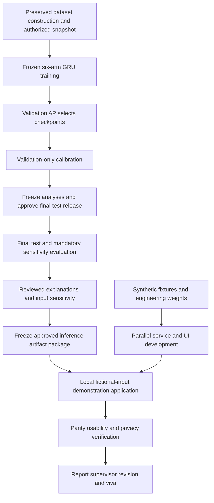

Model and calibrator parameters are frozen **before** final test performance is inspected. The later artifact-packaging step copies those fixed components and adds provenance; it does not refit or choose a more impressive model based on test or demonstration behavior. Likewise, explanation/scenario analysis policies are frozen before their applicable test use, as specified in chapters 16–19. Final results can reveal limitations without authorizing a new primary experiment.

Each boundary has a reviewable handoff: dataset to training is the authorized input/evidence protocol; training to analysis is the selected checkpoint and validation provenance; analysis to packaging is the frozen calibrator/configuration and released conclusions; packaging to app is the hash-bound trusted bundle; app to viva is the reproducible fictional fixture and verified presentation version. Keep private source evidence separate from public methodology summaries.

Build UI/service contracts in parallel using fictional fixtures if scope is confirmed, but retain honest status labels. A synthetic engineering bundle cannot be substituted into thesis performance tables. Conversely, a successful real training run does not automatically approve distributing its weights or enabling an app. The demo's model selector exposes only available reviewed bundles, not planned experiments labeled as complete.

The reproducibility appendix should distinguish three proofs: software parity on fictional cases; statistical evidence on governed held-out research data; and usability of the local demonstration. None is proof of clinical benefit. **Next:** use the stage checklist below to identify the next concrete task instead of expanding into hospital integration.

<a id="chapter-40"></a>
## 40. Returning-team system execution checklist

**Last reviewed: 2026-10-23. Application implementation status: PLANNED throughout.** This checklist complements [START HERE](#start-here); it does not replace the research training gates. No application task is marked complete merely because this design chapter exists.

| Stage | Present state | Owner role / next task | Completion evidence |
|---|---|---|---|
| System scope | PLANNED; supervisor requirement not established | Project lead confirms optional local demonstrator and exclusions | Versioned scope/stack decision |
| Research training foundation | IMPLEMENTED AND VERIFIED synthetically | Research engineer preserves current protocol/test evidence | Existing source/tests and qualified environment |
| Clinical execution and artifacts | BLOCKED — AUTHORIZATION OR RESOURCE | Custodian/lead resolves snapshot, statistics, storage and execution gates | Approved evidence, completed runs, reviewed artifact handling |
| Fictional fixtures | PLANNED | Fixture owner implements catalog/generator and bounded edits | Deterministic hashes, temporal/feature assertions, privacy review |
| Serving contract/loader | PLANNED | Inference engineer implements trusted package validation | Tamper/wrong-mask/partial-package rejection tests |
| Raw inference service | PLANNED | Inference engineer reuses model/scaler and sequence semantics | Six-mask direct-model parity and isolation tests |
| Calibration/final evaluation | PLANNED | Evaluation engineer completes separately approved R2C work | Frozen fit/provenance, governed final test results |
| IG/scenario services | PLANNED | Analysis engineer implements validated shared algorithms | Completeness, masking and dependent-feature tests |
| Frontend | PLANNED | UI owner builds selected minimal stack | Guided synthetic workflow and stale-state/accessibility tests |
| Bundle and app integration | PLANNED | Independent reviewer checks binding and outputs | Reviewed local release, resource/parity/security results |
| Presentation | PLANNED | Research lead rehearses with safe fictional examples | Reproducible script, versioned slides and honest fallback |

### Resume after weeks or months

- [ ] Read current handbook date and [project decision tree](#next-action); compare Git HEAD without overwriting local changes.
- [ ] Determine whether the demonstrator was actually approved as a deliverable and which stack was selected. Do not build the alternative stack by assumption.
- [ ] Check which proposed paths in chapter 29 now exist, then read their actual source and verified README commands. Until then, treat the tree as a proposal.
- [ ] Verify whether a trusted bundle is synthetic engineering or an authorized research artifact; check hashes and matching calibrator/configuration.
- [ ] Run the existing research synthetic suite and the subsequently documented app suite in a qualified environment. Historical test counts do not certify new app code.
- [ ] Select the first incomplete stage whose dependencies are satisfied; assign one owner and concrete acceptance tests.
- [ ] Leave unavailable panels disabled. Do not turn missing analysis into fabricated graphics or bypass protocol states.
- [ ] After review, update this table, START HERE, the roadmap, source index and exact startup/test commands together.

**Current next system action:** confirm the optional demonstrator scope/default Streamlit stack and assign an owner. **Current next overall project action remains** the preservation/authorized-execution decision in START HERE. Do not let UI work delay preservation of the expiring data objects or the frozen primary research.

<a id="open-questions"></a>
## Open Questions / Evidence Gaps

These are bounded evidence or implementation gaps, not instructions to reopen completed routine source investigations.

| Issue | Evidence and disposition | Smallest next action |
|---|---|---|
| Reported supervisor support versus frozen document states | Conversation/Step 83 acknowledges verbal support; freeze, supervisor package and execution-v2 still carry pending/draft states | Record genuine version-bound approval separately; retain historical records and require distinct execution authorization |
| Historic readiness text versus current software | Step 62/readiness-v1 describes earlier checkpoint/test behavior; R2A now provides epoch resume and rejects test evaluation | Follow current code/R2A/runbook; do not reuse obsolete optional test-switch or inference-only resume claims |
| R2B proposed scripts versus completed aggregate investigations | Proposal manifest remains a historical NOT EXECUTED preparation record; closure records subsequently supplied authorized results | Link closure to actual execution job IDs when supplied; do not invent IDs or rewrite the proposal retrospectively |
| Reversed antibiotic intervals | An earlier handoff explanation overstated what the overlap predicate rejects; synthetic counterexamples exist, but audited current-source V2 feature impact was zero | Preserve baseline and qualified closure; no correction is indicated by current evidence |
| Source overlap and signature collapse | Repeated intervals/signatures can reflect combined exposures or source construction; diagnostic differences do not prove invalid dose | Keep baseline provisionally; conditional common-cohort sensitivity requires a separate justified rule and authorization |
| Historical table-version equivalence | SQL/ZIP hashes and recorded COPY relationships do not authenticate every historical source state; timeline `@0` COPY is reported evidence | State limitation, retain available job/version evidence; do not claim exact equivalence from current-source replay |
| Official derived concepts | Public comparison commit is recorded, but official concept source is not vendored as historical deployed DDL | Cite recorded review carefully; do not invent raw item mappings or deployment correspondence |
| Physical schemas and units | Preserved construction SQL supports projected fields/types; live schema exports and complete upstream unit evidence are not independently authenticated here | Verify required schema/units against authorized snapshot evidence during input preparation |
| Training-statistics provenance | File hash is verified; hash alone does not establish same-population train-only derivation | Bind existing immutable statistics to the chosen training snapshot using authorized evidence; no silent recomputation |
| Four recovery ZIPs missing from fresh clone | They are present locally but ignored/untracked; one complete-suite provenance test depends on them | Arrange reviewed non-sensitive archive handoff or a separately authorized packaging fix |
| Dependency reproducibility | Historical runtime versions are recorded; no complete dependency lock/installation artifact set exists | Freeze a verified environment before the first clinical run |
| Machine-readable dependency inventory | Some backtick-token extraction in optimized source metadata includes projected column names as apparent references | Use actual FROM/JOIN clauses and chapter 6 for lineage; do not treat every token as a table |
| Old experiment suggestions | Earlier handoff contains exploratory ablation ideas beyond the frozen six | Use the six-mask freeze/ablations file; extra arms need explicit separate scope |
| Retention context | Billing-disabled state, 6.03 GiB and twelve December expirations are supplied reports, not live account checks | Authorized custodian confirms current object/retention status and selects preservation before expiry |
| Final evaluation and interpretation tooling | Calibration, clustered CIs, IG and coherent perturbations are specified but absent as complete executable workflows | Implement narrowly under later approval, synthetic-test, freeze before final test release |
| Compute acceleration | Current production is CPU-only; supported hosted/GPU environment and adaptation are not established | Decide authorized compute, benchmark synthetically and review any device change separately |
| Proposed application scope and implementation | Part VI is a design only; no frontend/backend, serving bundle exporter or application tests exist | Confirm optional deliverable, then implement shared services with fictional fixtures under separate authorization |
| Clinical results and formal bibliography | No V2 clinical model results exist; publication references still need verification | Train only after gates; verify references before submission without inventing performance or citations |

<a id="maintenance"></a>
## Verification and maintenance

**This edition is a documentation-only team-review draft.** Only `SEPSIS_GRU_V2_MASTER_HANDBOOK.md` is created/edited. No code, SQL, tests, configurations, statistics, historical records or approval states are changed. No BigQuery query, clinical-data access, real training, package installation, commit or remote operation is performed.

Local verification inspected 68 tracked files, the SQL members of both tracked archives, the four locally retained recovery archives and their preserved counterparts. It checked archive integrity and recorded hashes, execution-v2 source bindings, source/CLI consistency, the chapter and link structure, and content sensitivity. Current synthetic commands are documented against source; the historical 119-test result and Step 81 demo are identified as historical. The test suite is not rerun merely to create this documentation.

Markdown links and diagram structure are checked locally. Mermaid diagrams use standard GitHub flowchart syntax; renderer-level GitHub visual validation remains a team-review step because no renderer is installed or package added during this task. Review the rendered page before publication. Do not interpret static structure checks as a screenshot-confirmed rendering result.

### Initial edition verification record — 2026-10-23 (before Part VI)

- 25 numbered chapters; approximately 19,600 whitespace-delimited words.
- 234 relative/internal links resolve; explicit anchors are unique; code fences balance; all 20 tables have consistent column counts.
- Nine Mermaid flowcharts pass local node-reference, edge and delimiter checks; GitHub visual rendering remains unverified.
- Six ZIP integrity checks pass; four recovery archive hashes and all 20 preserved SQL/manifest member hashes and byte comparisons pass.
- Eleven execution-v2 source hashes and 21 proposed-diagnostic manifest hashes match local files.
- All 68 tracked files match HEAD byte-for-byte. Ordinary Git status is clean because this new handbook is ignored by the existing allowlist; it is not staged or committed.
- Content review and focused secret/identifier/path pattern screening found no restricted records, credentials or personal local paths. Aggregate evidence retains its supplied qualifications.
- No software tests were rerun for this documentation-only task; the 119-test inventory matches the recorded historical suite.

### Addendum verification record — 2026-10-23

Version 1.1 preserves the 25 research chapters and adds Part VI with 15 proposed system-development chapters: **40 chapters and approximately 27,900 words** overall. The table of contents, START HERE, next-action tree, roadmap and source index include the new phase. Every application chapter explicitly marks implementation as PLANNED; no proposed application path is represented as an existing link or verified startup command.

Local checks passed for 276 relative/internal links, unique anchors, balanced code fences, all 29 tables and structural node/edge/delimiter checks on 12 Mermaid diagrams. Six external links refer to three official technology documentation pages inspected for the stack comparison. Renderer-level GitHub visual verification remains pending; no package was installed to render diagrams.

All 68 tracked source files remain byte-identical to HEAD. Only this handbook was edited; it remains ignored by the existing allowlist, unstaged and uncommitted. No tests, clinical queries, training, protocol changes or remote publication were performed. Focused sensitive-content screening and review found no patient records/identifiers, credentials or personal local paths. Future artifacts and fixtures are specifications only.

Remaining application gaps are optional scope confirmation, stack/dependency qualification, trusted bundle exporter/loader, shared inference and analysis adapters, fictional fixture generation, UI and application tests, verified local startup commands and artifact-handling approval. These are separate from the still-pending authorized research inputs/execution and final-analysis work. The handbook is ready for team design review, not application execution.

### How to keep the handbook current

After each approved milestone, update the top version/date/source commit, START HERE status/next action, decision tree if needed, chapter status, roadmap checkbox and gap disposition together. If the demonstrator is in scope, also update chapter 40, the actual-versus-proposed file inventory, available bundle/capability status and verified application startup/test commands. Add the evidence reference and reviewer role. Link to a new protocol/decision record instead of silently rewriting original scientific or approval documents. An experiment is complete only when its artifacts and acceptance checks are reviewed, not when a command was launched.

Before releasing an update:

1. Compare against current code, manifests, protocol and actual approved evidence; check that all six feature dimensions and frozen parameters agree.
2. Recheck every relative link and explicit internal anchor, balanced code fences and Mermaid diagrams in GitHub preview.
3. Verify command flags against the CLI; label authorized placeholders and synthetic examples clearly.
4. Recheck privacy: no patient records/identifiers, credentials, sensitive environment paths or unreviewed model outputs.
5. Review Git changes and explicitly stage only intended non-sensitive documentation if separately authorized. This edition remains uncommitted for the project owner's review.
6. Record new test/run results accurately without replacing historical evidence with unverified claims.

If instructions and current implementation diverge, stop the affected operation, record a bounded discrepancy and identify the smallest correction. Do not use a handbook sentence to bypass a software or authorization gate. The practical next destination is [START HERE](#start-here), followed by the [GRU-A chapter](#chapter-14) once its prerequisites are satisfied.
