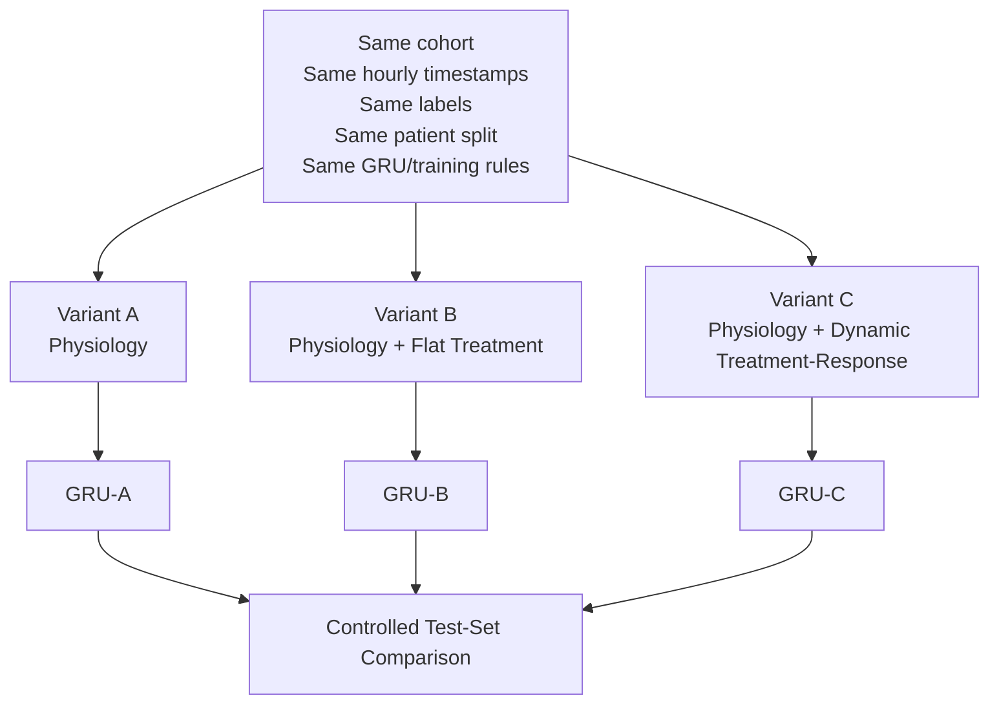
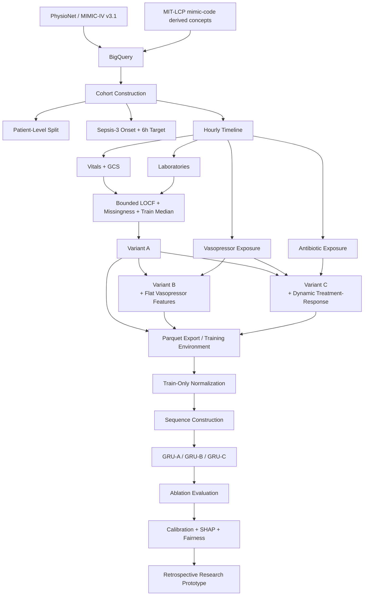
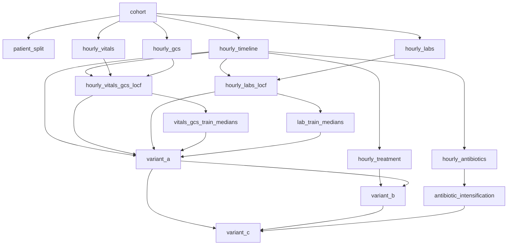

# Treatment-Response Coupling in GRU-Based Sepsis Prediction
## Master Project Roadmap, Progress Tracker, and Team Execution Guide

> **Project status date:** 13 August 2026  
> **Document role:** Single working guide for the project team  
> **Current major milestone:** Data retrieval, cohort construction, preprocessing, and construction/auditing of Variants A, B, and C are complete. Model-training preparation is next.

---

## Table of Contents

1. [How to Use This Guide](#1-how-to-use-this-guide)
2. [One-Page Executive Summary](#2-one-page-executive-summary)
3. [Project Overview](#3-project-overview)
4. [Why This Research Topic](#4-why-this-research-topic)
5. [Research Question and Experimental Logic](#5-research-question-and-experimental-logic)
6. [End-to-End Project Architecture](#6-end-to-end-project-architecture)
7. [Current Project Status](#7-current-project-status)
8. [Data Source and Data Discovery](#8-data-source-and-data-discovery)
9. [BigQuery as the Data-Engineering Workspace](#9-bigquery-as-the-data-engineering-workspace)
10. [Cohort Construction](#10-cohort-construction)
11. [Sepsis-3 Target Construction](#11-sepsis-3-target-construction)
12. [Patient-Level Data Split](#12-patient-level-data-split)
13. [Hourly Timeline Construction](#13-hourly-timeline-construction)
14. [Physiological Feature Extraction](#14-physiological-feature-extraction)
15. [Laboratory Feature Extraction](#15-laboratory-feature-extraction)
16. [Missing-Data Engineering](#16-missing-data-engineering)
17. [Variant A — Physiological Baseline](#17-variant-a--physiological-baseline)
18. [Variant B — Flat Treatment Baseline](#18-variant-b--flat-treatment-baseline)
19. [Variant C — Dynamic Treatment-Response Model Input](#19-variant-c--dynamic-treatment-response-model-input)
20. [Dataset Integrity Audits](#20-dataset-integrity-audits)
21. [BigQuery Table Manifest and Lineage](#21-bigquery-table-manifest-and-lineage)
22. [Feature Dictionary](#22-feature-dictionary)
23. [Important Research Decisions and Corrections](#23-important-research-decisions-and-corrections)
24. [What Is Complete vs. What Is Not Complete](#24-what-is-complete-vs-what-is-not-complete)
25. [What We Do Next — Detailed Execution Plan](#25-what-we-do-next--detailed-execution-plan)
26. [Phase 1 Next — Synchronize Methodology Figures](#26-phase-1-next--synchronize-methodology-figures)
27. [Phase 2 Next — Freeze and Version the Datasets](#27-phase-2-next--freeze-and-version-the-datasets)
28. [Phase 3 Next — Export BigQuery Data for Training](#28-phase-3-next--export-bigquery-data-for-training)
29. [Phase 4 Next — Training-Only Normalization](#29-phase-4-next--training-only-normalization)
30. [Phase 5 Next — GRU Sequence Construction](#30-phase-5-next--gru-sequence-construction)
31. [Phase 6 Next — Finalize the GRU Experiment](#31-phase-6-next--finalize-the-gru-experiment)
32. [Phase 7 Next — Train GRU-A, GRU-B, GRU-C](#32-phase-7-next--train-gru-a-gru-b-gru-c)
33. [Phase 8 Next — Final Evaluation and Ablation Analysis](#33-phase-8-next--final-evaluation-and-ablation-analysis)
34. [Phase 9 Next — Statistical Uncertainty](#34-phase-9-next--statistical-uncertainty)
35. [Phase 10 Next — Probability Calibration](#35-phase-10-next--probability-calibration)
36. [Phase 11 Next — Explainability](#36-phase-11-next--explainability)
37. [Phase 12 Next — Fairness Evaluation](#37-phase-12-next--fairness-evaluation)
38. [Phase 13 Next — Error Analysis and Robustness](#38-phase-13-next--error-analysis-and-robustness)
39. [Phase 14 Next — Prototype System](#39-phase-14-next--prototype-system)
40. [Team Workstreams and Learning Guide](#40-team-workstreams-and-learning-guide)
41. [Progress Estimate](#41-progress-estimate)
42. [Critical Leakage and Validity Rules](#42-critical-leakage-and-validity-rules)
43. [Risks and Mitigations](#43-risks-and-mitigations)
44. [Reproducibility Checklist](#44-reproducibility-checklist)
45. [Thesis and Defense Deliverables](#45-thesis-and-defense-deliverables)
46. [GitHub and MIMIC-IV Data Safety](#46-github-and-mimic-iv-data-safety)
47. [Master Chronological Checklist](#47-master-chronological-checklist)
48. [References](#48-references)
49. [Change Log](#49-change-log)

---

# 1. How to Use This Guide

This document is intended to be the **single project-level roadmap** for the team.

A team member should be able to use it to answer four questions:

1. **What exactly is our research project?**
2. **What have we already completed?**
3. **Why did we make each important methodological decision?**
4. **What should we do next, and how do we know that step is complete?**

### Status labels used in this document

- ✅ **Completed** — implemented and checked.
- 🟡 **Planned / next** — agreed direction but not yet implemented.
- ⚠️ **Decision gate** — must be resolved before moving further.
- 🔍 **Exploratory/audit context** — useful check performed during development, but not necessarily a final model feature or thesis result.
- ❌ **Rejected** — considered previously but deliberately removed.

> [!IMPORTANT]
> If an older chat message, old figure, old proposal sentence, or old note conflicts with the finalized implementation described here, **use this guide together with the actual frozen BigQuery tables and version-controlled SQL as the source of truth**.

### Source-of-truth priority

1. **Frozen BigQuery tables + verified audit results**
2. **Version-controlled SQL/Python code**
3. **This roadmap**
4. **Updated thesis methodology**
5. Older exploratory notes/chats

---

# 2. One-Page Executive Summary

## Project title

**Treatment-Response Coupling in GRU-Based Sepsis Prediction: A Calibrated, Explainable, and Counterfactual Framework**

## Core research idea

Standard sepsis prediction models often use physiological measurements such as heart rate, blood pressure, oxygen saturation, GCS, and laboratory values. Some treatment-aware approaches additionally include treatment information as flat variables such as:

- vasopressor present = 1
- vasopressor dose = 0.1

The research question in this project is whether it is more useful to explicitly represent **how treatment changes and physiology changes together over time**.

The project therefore uses a controlled three-variant experiment:

| Variant | Purpose | Input representation |
|---|---|---|
| **A** | Physiological baseline | Vitals + GCS + labs + missingness indicators |
| **B** | Flat treatment baseline | Variant A + norepinephrine-equivalent dose + vasopressor-active flag |
| **C** | Proposed dynamic representation | Variant A + $\Delta MAP$ + $\Delta Dose$ + $TRC$ + antibiotic intensification |

> [!IMPORTANT]
> **Variant C is not Variant B plus extra features.**  
> Variant B and Variant C are two alternative treatment representations built on the same Variant A physiological baseline.

## Current completed dataset

The current hourly modeling timeline contains:

| Quantity | Final value |
|---|---:|
| Hourly rows | **4,169,659** |
| ICU stays | **59,662** |
| Unique patients | **46,494** |
| Positive 6-hour-ahead rows | **48,330** |
| Negative rows | **4,121,329** |
| Positive hourly rate | **≈ 1.16%** |

## Patient-level split

| Split | Patients | Approx. % | ICU stays |
|---|---:|---:|---:|
| Train | **32,500** | **69.9%** | **41,724** |
| Validation | **6,929** | **14.9%** | **8,875** |
| Test | **7,065** | **15.2%** | **9,063** |

The split was made by `subject_id`, so one patient's ICU stays cannot appear in multiple subsets.

## Current milestone

### Completed

- [x] MIMIC-IV v3.1 access and exploration
- [x] BigQuery project/dataset workflow
- [x] Adult ICU cohort construction
- [x] Sepsis-3 onset linkage
- [x] Exclusion of unusable/pre-admission onset timeline cases
- [x] Patient-level train/validation/test split
- [x] 1-hour modeling timeline
- [x] 6-hour-ahead labels
- [x] Vital extraction
- [x] GCS extraction
- [x] Laboratory extraction
- [x] Bounded LOCF
- [x] Missingness indicators
- [x] Training-only median imputation
- [x] Variant A construction and audit
- [x] Hourly norepinephrine-equivalent treatment construction
- [x] Variant B construction and audit
- [x] Dynamic $\Delta MAP$, $\Delta Dose$, and $TRC$ design
- [x] Antibiotic-intensification construction
- [x] Variant C construction and audit
- [x] Methodology text revised to match implementation

### Next

- [ ] Update methodology figures
- [ ] Freeze/version table schemas and manifest
- [ ] Export A/B/C from BigQuery to private Parquet storage
- [ ] Compute training-only normalization statistics
- [ ] Build GRU sequences
- [ ] Finalize identical GRU architecture/training configuration
- [ ] Train A, B, and C
- [ ] Evaluate controlled ablation
- [ ] Calibration
- [ ] SHAP
- [ ] Fairness
- [ ] Error/robustness analysis
- [ ] PostgreSQL/FastAPI/React retrospective prototype
- [ ] Final thesis and defense

---

# 3. Project Overview

Sepsis is a life-threatening condition associated with organ dysfunction caused by a dysregulated response to infection. Sepsis-3 operationalizes organ dysfunction using an acute SOFA-score increase of at least two points.

Our project is a **retrospective clinical machine-learning research project** using MIMIC-IV v3.1.

The system is designed to predict whether a patient's Sepsis-3 onset will occur in the **next six hours** at each hourly point in an ICU trajectory.

The project has two broad goals:

### Research goal

Evaluate whether **dynamic treatment-response representation** improves GRU-based sepsis prediction compared with:

1. physiology without treatment information, and
2. flat treatment information.

### Engineering goal

Build a reproducible pipeline covering:

```text
MIMIC-IV
    ↓
Cohort and labels
    ↓
Hourly feature engineering
    ↓
A/B/C ablation datasets
    ↓
GRU training
    ↓
Evaluation
    ↓
Calibration + Explainability + Fairness
    ↓
Retrospective research dashboard
```

The project is **not** intended to produce a clinically deployable treatment recommendation system.

---

# 4. Why This Research Topic

## 4.1 Why sepsis prediction?

A major limitation of threshold-based clinical scoring is that it can become informative only after measurable deterioration has already occurred. A time-series model can instead use evolving patterns across multiple hours.

## 4.2 Why use temporal EHR data?

ICU patients are observed repeatedly. Their state is not one static row.

A simplified trajectory is:

```text
Hour 1 → HR 86, MAP 77, SpO2 97, ...
Hour 2 → HR 92, MAP 72, SpO2 96, ...
Hour 3 → HR 105, MAP 65, SpO2 94, ...
...
```

The order and trend can matter.

## 4.3 Why GRU?

A Gated Recurrent Unit is designed for sequential input. It maintains a hidden state across timesteps and can learn temporal dependencies while using gating mechanisms to control what previous information is retained.

The project uses the **same GRU family for A/B/C** so that the experiment tests the **input representation**, not different model families.

## 4.4 Why treatments matter

Suppose two patients both have a MAP of 65 mmHg.

- Patient 1 reaches MAP 65 without vasopressors.
- Patient 2 reaches MAP 65 while receiving a large or increasing vasopressor dose.

The physiological value is numerically similar, but the clinical context is different.

A flat treatment variable can tell the model that treatment exists, but it does not explicitly summarize the relationship between treatment adjustment and physiological movement.

This motivates Variant C.

---

# 5. Research Question and Experimental Logic

## Primary experimental question

**Does dynamic treatment-response representation provide predictive value beyond both physiology-only and flat-treatment baselines for six-hour-ahead Sepsis-3 prediction?**

## Controlled ablation



The comparison is valid only if the following remain fixed:

- cohort,
- patient split,
- hourly timeline,
- labels,
- common physiological preprocessing,
- GRU architecture,
- training procedure,
- random-seed policy,
- evaluation protocol.

Only the intended input representation should differ.

---

# 6. End-to-End Project Architecture



---

# 7. Current Project Status

## Phase-level tracker

| Phase | Status | Notes |
|---|---|---|
| Research framing | ✅ Completed for current stage | Research question and A/B/C logic defined |
| Data access and exploration | ✅ Completed | MIMIC-IV v3.1 explored in BigQuery |
| Cohort + Sepsis labels | ✅ Completed | Final cohort and target validated |
| Hourly feature engineering | ✅ Completed | Vitals, labs, GCS, treatments aligned |
| Missing-data preprocessing | ✅ Completed | Bounded LOCF + indicators + train medians |
| Variant A construction | ✅ Completed | Audited |
| Variant B construction | ✅ Completed | Audited |
| Variant C construction | ✅ Completed | Audited |
| Methodology text synchronization | ✅ Mostly completed | Figure synchronization still pending |
| Dataset export | 🟡 Next | BigQuery → private Parquet |
| Normalization | 🟡 Next | Must be training-only |
| Sequence/DataLoader pipeline | 🟡 Next | Strategy must be finalized |
| GRU training | ⬜ Not started | A/B/C |
| Final evaluation | ⬜ Not started | Test set remains untouched for final use |
| Calibration | ⬜ Not started | Selected model |
| SHAP | ⬜ Not started | Selected model |
| Fairness | ⬜ Not started | Selected model |
| Prototype | ⬜ Not started | PostgreSQL/FastAPI/React |
| Final thesis/defense | ⬜ Not complete | Continues throughout project |

---

# 8. Data Source and Data Discovery

## 8.1 Dataset

The project uses **MIMIC-IV v3.1**, a de-identified EHR dataset distributed through PhysioNet.

MIMIC-IV v3.1 is accessible to credentialed users and is available through BigQuery.

## 8.2 Why MIMIC-IV?

MIMIC-IV provides the kinds of longitudinal ICU information needed for this project:

- ICU stays,
- repeated bedside physiological measurements,
- laboratory results,
- medication/treatment records,
- demographic information,
- derived clinical concepts.

## 8.3 Role of MIT-LCP mimic-code

Rather than recreate every clinical concept manually, the project uses validated/shared MIMIC derived concepts where possible.

This was especially important for:

- Sepsis-3 onset,
- vitals,
- GCS,
- laboratory groups,
- norepinephrine-equivalent dose,
- antibiotics.

> [!NOTE]
> The thesis may describe the underlying raw domains such as `chartevents`, `labevents`, and `inputevents`, but the **actual implementation frequently queried MIMIC-IV derived concept tables** built from those raw domains.

## 8.4 Important actual derived sources used during implementation

The implementation used or inspected sources including:

```text
physionet-data.mimiciv_3_1_derived.vitalsign
physionet-data.mimiciv_3_1_derived.gcs
physionet-data.mimiciv_3_1_derived.chemistry
physionet-data.mimiciv_3_1_derived.complete_blood_count
physionet-data.mimiciv_3_1_derived.enzyme
physionet-data.mimiciv_3_1_derived.bg
physionet-data.mimiciv_3_1_derived.norepinephrine_equivalent_dose
physionet-data.mimiciv_3_1_derived.antibiotic
```

Sepsis-3 operationalization is tied to the MIT-LCP derived Sepsis-3 concept.

---

# 9. BigQuery as the Data-Engineering Workspace

BigQuery was used because the original MIMIC tables and derived concepts are large and relational.

The workflow was:

```text
MIMIC-IV in BigQuery
        ↓
Inspect schemas
        ↓
Prototype queries on individual stays
        ↓
Validate timestamps and measurement frequency
        ↓
Create permanent project tables
        ↓
Audit every major transformation
```

The team's working project dataset is:

```text
sepsis-gru-mimic.sepsis_gru
```

BigQuery is the **data-engineering environment**, not the final GRU-training runtime.

Later:

```text
BigQuery
   ↓
Parquet export
   ↓
Python / PyTorch
   ↓
GRU training
```

---

# 10. Cohort Construction

## 10.1 Initial eligibility logic

The methodology restricts the modeling population to:

- adult patients,
- age ≥ 18,
- ICU stays exceeding 24 hours.

## 10.2 Exploratory cohort counts

An earlier eligibility audit produced:

| Category | Count |
|---|---:|
| Initially eligible ICU stays | **75,672** |
| Sepsis-3 positive among eligible stays | **29,779** |
| Non-sepsis stays | **45,893** |

The important modeling issue was the **timing of sepsis relative to ICU admission**.

If sepsis onset is at or before the beginning of the usable ICU prediction timeline, the model cannot meaningfully perform pre-onset early warning from ICU history.

After temporal eligibility filtering, the final modeling cohort became:

| Category | Final count |
|---|---:|
| Final ICU stays | **59,662** |
| Post-admission sepsis-positive stays | **13,769** |
| Non-sepsis stays | **45,893** |
| Unique patients | **46,494** |

Thus:

$$
13{,}769 + 45{,}893 = 59{,}662
$$

## 10.3 Exploratory onset-timing check

Among the 13,769 usable post-admission sepsis stays, an exploratory check found:

| Onset timing | Stays |
|---|---:|
| Onset under 6 hours after ICU entry | **9,674** |
| Onset at or after 6 hours | **4,095** |
| Total | **13,769** |

This explains why many septic stays contribute fewer than six positive hourly labels.

> [!NOTE]
> These onset-timing counts are an exploratory validation of label behavior, not an additional train/test split.

---

# 11. Sepsis-3 Target Construction

## 11.1 Sepsis-3

The project relies on the MIMIC implementation of Sepsis-3 onset, which combines suspected infection with SOFA-based organ dysfunction.

The clinical Sepsis-3 definition describes organ dysfunction as an acute SOFA increase of at least two points.

## 11.2 Prediction target

At each modeled hour $t$, the task is:

> **Will Sepsis-3 onset occur after the current hour and within the next six hours?**

The hourly label is:

$$
Y_t =
\begin{cases}
1, & 0 < T_{\text{sepsis}} - t \le 6 \text{ hours} \\
0, & \text{otherwise}
\end{cases}
$$

## 11.3 Leakage prevention

For septic stays, the retained timeline stops before onset.

A timestep at or after the sepsis event is not used to predict that same event.

> [!IMPORTANT]
> No post-onset measurement may enter a pre-onset prediction example.

## 11.4 Final hourly target counts

| Label | Count |
|---|---:|
| Positive (`sepsis_next_6h = 1`) | **48,330** |
| Negative (`sepsis_next_6h = 0`) | **4,121,329** |
| Total | **4,169,659** |

The positive-row rate is approximately:

$$
\frac{48{,}330}{4{,}169{,}659} \times 100 \approx 1.16\%
$$

This is a **highly imbalanced hourly classification task**.

## 11.5 Positive-hour sanity check

For each of the 13,769 septic stays, the number of positive hours was audited:

| Positive hours before onset | Sepsis stays |
|---:|---:|
| 1 | 2,681 |
| 2 | 3,264 |
| 3 | 1,689 |
| 4 | 1,037 |
| 5 | 682 |
| 6 | 4,416 |
| **Total** | **13,769** |

Every septic stay had at least one positive prediction hour and no stay had more than six, matching the target design.

---

# 12. Patient-Level Data Split

## 12.1 Why split by patient?

A patient may have multiple ICU stays.

If ICU stays were independently randomized, one patient's information could appear in both training and testing.

Therefore the split was created using `subject_id`.

```text
Patient A
├── Stay 1
├── Stay 2
└── Stay 3
        ↓
all must belong to ONE split
```

## 12.2 Final split

| Split | Patients | % patients | ICU stays | Sepsis stay % |
|---|---:|---:|---:|---:|
| Train | **32,500** | **69.9%** | **41,724** | **23.07%** |
| Validation | **6,929** | **14.9%** | **8,875** | **22.99%** |
| Test | **7,065** | **15.2%** | **9,063** | **23.20%** |

The class prevalence is nearly identical across subsets.

## 12.3 Deterministic split

The split was created deterministically from `subject_id`, so rerunning the assignment does not randomly move patients across partitions.

> [!IMPORTANT]
> **The patient split is frozen. Do not regenerate it before model training.**

---

# 13. Hourly Timeline Construction

The project converts each ICU stay into one-hour timesteps.

Each timeline row contains core identifiers such as:

```text
subject_id
hadm_id
stay_id
hour
dataset_split
sepsis_next_6h
```

For a non-septic stay:

```text
ICU admission → hourly rows → ICU discharge
```

For a septic stay:

```text
ICU admission → hourly rows → stop BEFORE Sepsis-3 onset
```

## Final timeline

| Quantity | Count |
|---|---:|
| Total hourly rows | **4,169,659** |
| ICU stays | **59,662** |
| Patients | **46,494** |

This timeline became the common backbone for all A/B/C feature engineering.

---

# 14. Physiological Feature Extraction

## 14.1 Features

Six physiological variables were extracted:

1. Heart rate
2. Mean arterial pressure (MAP)
3. SpO$_2$
4. Temperature
5. Respiratory rate
6. Glasgow Coma Scale (GCS)

## 14.2 Hourly aggregation

For variables with multiple observations in one hour, the **latest non-null measurement in that hour** was retained.

This was first tested on individual ICU stays and then materialized across the full cohort.

## 14.3 Vitals extraction audit

The hourly vitals table produced:

| Item | Count |
|---|---:|
| Hourly vital rows | **3,945,970** |
| Stays with vitals | **58,813** |
| HR available | **3,881,092** |
| MAP available | **3,676,066** |
| SpO$_2$ available | **3,807,653** |
| Temperature available | **1,153,539** |
| Respiratory rate available | **3,817,767** |

Temperature was substantially less frequent than the other vital signs.

## 14.4 GCS audit

| Item | Count |
|---|---:|
| Hourly GCS rows | **1,137,776** |
| Stays with GCS | **54,204** |
| Non-null GCS rows in GCS table | **1,137,776** |

The GCS table itself contained observed GCS rows only. True model-timeline missingness was assessed after joining to the complete hourly timeline.

---

# 15. Laboratory Feature Extraction

## 15.1 Features

Five laboratory variables were selected:

1. Lactate
2. WBC
3. Creatinine
4. Total bilirubin
5. Platelets

## 15.2 Actual derived sources used

Implementation grouped the measurements using MIMIC-derived concepts:

- lactate → blood-gas derived concept
- WBC / platelets → complete blood count
- creatinine → chemistry
- bilirubin → enzyme/liver-related derived concept

## 15.3 Observed hourly lab audit

| Item | Count |
|---|---:|
| Hours with ≥1 selected lab | **433,384** |
| Stays with ≥1 selected lab | **53,399** |
| Lactate observations | **117,740** |
| WBC observations | **255,856** |
| Creatinine observations | **278,424** |
| Bilirubin observations | **75,674** |
| Platelet observations | **259,144** |

Lactate and bilirubin were substantially sparser than WBC, creatinine, and platelets.

---

# 16. Missing-Data Engineering

Missingness in EHR data is not random noise that should be hidden carelessly.

The pipeline uses three mechanisms:

1. **bounded LOCF**
2. **missingness indicators**
3. **training-only median fallback**

---

## 16.1 True hourly missingness before LOCF

After aligning vitals and GCS with all 4,169,659 timeline rows:

| Feature | Missing before LOCF |
|---|---:|
| Heart rate | **6.92%** |
| MAP | **11.84%** |
| SpO$_2$ | **8.68%** |
| Temperature | **72.33%** |
| Respiratory rate | **8.44%** |
| GCS | **72.71%** |

---

## 16.2 Bounded LOCF windows

The current implemented methodology uses:

| Feature group | Maximum carry-forward |
|---|---:|
| HR | **4 h** |
| MAP | **4 h** |
| SpO$_2$ | **4 h** |
| Respiratory rate | **4 h** |
| Temperature | **6 h** |
| GCS | **6 h** |
| Labs | **24 h** |

The goal is to use recent information without pretending that a very old observation remains fresh indefinitely.

---

## 16.3 Vitals/GCS missingness after LOCF

| Feature | Missing before | Missing after bounded LOCF |
|---|---:|---:|
| HR | 6.92% | **2.28%** |
| MAP | 11.84% | **2.89%** |
| SpO$_2$ | 8.68% | **2.80%** |
| Temperature | 72.33% | **6.44%** |
| Respiratory rate | 8.44% | **3.17%** |
| GCS | 72.71% | **9.99%** |

---

## 16.4 Lab missingness after 24-hour LOCF

| Lab | Still NULL after LOCF |
|---|---:|
| Lactate | **71.14%** |
| WBC | **11.90%** |
| Creatinine | **11.04%** |
| Bilirubin | **66.44%** |
| Platelets | **11.85%** |

The high remaining lactate and bilirubin missingness is expected because many patients simply do not receive those tests frequently.

---

## 16.5 Training-only median fallback

Any value still missing after the allowed LOCF period is filled using a median calculated **only from the training split**.

### Vitals/GCS training medians

| Feature | Training median |
|---|---:|
| Heart rate | **83** |
| MAP | **79** |
| SpO$_2$ | **97** |
| Temperature | **36.89** |
| Respiratory rate | **19** |
| GCS | **15** |

### Lab training medians

| Feature | Training median |
|---|---:|
| Lactate | **1.5** |
| WBC | **10.4** |
| Creatinine | **0.9** |
| Bilirubin | **0.7** |
| Platelets | **198** |

> [!IMPORTANT]
> Validation and test data were **not used to calculate these medians**.

---

## 16.6 Missingness indicators

For every physiological/laboratory variable, a binary indicator is preserved.

Conceptually:

| Hour | Actual measurement? | Numeric value after preprocessing | Missingness flag |
|---|---|---:|---:|
| 08:00 | Yes | 1.4 | 0 |
| 09:00 | No | 1.4 via LOCF | 1 |
| 10:00 | No | 1.4 via LOCF | 1 |

The indicator tells the model whether the feature was actually observed during that hour.

> [!NOTE]
> The missingness flag describes **current-hour observation status**, not whether the final numeric value is NULL.

---

# 17. Variant A — Physiological Baseline

## Definition

Variant A contains:

### Continuous physiological/lab values

- heart rate
- MAP
- SpO$_2$
- temperature
- respiratory rate
- GCS
- lactate
- WBC
- creatinine
- bilirubin
- platelets

### Binary missingness features

One for each of the 11 features above.

Thus Variant A has:

- **11 continuous physiological/lab inputs**
- **11 missingness indicators**
- **22 model input features total**

Identifiers, timestamps, split labels, and target columns are stored with the dataset but are **not physiological model inputs**.

## Structural audit

| Check | Result |
|---|---:|
| Total rows | **4,169,659** |
| ICU stays | **59,662** |
| Patients | **46,494** |
| Rows with unresolved feature NULLs | **0** |
| Positive labels | **48,330** |
| Negative labels | **4,121,329** |

### Status

**Variant A construction: ✅ COMPLETE AND FROZEN**

---

# 18. Variant B — Flat Treatment Baseline

Variant B asks:

> Does simply telling the GRU that vasopressor treatment is present and at what dose improve prediction over physiology alone?

## 18.1 Hourly norepinephrine-equivalent dose

The MIMIC derived `norepinephrine_equivalent_dose` concept contains treatment intervals that may overlap portions of an hour.

The project converted these intervals into an hourly time-weighted treatment intensity.

Conceptually, if:

```text
10:00–10:15 → dose 0.10
10:15–11:00 → dose 0.20
```

the hourly value is:

$$
\frac{0.10(15) + 0.20(45)}{60} = 0.175
$$

Hours with no overlapping vasopressor treatment are assigned dose **0**.

## 18.2 Flat treatment features

Variant B adds:

1. `norepinephrine_equivalent_dose`
2. `vasopressor_active`

where:

$$
vasopressor\_active =
\begin{cases}
1, & Dose_{NE} > 0 \\
0, & Dose_{NE}=0
\end{cases}
$$

## 18.3 Treatment exposure audit

| Quantity | Result |
|---|---:|
| Total timeline hours | **4,169,659** |
| Vasopressor treatment hours | **424,163** |
| No-treatment hours | **3,745,496** |
| Treatment-hour share | **10.17%** |
| Dose NULLs in Variant B | **0** |
| Active-flag NULLs | **0** |

## 18.4 Dose distribution sanity check

The continuous dose distribution was inspected before Variant B was frozen:

| Percentile | NE-equivalent dose |
|---|---:|
| P50 | **0.079695** |
| P90 | **0.292555** |
| P95 | **0.408** |
| P99 | **0.7529** |
| P99.5 | **1.000125** |
| P99.9 | **1.501448333** |
| Maximum | **10.880603333** |

The maximum is an extreme tail value.

> [!IMPORTANT]
> No arbitrary clipping or winsorization has been applied yet.  
> If outlier handling is later considered, the rule must be learned/decided using training data and documented as a new experiment decision.

## 18.5 Variant B feature count

- 22 Variant A features
- 1 continuous NE-equivalent dose
- 1 binary vasopressor-active flag
- **24 total model inputs**

### Status

**Variant B construction: ✅ COMPLETE AND FROZEN**

---

# 19. Variant C — Dynamic Treatment-Response Model Input

Variant C is the proposed research representation.

It asks:

> Does explicitly representing the temporal relationship between treatment adjustment and physiological movement provide value beyond flat treatment information?

> [!IMPORTANT]
> **Variant C starts from Variant A, not Variant B.**

Variant C therefore does **not** automatically carry the flat NE dose and vasopressor-active features used by Variant B.

---

## 19.1 Vasopressor dose change

For each stay:

$$
\Delta Dose_{vaso}(t)
=
Dose_{vaso}(t)-Dose_{vaso}(t-1)
$$

---

## 19.2 MAP change

$$
\Delta MAP(t)
=
MAP(t)-MAP(t-1)
$$

---

## 19.3 Treatment-response interaction

$$
TRC(t)
=
\Delta Dose_{vaso}(t)
\times
\Delta MAP(t)
$$

All three are retained:

- $\Delta Dose_{vaso}$
- $\Delta MAP$
- $TRC$

This is important because the sign of the product alone can be ambiguous.

For example:

```text
Dose ↑ + MAP ↑ → positive TRC
Dose ↓ + MAP ↓ → positive TRC
```

Both products are positive, but they describe different trajectories.

---

## 19.4 First-hour handling

At the first modeled hour of each ICU stay there is no previous hour.

Therefore:

$$
\Delta Dose_{vaso}(1)=0
$$

$$
\Delta MAP(1)=0
$$

$$
TRC(1)=0
$$

Only current and previous information is used.

No future timestep is used to construct these features.

---

## 19.5 Prototype validation of TRC

A heavily treated stay (`stay_id = 37631039`) was used to inspect whether the mathematics behaved as intended.

Example:

```text
Previous dose = 0.0600
Current dose  = 0.1561
ΔDose         = +0.0961

Previous MAP = 73
Current MAP  = 51
ΔMAP         = -22

TRC = 0.0961 × (-22)
    ≈ -2.1138
```

This means:

- treatment intensity increased,
- MAP simultaneously fell.

The feature captures the **temporal interaction**.

> [!WARNING]
> TRC is **not a causal estimate** of drug effectiveness.  
> It represents an observed temporal association in retrospective data.

---

## 19.6 Antibiotic intensification

The derived antibiotic table provides:

- `stay_id`
- antibiotic name
- route
- start time
- stop time

It does **not** directly provide a validated clinical "escalation" variable.

The project therefore created a reproducible measure of **increased concurrent antibiotic therapy**.

Let:

$$
A(t)
=
\text{number of distinct antibiotics active during hour }t
$$

Then:

$$
I_{ABX}(t)
=
\begin{cases}
1, & A(t)>A(t-1) \\
0, & \text{otherwise}
\end{cases}
$$

For the first modeled hour:

$$
I_{ABX}(1)=0
$$

## 19.7 Why we call it intensification, not spectrum escalation

The implementation does not rank antibiotics according to antimicrobial spectrum.

Therefore:

- ✅ **antibiotic intensification**
- ✅ **increase in concurrent antibiotic therapy**
- ❌ **validated spectrum escalation**
- ❌ **stronger antibiotic**

## 19.8 Antibiotic audits

| Quantity | Result |
|---|---:|
| Timeline hours | **4,169,659** |
| Antibiotic-active hours | **1,645,913** |
| No-antibiotic hours | **2,523,746** |
| Maximum simultaneous antibiotics | **7** |
| Intensification hours | **55,879** |
| Stays with ≥1 intensification | **24,037** |
| NULL intensification flags | **0** |

## 19.9 Variant C final audit

| Check | Result |
|---|---:|
| Rows | **4,169,659** |
| ICU stays | **59,662** |
| Patients | **46,494** |
| New dynamic-feature NULLs | **0** |
| Non-zero dose-change hours | **272,507** |
| Antibiotic-intensification hours | **55,879** |
| Positive labels | **48,330** |
| Negative labels | **4,121,329** |

## 19.10 Variant C feature count

- 22 Variant A features
- $\Delta MAP$
- $\Delta Dose$
- $TRC$
- antibiotic intensification
- **26 total model inputs**

### Status

**Variant C construction: ✅ COMPLETE AND FROZEN**

---

# 20. Dataset Integrity Audits

A transformation was not considered correct merely because the SQL query ran.

The project repeatedly checked:

- row count,
- stay count,
- patient count,
- label count,
- feature NULLs,
- class balance,
- treatment distribution,
- onset-window behavior.

## Final cross-variant invariant

All three variants must retain:

```text
4,169,659 hourly rows
59,662 ICU stays
46,494 patients
48,330 positive hourly labels
4,121,329 negative hourly labels
```

If any future export/preprocessing stage changes these unexpectedly, stop and investigate.

> [!IMPORTANT]
> **Do not train a model until exported counts and identifiers match the frozen BigQuery source.**

---

# 21. BigQuery Table Manifest and Lineage

The following project tables were created during the data-engineering workflow.

| Table | Role |
|---|---|
| `cohort` | Final ICU modeling cohort |
| `patient_split` | Frozen patient-level train/validation/test assignment |
| `hourly_timeline` | Common one-hour timeline + labels |
| `hourly_vitals` | Observed hourly vital values |
| `hourly_gcs` | Observed hourly GCS |
| `hourly_labs` | Observed hourly selected labs |
| `hourly_labs_locf` | Lab timeline after bounded LOCF |
| `lab_train_medians` | Training-only laboratory medians |
| `hourly_vitals_gcs_locf` | Vitals/GCS after bounded LOCF |
| `vitals_gcs_train_medians` | Training-only vitals/GCS medians |
| `variant_a` | Physiological baseline dataset |
| `hourly_treatment` | Hourly NE-equivalent vasopressor exposure |
| `variant_b` | Flat-treatment dataset |
| `hourly_antibiotics` | Hourly active-antibiotic count |
| `antibiotic_intensification` | Dynamic antibiotic-intensification flag |
| `variant_c` | Dynamic treatment-response dataset |

Project path:

```text
sepsis-gru-mimic.sepsis_gru.<table_name>
```

## Table lineage



> [!NOTE]
> Variant C used Variant B internally as a convenient source of the already aligned hourly NE dose when calculating dynamic changes. The **final Variant C input matrix starts from Variant A and does not inherit Variant B's flat treatment predictors**.

---

# 22. Feature Dictionary

## 22.1 Metadata columns

These columns organize the dataset and should not automatically be treated as model features:

| Column | Purpose |
|---|---|
| `subject_id` | Patient identifier |
| `hadm_id` | Hospital admission identifier |
| `stay_id` | ICU stay identifier |
| `hour` | Hourly timestamp |
| `dataset_split` | train / validation / test |
| `sepsis_next_6h` | Target label |

---

## 22.2 Variant A model inputs

### Continuous

| Feature | Type |
|---|---|
| `heart_rate` | physiological |
| `map` | physiological |
| `spo2` | physiological |
| `temperature` | physiological |
| `resp_rate` | physiological |
| `gcs` | neurological |
| `lactate` | laboratory |
| `wbc` | laboratory |
| `creatinine` | laboratory |
| `bilirubin` | laboratory |
| `platelet` | laboratory |

### Binary missingness indicators

```text
heart_rate_missing
map_missing
spo2_missing
temperature_missing
resp_rate_missing
gcs_missing
lactate_missing
wbc_missing
creatinine_missing
bilirubin_missing
platelet_missing
```

**Variant A input dimension: 22**

---

## 22.3 Variant B additions

| Feature | Type |
|---|---|
| `norepinephrine_equivalent_dose` | continuous treatment intensity |
| `vasopressor_active` | binary treatment indicator |

**Variant B input dimension: 24**

---

## 22.4 Variant C additions

| Feature | Type |
|---|---|
| `delta_map` | continuous dynamic physiology |
| `delta_dose` | continuous dynamic treatment |
| `treatment_response_interaction` | continuous interaction |
| `antibiotic_intensification` | binary dynamic treatment indicator |

**Variant C input dimension: 26**

---

# 23. Important Research Decisions and Corrections

This section records decisions that should not be forgotten later.

---

## Decision 1 — Reject universal expected-MAP formula

### Previous idea — rejected

An early proposal version used:

$$
MAP_{expected}(t)
=
65+\alpha \times Dose_{NE}(t)
$$

and:

$$
\Delta_{vaso}
=
MAP_{actual}-MAP_{expected}
$$

### Why rejected

A universal fixed $\alpha$ for heterogeneous ICU patients was not sufficiently justified.

Using an arbitrary coefficient would make the proposed feature look physiologically precise without a defensible universal mapping.

### Final decision

Use observed temporal changes:

$$
\Delta Dose_t = Dose_t-Dose_{t-1}
$$

$$
\Delta MAP_t = MAP_t-MAP_{t-1}
$$

$$
TRC_t=\Delta Dose_t \times \Delta MAP_t
$$

**Status: ✅ finalized**

---

## Decision 2 — TRC is not causal

TRC represents concurrent temporal movement.

It does **not** prove:

> the vasopressor caused the MAP change.

All writing, SHAP interpretation, and dashboard wording must preserve this distinction.

---

## Decision 3 — Antibiotic "intensification", not "spectrum escalation"

The implementation measures increased concurrent antibiotic count.

No validated antimicrobial-spectrum hierarchy has been implemented.

**Status: ✅ finalized terminology**

---

## Decision 4 — Variant C does not inherit Variant B

Final experimental logic:

```text
A = physiology

B = physiology + flat treatment

C = physiology + dynamic treatment-response
```

**Status: ✅ finalized**

---

## Decision 5 — Split by patient before data-dependent preprocessing

All stays from one `subject_id` remain in the same split.

**Status: ✅ completed**

---

## Decision 6 — Median statistics from training only

Validation/test values cannot influence imputation statistics.

**Status: ✅ completed**

---

## Decision 7 — Normalization is NOT completed yet

The roadmap/thesis must not claim that z-score scaling has already been executed.

**Status: 🟡 next stage**

---

## Decision 8 — Downstream AI components remain prospective

The following are still planned:

- model training,
- calibration,
- SHAP,
- fairness,
- PostgreSQL,
- FastAPI,
- React dashboard,
- counterfactual interface.

They must not be described as completed results.

---

# 24. What Is Complete vs. What Is Not Complete

## Completed data-engineering stage

- [x] Dataset identification
- [x] MIMIC-IV access
- [x] BigQuery exploration
- [x] Cohort construction
- [x] Sepsis-3 onset integration
- [x] Patient-level split
- [x] Hourly timeline
- [x] Six-hour target
- [x] Vital extraction
- [x] GCS extraction
- [x] Lab extraction
- [x] Missingness audits
- [x] Bounded LOCF
- [x] Training-only median calculation
- [x] Missingness indicators
- [x] Variant A
- [x] Hourly vasopressor representation
- [x] Variant B
- [x] $\Delta MAP$
- [x] $\Delta Dose$
- [x] TRC
- [x] Hourly antibiotic count
- [x] Antibiotic intensification
- [x] Variant C
- [x] A/B/C integrity audits

## Not completed

- [ ] Final methodology figure updates
- [ ] Immutable table snapshots/version tags
- [ ] Parquet export
- [ ] Export manifest verification
- [ ] Train-only normalization
- [ ] Sequence-length analysis
- [ ] Final sequence strategy
- [ ] PyTorch Dataset
- [ ] Padding/masking
- [ ] DataLoaders
- [ ] Final architecture selection
- [ ] Final hyperparameters
- [ ] Class-weight calculation from training rows
- [ ] GRU-A training
- [ ] GRU-B training
- [ ] GRU-C training
- [ ] Final untouched test evaluation
- [ ] Statistical uncertainty
- [ ] Temperature scaling
- [ ] Reliability diagrams
- [ ] SHAP
- [ ] Fairness analysis
- [ ] Error analysis
- [ ] Robustness/sensitivity checks
- [ ] PostgreSQL
- [ ] FastAPI
- [ ] React dashboard
- [ ] Counterfactual prototype
- [ ] Final thesis results
- [ ] Final defense presentation

---

# 25. What We Do Next — Detailed Execution Plan

The next stages should be done in order.


---

# 26. Phase 1 Next — Synchronize Methodology Figures

## What to update

### Figure 4.3

Check whether the hourly feature-engineering diagram accurately shows:

- hourly alignment,
- physiology,
- labs,
- bounded LOCF,
- missingness indicators,
- treatment features.

### Figure 4.4.3

This figure definitely needs to show the final ablation:

```text
Variant A
Physiology + missingness

Variant B
A + NE-equivalent dose + vaso-active

Variant C
A + ΔMAP + ΔDose + TRC + antibiotic intensification
```

### Figure 4.1

Check terminology only. Remove any outdated reference to expected MAP / $\alpha$.

### Figures 4.5 and 4.6

Likely no conceptual change unless they explicitly show the obsolete feature definition.

## Completion criterion

- [ ] No figure contains expected-MAP/$\alpha$ logic.
- [ ] No figure calls concurrent-antibiotic count a validated spectrum escalation.
- [ ] Variant C is visually separate from Variant B.
- [ ] Figure labels agree with methodology text.

---

# 27. Phase 2 Next — Freeze and Version the Datasets

Before exporting anything, create a reproducibility snapshot.

## Required manifest

Record for each:

```text
variant_a
variant_b
variant_c
```

the:

- BigQuery project,
- dataset,
- table name,
- schema,
- row count,
- stay count,
- patient count,
- positive label count,
- negative label count,
- creation/update timestamp,
- SQL script/commit that generated it.

## Completion criterion

A file such as:

```text
artifacts/dataset_manifest.json
```

or:

```text
docs/DATASET_MANIFEST.md
```

exists and matches BigQuery.

> [!IMPORTANT]
> Once frozen, do not silently overwrite A/B/C.  
> If methodology changes, create a new version and document why.

---

# 28. Phase 3 Next — Export BigQuery Data for Training

## Recommended format

**Parquet**, not one giant CSV.

Why:

- columnar,
- compressed,
- preserves data types,
- faster to load,
- easier to process in chunks,
- much more suitable for millions of rows.

## Recommended organization

```text
private_data/
├── variant_a/
│   ├── train/
│   ├── validation/
│   └── test/
├── variant_b/
│   ├── train/
│   ├── validation/
│   └── test/
└── variant_c/
    ├── train/
    ├── validation/
    └── test/
```

## Example BigQuery export pattern

Replace the bucket placeholder with the team's private Google Cloud Storage bucket.

```sql
EXPORT DATA OPTIONS(
  uri='gs://YOUR_PRIVATE_BUCKET/sepsis/variant_a/train/*.parquet',
  format='PARQUET',
  overwrite=true
) AS
SELECT *
FROM `sepsis-gru-mimic.sepsis_gru.variant_a`
WHERE dataset_split = 'train'
ORDER BY stay_id, hour;
```

Repeat for:

- validation,
- test,
- Variant B,
- Variant C.

## Export validation

For every exported split:

1. count rows,
2. count unique stays,
3. count unique patients,
4. count positives,
5. count negatives,
6. confirm schema,
7. confirm no duplicate `(stay_id, hour)` key,
8. confirm each stay remains in exactly one split.

## Decision gate

> [!IMPORTANT]
> **DO NOT normalize or train until exported counts match BigQuery.**

## Memory strategy

Do not assume all 4.17 million rows must be loaded into RAM simultaneously.

Use:

- PyArrow datasets,
- Parquet row groups,
- split-wise processing,
- batched sequence creation.

---

# 29. Phase 4 Next — Training-Only Normalization

Median imputation has been completed.

Z-score normalization has **not**.

## Formula

For continuous feature $X$:

$$
X_{norm}
=
\frac{X-\mu_{train}}{\sigma_{train}}
$$

## Training-only rule

Compute $\mu$ and $\sigma$ from the **training split only**.

Then apply the same values to:

- train,
- validation,
- test.

## Continuous features to normalize

### Common Variant A values

- heart rate
- MAP
- SpO$_2$
- temperature
- respiratory rate
- GCS
- lactate
- WBC
- creatinine
- bilirubin
- platelets

### Variant B additional continuous variable

- norepinephrine-equivalent dose

### Variant C additional continuous variables

- delta MAP
- delta dose
- TRC

## Usually leave binary indicators as 0/1

- all missingness flags
- vasopressor active
- antibiotic intensification

## Save scaler artifacts

Example:

```json
{
  "heart_rate": {"mean": "...", "std": "..."},
  "map": {"mean": "...", "std": "..."}
}
```

Use a versioned file:

```text
artifacts/scalers_v1.json
```

## Verification

Training continuous variables should be approximately:

- mean ≈ 0
- standard deviation ≈ 1

Validation/test do **not** need mean 0.

> [!WARNING]
> Never fit a new scaler separately on validation or test.

---

# 30. Phase 5 Next — GRU Sequence Construction

Rows must now become sequences.

## Sequence unit

Use:

```text
stay_id
```

Within each stay:

```python
group = group.sort_values("hour")
```

Then:

```text
X = [T, F]
y = [T]
```

where:

- $T$ = number of modeled hours in that stay,
- $F$ = input dimension.

## Example

```text
Stay 123
├── Hour 1 → x1, y1
├── Hour 2 → x2, y2
├── Hour 3 → x3, y3
└── Hour T → xT, yT
```

## Major design decision still pending

We have not yet frozen whether training will use:

### Option A — full ICU sequences

Advantages:

- preserves all temporal history,
- aligns with current variable-length-sequence methodology.

Challenges:

- very long stays create memory/padding inefficiency.

### Option B — fixed-length rolling windows

Examples:

- 24 h,
- 48 h,
- 72 h.

Advantages:

- easier batching,
- predictable memory.

Challenges:

- changes the training example definition,
- requires careful overlap handling.

### Recommended next action

Before deciding:

1. compute sequence length distribution,
2. report P50/P75/P90/P95/P99/max,
3. estimate GPU memory,
4. choose one strategy,
5. apply exactly the same strategy to A/B/C.

## Padding and masks

If variable-length sequences are used:

- pad within batch,
- create masks,
- ensure padded timesteps do not contribute to loss or metrics.

Consider PyTorch sequence utilities such as packed sequences if helpful.

## Completion criterion

A sample batch must show:

```text
X shape: [batch, time, features]
y shape: [batch, time]
mask shape: [batch, time]
```

and the same stay/hour order must be recoverable for debugging.

---

# 31. Phase 6 Next — Finalize the GRU Experiment

The model configuration should be frozen **before** final A/B/C training.

## Architecture rule

The architecture must remain identical across variants except for input dimension.

For example:

```text
Variant A input = 22
Variant B input = 24
Variant C input = 26
```

Everything after the input projection should be kept equivalent.

## Candidate configuration from proposal

The proposal discussed choices such as:

- GRU,
- potentially 2 layers,
- hidden size around 64,
- class-weighted BCE,
- Adam,
- learning rate around $10^{-3}$,
- ReduceLROnPlateau,
- early stopping.

> [!IMPORTANT]
> These are **candidate/planned settings**, not completed experiment facts.

## Before freezing

Run small development experiments using train/validation only to verify:

- no NaN losses,
- reasonable GPU memory,
- forward/backward works,
- masking works,
- checkpoint saving works.

Then freeze one configuration for A/B/C.

## Reproducibility

Record:

- Python version,
- PyTorch version,
- CUDA version,
- GPU,
- random seeds,
- batch size,
- architecture,
- optimizer,
- learning rate,
- scheduler,
- early stopping,
- class weights,
- feature order.

---

# 32. Phase 7 Next — Train GRU-A, GRU-B, GRU-C

Train one model per variant.

```text
Variant A → GRU-A
Variant B → GRU-B
Variant C → GRU-C
```

## Do not modify training rules between models

The goal is not:

> find the best custom architecture for each variant.

The goal is:

> test whether input representation changes performance under the same model framework.

## Training loop outputs

Save per epoch:

- train loss,
- validation loss,
- validation AUROC,
- validation AUPRC,
- learning rate,
- epoch duration.

Save best checkpoint according to one predefined validation rule.

Example:

```text
checkpoints/
├── gru_a_best.pt
├── gru_b_best.pt
└── gru_c_best.pt
```

## Class imbalance

Compute class weights **from the training split**, not the entire dataset.

A common candidate is:

$$
w_1
=
\frac{N_{neg,train}}{N_{pos,train}}
$$

Do not copy the global imbalance ratio blindly.

---

# 33. Phase 8 Next — Final Evaluation and Ablation Analysis

After training/hyperparameter decisions are complete, perform the final evaluation on the untouched test set.

## Primary discrimination metrics

- AUROC
- AUPRC

Because positive hourly rows are rare, **AUPRC is especially important**.

## Additional metrics

- sensitivity / recall
- specificity
- precision / PPV
- F1
- confusion matrix

## Threshold selection

If a classification threshold is needed:

- select it using validation,
- freeze it,
- apply once to test.

Never choose a threshold because it looks good on test data.

## Research interpretation

### If B > A

Flat treatment information adds signal beyond physiology.

### If C > A

Dynamic treatment-response features add signal beyond physiology.

### If C > B

This is the most direct support for the project's central claim that dynamic representation adds value beyond flat treatment representation.

### If C ≈ B or C < B

That is still a scientifically valid result.

Do not force the expected conclusion.

---

# 34. Phase 9 Next — Statistical Uncertainty

Hourly rows from the same patient are correlated.

Therefore, uncertainty should not be estimated by pretending all 4.17 million rows are independent.

## Recommended approach

Use patient- or stay-level bootstrap resampling for:

- AUROC confidence intervals,
- AUPRC confidence intervals,
- paired A-vs-B,
- paired B-vs-C,
- paired A-vs-C differences.

## Paired comparison

Because all variants predict on the same patients/hours, use paired resampling when comparing model metrics.

Record:

```text
metric difference
95% bootstrap CI
number of bootstrap replicates
resampling unit
seed
```

---

# 35. Phase 10 Next — Probability Calibration

Calibration is performed **after model training**.

Temperature scaling is a suitable planned post-hoc method.

For logit $z$:

$$
p_{cal}
=
\sigma\left(\frac{z}{T}\right)
$$

where $T$ is fitted on validation data.

## Rules

- model weights stay frozen,
- fit $T$ using validation,
- evaluate calibrated performance on test.

## Report

- ECE before calibration
- ECE after calibration
- NLL
- Brier score if adopted
- reliability diagram

> [!WARNING]
> Do not fit temperature on the test set.

---

# 36. Phase 11 Next — Explainability

The selected model will be analyzed using SHAP or a compatible recurrent-model attribution approach.

## Procedure

1. verify explainer compatibility with the final GRU,
2. choose background examples from **training only**,
3. explain held-out test predictions,
4. map attribution back to:
   - feature,
   - timestep,
   - patient/stay.

## Key questions

- Is TRC influential?
- Are $\Delta Dose$ and $\Delta MAP$ influential?
- Does antibiotic intensification contribute?
- Are explanations physiologically plausible?
- Does the model depend excessively on missingness indicators?

> [!WARNING]
> SHAP explains model behavior.  
> It does not establish clinical causality.

---

# 37. Phase 12 Next — Fairness Evaluation

Fairness variables are primarily for evaluation, not automatically model inputs.

Planned subgroups:

- age,
- sex,
- insurance as a socioeconomic proxy.

## Important pending detail

Age bins should be made non-overlapping before analysis.

For example:

```text
18–40
41–64
65+
```

or another explicitly defined scheme.

## Report per subgroup

- sample size,
- number of positive stays/hours,
- AUROC,
- AUPRC if sample size supports it,
- calibration metric.

Small subgroups must be interpreted cautiously.

---

# 38. Phase 13 Next — Error Analysis and Robustness

Do not stop after reporting one AUROC number.

Analyze:

- false positives,
- false negatives,
- very early sepsis,
- very long stays,
- high missingness,
- extreme vasopressor doses,
- antibiotic intensification cases.

## Sensitivity checks worth considering

Only if time permits and only after the primary experiment is frozen:

- alternate sequence length,
- alternate LOCF window,
- robust scaling,
- training-only winsorization of extreme NE dose,
- removing one dynamic feature at a time.

These must be labeled secondary/sensitivity analyses, not silently mixed with the main experiment.

---

# 39. Phase 14 Next — Prototype System

This comes after the model experiment.

Planned stack:

```text
PostgreSQL
    ↓
FastAPI
    ↓
React
```

## PostgreSQL

Potential tables:

```text
patient_trajectories
shap_values
treatment_events
```

## FastAPI

Potential endpoints:

```text
GET /patients
GET /trajectory
GET /shap
POST /whatif
```

## Counterfactual simulation rule

If the user modifies a treatment value, derived treatment-response variables must be recomputed consistently.

For example, changing dose can affect:

- $\Delta Dose$
- TRC

Do not allow mutually inconsistent feature vectors.

## Safety framing

The simulator is:

- retrospective,
- model-behavior exploration,
- non-causal,
- not a treatment recommendation engine,
- not for clinical use.

Display a persistent disclaimer.

---

# 40. Team Workstreams and Learning Guide

Official owner assignment has not yet been frozen in this roadmap.

The team should assign one primary owner and at least one backup for each workstream.

## Workstream A — Data and Reproducibility

### Must understand

- MIMIC-IV table structure
- BigQuery SQL
- cohort logic
- patient split
- hourly timeline
- LOCF
- missingness indicators
- A/B/C lineage
- Parquet export

### Next deliverables

- dataset manifest
- export scripts
- row-count validation
- private storage organization

---

## Workstream B — GRU / Machine Learning

### Must understand

- NumPy/Pandas/PyArrow
- PyTorch tensors
- Dataset/DataLoader
- padding/masks
- GRU
- BCE loss
- class imbalance
- AUROC/AUPRC
- early stopping
- checkpoints

### Next deliverables

- sequence-length analysis
- model-ready dataset class
- training configuration
- GRU-A/B/C checkpoints

---

## Workstream C — Evaluation / Responsible AI

### Must understand

- AUROC/AUPRC
- threshold selection
- bootstrap confidence intervals
- calibration
- ECE
- reliability diagrams
- SHAP
- subgroup evaluation

### Next deliverables

- evaluation notebook
- ablation table
- calibration report
- SHAP plots
- fairness tables

---

## Workstream D — System / Documentation

### Must understand

- PostgreSQL
- FastAPI
- React
- model inference
- API design
- thesis methodology/results
- system diagrams

### Next deliverables

- updated figures
- database schema
- API
- dashboard
- final report integration

---

## Team rule

Even with divided responsibilities:

> **Every member must understand the A/B/C experiment and data flow well enough to explain it during defense.**

---

# 41. Progress Estimate

A single percentage would create false precision.

A more defensible status is:

## Data-engineering milestone

**≈ 100% complete for the currently defined A/B/C dataset-construction stage.**

## Overall project

The project is approximately in the **middle of the end-to-end research lifecycle**, but substantial work remains in:

- model preparation,
- training,
- evaluation,
- responsible AI,
- prototype,
- final thesis.

A reasonable milestone-based description is:

> **The project has completed its major data-engineering foundation and all three ablation datasets. Modeling and downstream evaluation/system work remain.**

If a rough range is required for team planning, use **approximately 35–45% of the full end-to-end project**, with the explicit note that this is a milestone estimate, not a measured percentage.

---

# 42. Critical Leakage and Validity Rules

> [!IMPORTANT]
> These rules are non-negotiable.

## Rule 1

Never put the same `subject_id` in more than one split.

## Rule 2

Never calculate imputation, normalization, clipping, or feature-selection statistics using test data.

## Rule 3

Never use post-Sepsis-3 observations to predict the same onset.

## Rule 4

Never tune classification thresholds on test.

## Rule 5

Never fit temperature scaling on test.

## Rule 6

Never pick the best model by repeatedly checking test results.

## Rule 7

Keep A/B/C training architecture and training protocol identical except for input dimension.

## Rule 8

Document every methodology change after the dataset freeze.

---

# 43. Risks and Mitigations

| Risk | Why it matters | Mitigation |
|---|---|---|
| Patient leakage | Inflated performance | Frozen `subject_id` split |
| Temporal leakage | Future information predicts past | Pre-onset timelines + causal-time feature construction |
| Test leakage | Invalid generalization estimate | Test untouched until final evaluation |
| Sparse labs | Artificially missing inputs | bounded LOCF + train median + missingness indicator |
| Extreme treatment values | Can distort scaling/training | inspect train distribution; sensitivity analysis if needed |
| Very long ICU sequences | GPU/padding issues | analyze sequence lengths before choosing strategy |
| Class imbalance | Model predicts mostly zero | train-set class weighting + AUPRC |
| Correlated hourly rows | Overconfident CIs | bootstrap by stay/patient |
| TRC causal overclaim | Scientifically incorrect | describe as temporal interaction only |
| Antibiotic terminology | Count increase ≠ broader spectrum | call it intensification |
| MIMIC redistribution | DUA/privacy violation | never publish exported patient-level data |
| Figure/method mismatch | Defense confusion | synchronize figures before next modeling phase |

---

# 44. Reproducibility Checklist

- [x] Dataset version identified: MIMIC-IV v3.1
- [x] Patient split frozen
- [x] Hourly label definition frozen
- [x] A/B/C BigQuery tables created
- [x] Major row counts audited
- [x] Training-only medians stored
- [ ] SQL files committed to repository
- [ ] Dataset table manifest committed
- [ ] BigQuery schemas exported/documented
- [ ] Parquet export manifest created
- [ ] Normalization parameters stored
- [ ] Feature-order files stored
- [ ] Sequence strategy documented
- [ ] Random seeds documented
- [ ] Environment file created
- [ ] Training configs committed
- [ ] Best checkpoint rules documented
- [ ] Metrics code committed
- [ ] Bootstrap code committed
- [ ] Calibration config committed
- [ ] SHAP configuration committed
- [ ] Final result tables generated automatically
- [ ] README explains how to reproduce the pipeline

---

# 45. Thesis and Defense Deliverables

## Methodology

- [x] Sepsis operationalization text
- [x] A/B/C definitions
- [x] TRC equation updated
- [x] Antibiotic intensification terminology
- [x] Old $\alpha$-expected-MAP formula removed
- [ ] Update feature-engineering figure
- [ ] Update ablation figure
- [ ] Check overview figure

## Results

Later generate:

- [ ] cohort-flow table/diagram
- [ ] missingness table
- [ ] class-distribution table
- [ ] A/B/C performance table
- [ ] ROC curves
- [ ] precision-recall curves
- [ ] training curves
- [ ] confidence intervals
- [ ] reliability diagram
- [ ] SHAP summary
- [ ] example patient explanation
- [ ] subgroup/fairness table
- [ ] error analysis
- [ ] prototype screenshots

## Defense questions every member should be ready for

1. Why six hours?
2. Why GRU?
3. Why patient-level split?
4. Why is AUPRC important?
5. Why not use all missing values as zero?
6. Why bounded LOCF?
7. Why training-only medians?
8. What is the difference between Variant B and C?
9. Why was the expected-MAP/$\alpha$ formula removed?
10. What does TRC mean?
11. Why is TRC not causal?
12. Why call the antibiotic feature intensification?
13. How did you prevent leakage?
14. Why is the test set untouched?
15. What evidence would support the main research claim?
16. What if Variant C performs worse?

---

# 46. GitHub and MIMIC-IV Data Safety

> [!CAUTION]
> **Do not upload MIMIC patient-level data to a public GitHub repository.**

MIMIC-IV is a restricted-access credentialed dataset.

Safe items to push:

```text
README.md
this roadmap
SQL scripts
Python source code
configuration templates
schemas without patient data
aggregated non-identifying audit statistics
figures that comply with the data-use agreement
```

Do **not** push:

```text
Parquet exports
CSV patient rows
raw MIMIC tables
credentials
service-account JSON
.env files
API keys
private bucket paths containing secrets
trained artifacts if redistribution rules prohibit them
```

Recommended `.gitignore` entries:

```gitignore
# Private MIMIC data
data/
private_data/
exports/
*.parquet

# Credentials
.env
*.pem
service-account*.json
credentials*.json

# Model checkpoints if large/private
checkpoints/
*.pt
*.pth

# Local caches
__pycache__/
.ipynb_checkpoints/
```

---

# 47. Master Chronological Checklist

## A. Research framing

- [x] Define sepsis early-warning problem
- [x] Identify treatment-awareness gap
- [x] Define physiology baseline
- [x] Define flat-treatment baseline
- [x] Define dynamic treatment-response hypothesis
- [x] Define controlled A/B/C ablation

## B. Data access

- [x] Obtain MIMIC-IV access
- [x] Access MIMIC-IV v3.1 in BigQuery
- [x] Inspect relevant schemas
- [x] Inspect MIMIC-derived concepts

## C. Cohort

- [x] Define adult eligibility
- [x] Define ICU duration criterion
- [x] Link Sepsis-3 onset
- [x] Exclude unusable temporal cases
- [x] Finalize 59,662 stays
- [x] Confirm 46,494 patients

## D. Splitting

- [x] Split by patient
- [x] Freeze train patients
- [x] Freeze validation patients
- [x] Freeze test patients
- [x] Verify class balance

## E. Hourly target

- [x] Build 1-hour timeline
- [x] Stop septic trajectory before onset
- [x] Build next-6-hour target
- [x] Audit positive-hour distribution
- [x] Confirm 4,169,659 rows

## F. Physiology

- [x] Extract HR
- [x] Extract MAP
- [x] Extract SpO$_2$
- [x] Extract temperature
- [x] Extract respiratory rate
- [x] Extract GCS
- [x] Audit missingness

## G. Laboratories

- [x] Extract lactate
- [x] Extract WBC
- [x] Extract creatinine
- [x] Extract bilirubin
- [x] Extract platelets
- [x] Audit lab availability

## H. Missing-data preprocessing

- [x] 4-hour LOCF for HR/MAP/SpO$_2$/RR
- [x] 6-hour LOCF for temperature/GCS
- [x] 24-hour LOCF for labs
- [x] Create missingness indicators
- [x] Calculate train-only medians
- [x] Median-fill remaining values
- [x] Verify no unresolved model-feature NULLs

## I. Variant A

- [x] Construct Variant A
- [x] Audit rows
- [x] Audit stays
- [x] Audit patients
- [x] Audit labels
- [x] Freeze A

## J. Variant B

- [x] Build hourly NE-equivalent dose
- [x] Audit treatment hours
- [x] Audit dose distribution
- [x] Create vaso-active indicator
- [x] Construct Variant B
- [x] Verify no treatment NULLs
- [x] Freeze B

## K. Variant C

- [x] Reject expected-MAP/$\alpha$ formulation
- [x] Define $\Delta Dose$
- [x] Define $\Delta MAP$
- [x] Define TRC
- [x] Prototype-test dynamic calculation
- [x] Build hourly active-antibiotic counts
- [x] Define antibiotic intensification
- [x] Construct Variant C
- [x] Audit dynamic features
- [x] Freeze C

## L. Documentation synchronization

- [x] Update treatment-response methodology text
- [x] Correct Variant C definition
- [x] Change escalation → intensification
- [x] Remove universal $\alpha$
- [ ] Update Figure 4.3
- [ ] Update Figure 4.4.3
- [ ] Review Figure 4.1

## M. Dataset handoff to ML

- [ ] Create dataset manifest
- [ ] Record schemas
- [ ] Record BigQuery table metadata
- [ ] Create private GCS location
- [ ] Export Variant A train/val/test Parquet
- [ ] Export Variant B train/val/test Parquet
- [ ] Export Variant C train/val/test Parquet
- [ ] Verify export row counts
- [ ] Verify duplicate keys
- [ ] Verify patient separation

## N. Normalization

- [ ] Define continuous feature list
- [ ] Calculate train means/std
- [ ] Save scaler artifact
- [ ] Transform train
- [ ] Transform validation using same scaler
- [ ] Transform test using same scaler
- [ ] Audit transformed distributions

## O. Sequences

- [ ] Analyze stay lengths
- [ ] Freeze sequence strategy
- [ ] Group by `stay_id`
- [ ] Sort by hour
- [ ] Build `X` and `y`
- [ ] Implement Dataset
- [ ] Implement padding/masking
- [ ] Implement DataLoader
- [ ] Verify sample batches

## P. GRU experiment

- [ ] Freeze model architecture
- [ ] Freeze seeds
- [ ] Compute train class weight
- [ ] Freeze optimizer
- [ ] Freeze learning rate
- [ ] Freeze scheduler
- [ ] Freeze early stopping
- [ ] Save config

## Q. Training

- [ ] Train GRU-A
- [ ] Save best A checkpoint
- [ ] Train GRU-B
- [ ] Save best B checkpoint
- [ ] Train GRU-C
- [ ] Save best C checkpoint

## R. Final evaluation

- [ ] Freeze evaluation code
- [ ] Run final test A
- [ ] Run final test B
- [ ] Run final test C
- [ ] AUROC
- [ ] AUPRC
- [ ] Sensitivity
- [ ] Specificity
- [ ] Precision
- [ ] F1
- [ ] Confusion matrices
- [ ] Ablation comparison

## S. Statistical validation

- [ ] Patient/stay bootstrap
- [ ] Metric confidence intervals
- [ ] Paired A/B/C differences

## T. Responsible AI

- [ ] Fit validation temperature
- [ ] Test calibrated model
- [ ] ECE
- [ ] Reliability plot
- [ ] SHAP
- [ ] Fairness
- [ ] Error analysis

## U. Prototype

- [ ] PostgreSQL schema
- [ ] Import precomputed results
- [ ] FastAPI endpoints
- [ ] Model inference endpoint
- [ ] Counterfactual feature recomputation
- [ ] React interface
- [ ] Disclaimer
- [ ] End-to-end test

## V. Final project

- [ ] Results chapter
- [ ] Discussion
- [ ] Limitations
- [ ] Final diagrams
- [ ] Reproducibility appendix
- [ ] Final presentation
- [ ] Demo
- [ ] Defense preparation

---

# 48. References

The following are the main authoritative references this roadmap is grounded in. Map them to the final thesis bibliography.

1. **MIMIC-IV v3.1 — PhysioNet**  
   Johnson A, Bulgarelli L, Pollard T, et al. *MIMIC-IV (version 3.1).* PhysioNet, 2024.  
   https://physionet.org/content/mimiciv/3.1/

2. **MIMIC-IV dataset paper**  
   Johnson AEW, Bulgarelli L, Shen L, et al. *MIMIC-IV, a freely accessible electronic health record dataset.* Scientific Data.  
   https://doi.org/10.1038/s41597-022-01899-x

3. **MIT-LCP MIMIC Code Repository**  
   https://github.com/MIT-LCP/mimic-code

4. **MIT-LCP MIMIC-IV Sepsis-3 SQL concept**  
   https://github.com/MIT-LCP/mimic-code/blob/main/mimic-iv/concepts_postgres/sepsis/sepsis3.sql

5. **Sepsis-3**  
   Singer M, Deutschman CS, Seymour CW, et al. *The Third International Consensus Definitions for Sepsis and Septic Shock (Sepsis-3).* JAMA. 2016;315(8):801–810.  
   https://doi.org/10.1001/jama.2016.0287

6. **GRU / RNN Encoder-Decoder**  
   Cho K, van Merrienboer B, Gulcehre C, et al. *Learning Phrase Representations using RNN Encoder-Decoder for Statistical Machine Translation.* 2014.  
   https://arxiv.org/abs/1406.1078

7. **Temperature Scaling / Calibration**  
   Guo C, Pleiss G, Sun Y, Weinberger KQ. *On Calibration of Modern Neural Networks.* ICML 2017.  
   https://proceedings.mlr.press/v70/guo17a.html

8. **SHAP**  
   Lundberg SM, Lee S-I. *A Unified Approach to Interpreting Model Predictions.* NeurIPS 2017.  
   https://proceedings.neurips.cc/paper/2017/hash/8a20a8621978632d76c43dfd28b67767-Abstract.html

9. **BigQuery export documentation**  
   Google Cloud. *Export statements in GoogleSQL / Export table data to Cloud Storage.*  
   https://docs.cloud.google.com/bigquery/docs/reference/standard-sql/export-statements

---

# 49. Change Log

## Version 1.0 — 13 August 2026

Created as the team's master project roadmap after completion of the A/B/C BigQuery dataset-construction stage.

### Recorded finalized decisions

- final cohort = 59,662 ICU stays / 46,494 patients,
- patient-level 70/15/15 split,
- six-hour-ahead hourly target,
- bounded LOCF,
- training-only median fallback,
- Variant A physiology baseline,
- Variant B flat vasopressor baseline,
- Variant C dynamic treatment-response representation,
- rejection of expected-MAP/$\alpha$ formula,
- $\Delta MAP$, $\Delta Dose$, and TRC retained separately,
- antibiotic "intensification" terminology,
- Variant C does not inherit Variant B's flat predictors,
- BigQuery A/B/C tables structurally audited and frozen for the current methodology.

---

## Final Reminder

> **Current position:**  
> We have the datasets.  
> We have not trained the GRUs yet.
>
> **Immediate next order:**  
> Figures → dataset freeze/manifest → Parquet export → validation → training-only normalization → sequence construction → GRU experiment.

