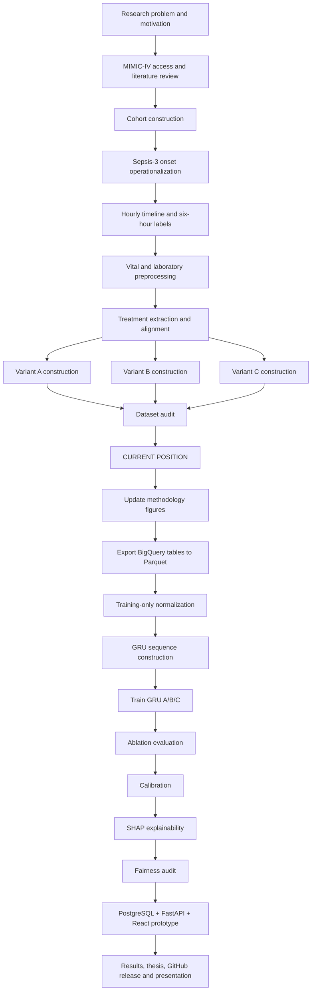
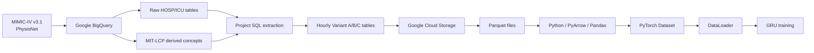

# Sepsis Prediction Research Project: Complete End-to-End Roadmap and Progress Record

**Document purpose:** Master research roadmap, implementation record, progress tracker, and GitHub-ready project plan  
**Project status date:** August 12, 2026  
**Recommended filename:** `PROJECT_ROADMAP.md`  
**Current project position:** **Data retrieval, cohort construction, preprocessing, and Variant A/B/C dataset construction are complete. Model-preparation and modeling begin next.**

## Executive Summary

I am developing a retrospective sepsis-prediction research system using **MIMIC-IV v3.1** ICU data. My central research idea is not simply to determine whether a patient is receiving treatment, but to investigate whether explicitly representing the **temporal relationship between treatment changes and physiological changes** improves prediction of sepsis within the next six hours.

Sepsis is clinically important because Sepsis-3 defines it as life-threatening organ dysfunction caused by a dysregulated host response to infection. The consensus criteria operationalize organ dysfunction using an acute SOFA increase of at least two points and emphasize the importance of timely recognition. citeturn4search0turn4search1

The project uses MIMIC-IV v3.1, released through PhysioNet and available through BigQuery. MIMIC-IV is a restricted, deidentified clinical dataset from Beth Israel Deaconess Medical Center, and v3.1 is available through the corresponding hospital and ICU BigQuery schemas. citeturn0search0turn0search2 I use MIT-LCP's `mimic-code` repository for validated derived clinical concepts rather than recreating complex Sepsis-3 logic independently; the repository specifically contains MIMIC-IV concepts for SOFA, suspicion of infection, Sepsis-3, antibiotics, vasoactive drugs, and norepinephrine-equivalent dose. citeturn5search3turn6search4

My **completed data-engineering pipeline** has produced:

| Item | Final project value |
|---|---:|
| Unique patients | **46,494** |
| ICU stays | **59,662** |
| Hourly modeling rows | **4,169,659** |
| Positive pre-sepsis hourly labels | **48,330** |
| Negative hourly labels | **4,121,329** |
| Overall positive-hour prevalence | **~1.16%** |
| Training patients | **32,500** |
| Validation patients | **6,929** |
| Test patients | **7,065** |
| Variant A | **Constructed and audited** |
| Variant B | **Constructed and audited** |
| Variant C | **Constructed and audited** |

These counts are the frozen project counts from the datasets we constructed and discussed. The original methodology document already established the overall MIMIC-IV → temporal feature engineering → GRU ablation → Responsible AI → FastAPI/React architecture and has been used as the starting point for the revised methodology. fileciteturn0file0

The project has therefore moved through:



A reasonable way to communicate progress is:

> **The complete data foundation is finished. I now have the three final modeling datasets. The next major phase is model preparation and GRU training.**

I would describe the **data-engineering phase itself as 100% complete**. For the entire end-to-end research project—including modeling, evaluation, Responsible AI analysis, prototype development, results, and final reporting—I would describe current progress as approximately **halfway through the overall roadmap**, rather than claiming an artificially precise percentage.

The immediate sequence from this checkpoint is:

```text
Update Figures
      ↓
Freeze Dataset Schema
      ↓
BigQuery → GCS Parquet Export
      ↓
Training-Only Normalization
      ↓
Stay-Level Sequence Construction
      ↓
PyTorch Dataset/DataLoader
      ↓
GRU-A / GRU-B / GRU-C
      ↓
Ablation Evaluation
      ↓
Calibration
      ↓
SHAP
      ↓
Fairness
      ↓
Prototype
      ↓
Final Thesis / Paper / Presentation
```

## Project Definition and Research Rationale

**What I am building**

I am building a retrospective machine-learning research pipeline for **hourly prediction of Sepsis-3 onset within a six-hour forward horizon** in adult ICU patients.

The project is deliberately not framed as a live diagnostic tool. MIMIC-IV contains retrospectively collected, deidentified clinical data; this project therefore evaluates a methodological research question using historical ICU trajectories rather than claiming prospective bedside efficacy. citeturn0search0

The project has two complementary parts.

The first part is the scientific experiment:

```text
Clinical time-series data
        ↓
Physiology and laboratory features
        ↓
Treatment representation
        ↓
GRU
        ↓
Six-hour sepsis risk
```

The second part is the Responsible AI and prototype layer:

```text
Best GRU
   ↓
Calibration
   ↓
Explainability
   ↓
Fairness evaluation
   ↓
Retrospective what-if interface
```

The existing project methodology already contains these major modules, including the controlled GRU ablation, calibration, SHAP, fairness analysis, PostgreSQL, FastAPI, React, and retrospective counterfactual simulator. fileciteturn0file0

**Why I chose sepsis**

Sepsis is particularly suitable for temporal modeling because the condition develops through evolving physiological abnormalities rather than being represented by a single isolated measurement. Sepsis-3 explicitly characterizes sepsis through infection-associated organ dysfunction, while the clinical phenotype may be altered by interventions such as vasopressors and other therapies. citeturn4search0turn4search1

That observation directly motivates my project.

A conventional model may see:

```text
MAP = 62
Vasopressor = ON
```

but that does not tell the model what happened temporally.

For example:

```text
Previous dose = 0.05
Current dose  = 0.10

Previous MAP = 60
Current MAP  = 70
```

contains a very different temporal pattern from:

```text
Previous dose = 0.05
Current dose  = 0.10

Previous MAP = 60
Current MAP  = 52
```

Both examples could have the same current treatment flag, yet their treatment/physiology trajectories differ.

That motivates the treatment-response representation in Variant C.

**Clinical goal**

My clinical research goal is:

> To identify evolving physiological patterns associated with Sepsis-3 onset several hours before the recorded onset while explicitly examining whether treatment-response dynamics contribute useful predictive information.

It is **not**:

> To prescribe vasopressor or antibiotic therapy.

and it is **not**:

> To estimate the causal effect of changing treatment.

Those distinctions must remain explicit throughout the thesis and prototype.

**Technical goal**

My technical goal is to construct a controlled comparison in which:

```text
Same cohort
Same labels
Same patient split
Same GRU architecture
Same optimization procedure
Same evaluation procedure
Different treatment representation
```

Therefore, any reproducible performance difference between the variants can be attributed more credibly to their input representation rather than to differences in model architecture.

**Primary research question**

My primary research question is:

> **RQ1:** Does incorporating dynamic treatment-response information improve six-hour-ahead sepsis prediction compared with both a physiology-only baseline and a flat-treatment baseline?

Operationally:

\[
A \quad \text{vs.} \quad B \quad \text{vs.} \quad C
\]

where:

\[
A = \text{Physiology}
\]

\[
B = \text{Physiology} + \text{Flat Treatment}
\]

\[
C = \text{Physiology} + \text{Dynamic Treatment-Response}
\]

The central comparison is particularly:

\[
C \quad \text{vs.} \quad B
\]

because this tests whether temporal treatment-response representation provides information beyond simply knowing that treatment occurred.

**Responsible AI research question**

The project also contains a second methodological objective:

> **RQ2:** Can the selected model's outputs be made more interpretable and better characterized through probability calibration, feature attribution, subgroup fairness evaluation, and a retrospective human-in-the-loop interface?

One methodological caution is important: unless I later conduct an actual human-subject usability/trust study, I should **not claim that SHAP or the dashboard empirically “improves clinician trust.”** I can demonstrate calibration, explanations, subgroup performance, and interface functionality, but trust is a human outcome that would require separate evaluation.

**Why GRU**

The recurrent model used for the controlled experiment is a **Gated Recurrent Unit (GRU)**. GRUs were introduced by Cho et al. as a gated recurrent architecture capable of maintaining temporal hidden-state information. citeturn4academia48 PyTorch currently provides a native GRU implementation and supports variable-length packed sequences, which fits the stay-level hourly sequence structure required here. citeturn2search0turn2search3

The final justification in the thesis should emphasize:

> I chose one recurrent architecture and hold it fixed because the primary scientific question concerns **feature representation**, not architecture benchmarking.

That is stronger than claiming that every alternative architecture is infeasible.

## Data Provenance and Completed Data Engineering

**Data source and access path**

I use **MIMIC-IV v3.1**. PhysioNet released v3.1 in October 2024 and subsequently made it available through BigQuery; the official BigQuery schemas include `mimiciv_v3_1_hosp` and `mimiciv_v3_1_icu`. citeturn0search0turn0search2

MIMIC-IV contains deidentified hospital and ICU data originating from Beth Israel Deaconess Medical Center. PhysioNet notes that the dataset is intentionally close to real-world clinical data and that implausible or irregular values may exist, which is precisely why explicit cleaning and preprocessing are required before model training. citeturn0search0

Access is restricted: researchers must be credentialed, complete the required human-subjects training, and sign the PhysioNet data-use agreement. citeturn0search0turn14search2

My data route is therefore:



**Why BigQuery was used**

I used BigQuery because MIMIC-IV v3.1 is officially available there and because cohort construction and large multi-table joins are naturally handled in SQL close to the data. citeturn0search2turn5search3

I therefore regard BigQuery as my:

> **data retrieval + clinical data engineering environment**

rather than my final neural-network training environment.

The final GRU is trained in Python/PyTorch after exporting the engineered tables.

**Source tables and concepts**

The extraction uses data from MIMIC-IV components such as:

| Source | Primary purpose in this project |
|---|---|
| `icustays` | ICU stay identifiers and ICU timing |
| `patients` | Patient-level information, including age derivation |
| `admissions` | Admission and demographic metadata |
| `chartevents` | Bedside physiological measurements |
| `labevents` | Laboratory measurements |
| treatment-derived concepts | Vasopressor and antibiotic information |
| `sofa` derived concept | SOFA-related organ dysfunction |
| `suspicion_of_infection` | Infection proxy |
| `sepsis3` | ICU Sepsis-3 onset |
| norepinephrine-equivalent concept | Harmonized vasopressor intensity |

The MIT-LCP `mimic-code` project explicitly maintains reproducible derived concepts for MIMIC, including Sepsis-3, suspicion of infection, SOFA, antibiotic use, and norepinephrine-equivalent dose. citeturn5search1turn6search4

**Important Sepsis-3 provenance correction**

I should not describe the MIT-LCP suspicion-of-infection implementation as a simple symmetric “±24 hour antibiotic/culture window.”

The current MIT-LCP code is more specific. It can associate an antibiotic with a culture obtained before it by up to 72 hours, or a culture obtained after antibiotic initiation within 24 hours. The derived Sepsis-3 query then connects suspected infection with SOFA in a window extending from 48 hours before to 24 hours after the suspected-infection time and identifies an ICU onset. citeturn5search0turn5search2

Therefore, the safest methodology wording is:

> “I use the validated MIT-LCP MIMIC-IV Sepsis-3 derived concept for sepsis onset rather than independently reimplementing suspected-infection and SOFA timing logic.”

That avoids accidental disagreement with the upstream clinical concept.

**Cohort inclusion**

My project cohort is restricted to:

| Criterion | Rule |
|---|---|
| Population | Adult ICU patients |
| Age | `>= 18 years` |
| ICU duration | `> 24 hours` |
| Modeling unit | Hourly ICU observations |
| Patient leakage prevention | Split by `subject_id` |

The resulting frozen cohort is:

```text
46,494 unique patients
        ↓
59,662 ICU stays
        ↓
4,169,659 hourly modeling observations
```

These are **project-specific derived cohort counts**, not the total size of MIMIC-IV.

**Patient-level splitting**

I performed the split using `subject_id`, not individual rows and not `stay_id`.

That means:

```text
Patient X
 ├── Stay 1
 ├── Stay 2
 └── Stay 3

ALL stays must belong to the same split.
```

Final split:

| Split | Patients | Approximate share |
|---|---:|---:|
| Train | **32,500** | **69.9%** |
| Validation | **6,929** | **14.9%** |
| Test | **7,065** | **15.2%** |
| **Total** | **46,494** | **100%** |

This is one of the most important anti-leakage decisions in the project.

**Hourly timeline construction**

The original EHR data are irregularly sampled. My sequential model, however, requires a consistent time axis.

I therefore convert every eligible ICU stay into:

\[
X \in \mathbb{R}^{T\times F}
\]

where:

- \(T\) is the number of modeled ICU hours for that stay;
- \(F\) is the number of model features.

Conceptually:

```text
stay_id = X

Hour 0   → feature vector X0
Hour 1   → feature vector X1
Hour 2   → feature vector X2
...
Hour T   → feature vector XT
```

Each source measurement is aligned to the appropriate hourly interval.

For bedside variables with multiple measurements inside one hour, the project's working rule is to use the latest current-hour value so that the hourly representation reflects the latest known state in that interval.

**Six-hour prediction target**

For each eligible hour \(t\), I predict whether Sepsis-3 onset occurs after the current hour and within the next six hours.

```markdown
$$
Y_t =
\begin{cases}
1, & 0 < T_{\text{sepsis}} - t \leq 6\text{ hours} \\
0, & \text{otherwise}
\end{cases}
$$
```

Thus:

```text
Current hour     Sepsis onset
     │                 │
     ├──── ≤ 6 h ──────┤  → positive
```

Information occurring after the onset is not used to predict that onset.

Final label counts:

| Label | Hours |
|---|---:|
| Positive | **48,330** |
| Negative | **4,121,329** |
| Total | **4,169,659** |

This corresponds to approximately **1.16% positive hours**, which confirms substantial class imbalance.

**Physiological variables**

Variant A begins with six bedside physiological variables:

| Variable | Bounded LOCF |
|---|---:|
| Heart rate | **4 h** |
| MAP | **4 h** |
| SpO₂ | **4 h** |
| Respiratory rate | **4 h** |
| Temperature | **6 h** |
| GCS | **6 h** |

This bounded strategy is important.

I do **not** allow:

```text
Old value ───────────────────────────────→ carried forever
```

Instead:

```text
Actual measurement
      ↓
Carry only within allowed window
      ↓
If still absent
      ↓
Training-only median
```

**Laboratory variables**

The five laboratory variables are:

| Laboratory variable | LOCF limit |
|---|---:|
| Lactate | **24 h** |
| WBC | **24 h** |
| Creatinine | **24 h** |
| Total bilirubin | **24 h** |
| Platelets | **24 h** |

Laboratory measurements receive a longer window because they are normally recorded less frequently than bedside vital signs.

**Training-only median imputation**

Remaining missing values after bounded LOCF are imputed using medians calculated **only from the training population**.

Those training medians are frozen as:

| Feature | Training median |
|---|---:|
| Heart rate | **83** |
| MAP | **79** |
| SpO₂ | **97** |
| Temperature | **36.89** |
| Respiratory rate | **19** |
| GCS | **15** |
| Lactate | **1.5** |
| WBC | **10.4** |
| Creatinine | **0.9** |
| Bilirubin | **0.7** |
| Platelets | **198** |

The validation and test populations do **not** calculate their own medians.

The correct pattern is:

```text
TRAIN
  ↓
calculate medians
  ↓
freeze them
  ├───────────────┐
  ↓               ↓
VALIDATION        TEST
use train values  use train values
```

**Missingness-indicator semantics**

Each of the 11 physiology/laboratory measurements receives a corresponding missingness feature.

My important semantic rule is:

```text
0 = an actual value was measured in the current hour
1 = no actual value was measured in the current hour
```

Therefore:

| Situation | Numeric model value | Missingness flag |
|---|---|---:|
| Actually measured this hour | actual value | 0 |
| LOCF from previous hour | carried value | 1 |
| Training median | median value | 1 |

This is deliberately different from:

> “1 only if the final numeric cell is NULL.”

After imputation there should not be NULL model inputs, so that interpretation would destroy missingness information.

**Vasopressor processing**

Treatment records occur as intervals rather than naturally hourly measurements.

I therefore align vasopressor exposure with the hourly grid.

Conceptually, for hour \(h\):

```markdown
$$
Dose_h
=
\sum_j
d_j
\frac{\operatorname{overlap}(j,h)}
{1\text{ hour}}
$$
```

where \(d_j\) is the norepinephrine-equivalent intensity of treatment interval \(j\).

This produces a time-weighted hourly treatment intensity rather than blindly assigning the full interval dose to every touched hour.

The upstream `mimic-code` repository includes a norepinephrine-equivalent-dose concept specifically for harmonizing vasoactive agents. citeturn6search4

For Variant B, I retain:

```text
norepinephrine-equivalent hourly dose
vasopressor-active indicator
```

with the active indicator conceptually equivalent to:

```markdown
$$
I_{\text{vaso}}(t)
=
\mathbf{1}\left[Dose_{\text{vaso}}(t) > 0\right]
$$
```

**Antibiotic processing**

For each modeled hour I determine which antibiotic administration intervals overlap that hour.

I then count the number of distinct concurrently active antibiotics:

\[
A(t)=\text{number of distinct antibiotics active at hour }t.
\]

The Variant C binary feature identifies an increase in that count from the previous hour.

This must be called **antibiotic intensification**, not “spectrum escalation,” because I have not assigned antibiotics a validated spectrum ranking.

Project audit results recorded during construction include:

```text
Antibiotic-active hourly intervals: 1,645,913
Maximum concurrent antibiotic count: 7
Antibiotic-intensification hours: 55,879
ICU stays containing intensification: 24,037
```

**Final Variant A/B/C definitions**

The controlled experiment is now frozen as follows:

| Feature group | Variant A | Variant B | Variant C |
|---|:---:|:---:|:---:|
| Heart rate | ✓ | ✓ | ✓ |
| MAP | ✓ | ✓ | ✓ |
| SpO₂ | ✓ | ✓ | ✓ |
| Temperature | ✓ | ✓ | ✓ |
| Respiratory rate | ✓ | ✓ | ✓ |
| GCS | ✓ | ✓ | ✓ |
| Lactate | ✓ | ✓ | ✓ |
| WBC | ✓ | ✓ | ✓ |
| Creatinine | ✓ | ✓ | ✓ |
| Bilirubin | ✓ | ✓ | ✓ |
| Platelets | ✓ | ✓ | ✓ |
| 11 missingness indicators | ✓ | ✓ | ✓ |
| Norepinephrine-equivalent dose | — | ✓ | — |
| Vasopressor-active indicator | — | ✓ | — |
| \(\Delta MAP\) | — | — | ✓ |
| \(\Delta Dose_{vaso}\) | — | — | ✓ |
| TRC | — | — | ✓ |
| Antibiotic intensification | — | — | ✓ |
| **Approx. model-input feature count** | **22** | **24** | **26** |

Variant C intentionally returns to the Variant A baseline and adds the dynamic representation.

Thus:

```text
Variant A
Physiology + laboratory values + missingness
```

```text
Variant B
Variant A
+
flat vasopressor information
```

```text
Variant C
Variant A
+
ΔMAP
+
ΔDose
+
TRC
+
antibiotic intensification
```

It is **not**:

```text
Variant C = Variant B + all dynamic features
```

unless the experimental design is explicitly changed later.

That distinction must remain unchanged in the methodology, figures, model feature lists, and result tables.

Metadata such as:

```text
subject_id
stay_id
hour
split
label
sepsis onset timestamp
```

must remain metadata/indexing fields, not neural-network predictors.

Similarly, age, sex, and insurance should remain fairness-stratification variables unless I explicitly decide to include them as predictors in all three models.

## Mathematical Specification and Experimental Design

This section acts as the single mathematical source of truth for the project.

**SOFA change**

Sepsis-3 operationalizes organ dysfunction using an acute SOFA increase of at least two points. citeturn4search0

Copy-ready Markdown/LaTeX:

```markdown
$$
\Delta \mathrm{SOFA}
=
\mathrm{SOFA}_{\mathrm{observed}}
-
\mathrm{SOFA}_{\mathrm{baseline}}
\geq 2
$$
```

The MIT-LCP ICU `sepsis3` derived query notes that its operational implementation assumes baseline SOFA zero because pre-existing organ dysfunction is not known in that concept. citeturn5search2

**Vasopressor dose change**

```markdown
$$
\Delta Dose_{\mathrm{vaso}}(t)
=
Dose_{\mathrm{vaso}}(t)
-
Dose_{\mathrm{vaso}}(t-1)
$$
```

For the first modeled hour:

```markdown
$$
\Delta Dose_{\mathrm{vaso}}(1)=0
$$
```

**MAP change**

```markdown
$$
\Delta MAP(t)
=
MAP(t)-MAP(t-1)
$$
```

For the first modeled hour:

```markdown
$$
\Delta MAP(1)=0
$$
```

**Treatment-response coupling**

```markdown
$$
TRC(t)
=
\Delta Dose_{\mathrm{vaso}}(t)
\times
\Delta MAP(t)
$$
```

For the first hour:

```markdown
$$
TRC(1)=0
$$
```

The correct interpretation is:

> TRC is an engineered temporal interaction between treatment change and MAP change.

It is **not**:

> a causal treatment-effect estimator.

It is also important not to interpret TRC's sign alone as a complete clinical direction indicator because:

\[
(+)\times(+)=+
\]

and

\[
(-)\times(-)=+
\]

so the separate \(\Delta Dose\) and \(\Delta MAP\) features must be retained alongside the interaction.

**Antibiotic intensification**

Let:

\[
A(t)=\text{number of distinct antibiotics active at hour }t.
\]

Then:

```markdown
$$
I_{ABX}(t)
=
\begin{cases}
1, & A(t)>A(t-1) \\
0, & \text{otherwise}
\end{cases}
$$
```

and:

```markdown
$$
I_{ABX}(1)=0
$$
```

Again, this feature should consistently be called:

> **antibiotic intensification**

rather than:

> spectrum escalation.

**Six-hour label**

```markdown
$$
Y_t =
\begin{cases}
1, & 0<T_{\mathrm{sepsis}}-t\leq6\text{ hours}\\
0, & \text{otherwise}
\end{cases}
$$
```

**Z-score normalization**

This is the immediate preprocessing stage still to be performed.

```markdown
$$
X_{\mathrm{norm}}
=
\frac{X-\mu_{\mathrm{train}}}
{\sigma_{\mathrm{train}}}
$$
```

where:

```markdown
$$
\mu_{\mathrm{train}}
=
\frac{1}{N_{\mathrm{train}}}
\sum_{i=1}^{N_{\mathrm{train}}}X_i
$$
```

and:

```markdown
$$
\sigma_{\mathrm{train}}
=
\sqrt{
\frac{1}{N_{\mathrm{train}}}
\sum_{i=1}^{N_{\mathrm{train}}}
(X_i-\mu_{\mathrm{train}})^2
}
$$
```

Only continuous predictors should normally be standardized.

Likely continuous columns are:

```text
A:
heart_rate
map
spo2
temperature
resp_rate
gcs
lactate
wbc
creatinine
bilirubin
platelets

B additionally:
norepinephrine_equivalent_dose

C additionally:
delta_map
delta_dose
trc
```

Binary missingness, vasopressor-active, and antibiotic-intensification indicators should remain binary unless a deliberate alternative is documented.

**Corrected GRU equations**

PyTorch's current GRU documentation defines the recurrent operations as follows. citeturn2search0

```markdown
$$
r_t
=
\sigma
\left(
W_{ir}x_t+b_{ir}
+
W_{hr}h_{t-1}+b_{hr}
\right)
$$
```

```markdown
$$
z_t
=
\sigma
\left(
W_{iz}x_t+b_{iz}
+
W_{hz}h_{t-1}+b_{hz}
\right)
$$
```

```markdown
$$
n_t
=
\tanh
\left(
W_{in}x_t+b_{in}
+
r_t\odot
\left(
W_{hn}h_{t-1}+b_{hn}
\right)
\right)
$$
```

```markdown
$$
h_t
=
(1-z_t)\odot n_t
+
z_t\odot h_{t-1}
$$
```

Hourly risk logit:

```markdown
$$
z_t^{out}
=
W_o h_t+b_o
$$
```

Probability:

```markdown
$$
\hat{y}_t
=
\sigma(z_t^{out})
$$
```

These equations correct the malformed GRU equations in the earlier methodology source. The original GRU/RNN Encoder-Decoder work is attributed to Cho et al. citeturn4academia48

**Class-weighted binary loss**

The research equation may be written:

```markdown
$$
\mathcal{L}
=
-\frac{1}{N}
\sum_{i=1}^{N}
\left[
w_1y_i\log(\hat{y}_i)
+
w_0(1-y_i)\log(1-\hat{y}_i)
\right]
$$
```

with:

```markdown
$$
w_1
=
\frac{N_{\mathrm{neg,train}}}
{N_{\mathrm{pos,train}}}
$$
```

However, for PyTorch implementation I should use logits directly with:

```python
torch.nn.BCEWithLogitsLoss(...)
```

because it combines sigmoid and binary cross-entropy in a numerically stable implementation. PyTorch explicitly supports a positive-class weight such as \(N_{neg}/N_{pos}\). citeturn2search2

The weight must be calculated using **training labels only**, not the total dataset.

**Controlled ablation rule**

Everything except input representation must be frozen:

| Experimental element | A | B | C |
|---|---|---|---|
| Patient cohort | Same | Same | Same |
| Split | Same | Same | Same |
| Labels | Same | Same | Same |
| Hourly timeline | Same | Same | Same |
| GRU hidden size | Same | Same | Same |
| GRU layers | Same | Same | Same |
| Dropout | Same | Same | Same |
| Optimizer | Same | Same | Same |
| Learning rate | Same | Same | Same |
| Batch size | Same | Same | Same |
| Early stopping | Same | Same | Same |
| Seeds | Same | Same | Same |
| **Input representation** | **Different** | **Different** | **Different** |

This is what makes the study an ablation experiment rather than three unrelated models.

## Current Progress and Status

The following table should be treated as the project's master progress tracker.

| Phase / Task | Status | Current note |
|---|---|---|
| Define sepsis-prediction problem | ✅ Complete | Six-hour forward prediction |
| Establish RQ1 | ✅ Complete | Dynamic treatment-response vs baselines |
| Establish Responsible AI objective | ✅ Complete | Calibration, explanations, fairness, prototype |
| Obtain MIMIC-IV access | ✅ Complete | Data accessed through BigQuery |
| Identify MIMIC-IV v3.1 sources | ✅ Complete | Raw + derived concepts |
| Use MIT-LCP Sepsis-3 concept | ✅ Complete | Avoided independent clinical reimplementation |
| Define adult ICU cohort | ✅ Complete | Age ≥18, ICU stay >24 h |
| Build patient-level split | ✅ Complete | 32,500 / 6,929 / 7,065 patients |
| Construct hourly timeline | ✅ Complete | 4,169,659 hourly rows |
| Construct six-hour labels | ✅ Complete | 48,330 positive hours |
| Extract vital signs | ✅ Complete | Six physiological variables |
| Extract laboratories | ✅ Complete | Five laboratory variables |
| Implement bounded LOCF | ✅ Complete | 4 h / 6 h / 24 h |
| Calculate training medians | ✅ Complete | Eleven medians frozen |
| Implement median imputation | ✅ Complete | Training statistics only |
| Implement missingness indicators | ✅ Complete | Current-hour measurement semantics |
| Extract vasopressor treatment | ✅ Complete | NE-equivalent representation |
| Align treatment to hours | ✅ Complete | Time-weighted |
| Derive vasopressor-active flag | ✅ Complete | Variant B |
| Extract antibiotic intervals | ✅ Complete | Hourly overlap |
| Compute concurrent ABX count | ✅ Complete | Distinct active agents |
| Compute ABX intensification | ✅ Complete | Current count > previous count |
| Compute \(\Delta Dose\) | ✅ Complete | Variant C |
| Compute \(\Delta MAP\) | ✅ Complete | Variant C |
| Compute TRC | ✅ Complete | Variant C |
| Construct Variant A | ✅ Complete | Physiology baseline |
| Construct Variant B | ✅ Complete | Flat vasopressor treatment |
| Construct Variant C | ✅ Complete | Dynamic treatment-response |
| Audit A/B/C dimensions | ✅ Complete | Common cohort/timeline |
| Remove NULLs in final dynamic features | ✅ Complete | Audited |
| Update methodology text | ✅ Mostly complete | New methodology synchronized |
| Update methodology figures | 🟡 Next | Figures 4.3/4.4.3 |
| Freeze export manifests | ⬜ Pending | Do before modeling |
| Export BigQuery → Parquet | ⬜ Pending | Immediate model-prep task |
| Compute z-score scaler | ⬜ Pending | Training partition only |
| Normalize A/B/C | ⬜ Pending | No validation/test fitting |
| Construct stay sequences | ⬜ Pending | Group by `stay_id`, order by hour |
| Build PyTorch Dataset | ⬜ Pending | Variable length |
| Build DataLoader/collate | ⬜ Pending | Padding + mask |
| Freeze hyperparameters | ⬜ Pending | Values currently unspecified |
| Train GRU A | ⬜ Pending | Same architecture |
| Train GRU B | ⬜ Pending | Same architecture |
| Train GRU C | ⬜ Pending | Same architecture |
| Ablation evaluation | ⬜ Pending | AUROC/AUPRC etc. |
| Select final model | ⬜ Pending | Based on validation/test protocol |
| Temperature scaling | ⬜ Pending | Validation logits |
| Calibration evaluation | ⬜ Pending | ECE + reliability |
| SHAP precomputation | ⬜ Pending | Final model |
| Fairness audit | ⬜ Pending | Age/sex/insurance |
| PostgreSQL preparation | ⬜ Pending | Prototype |
| FastAPI backend | ⬜ Pending | Prototype |
| React dashboard | ⬜ Pending | Prototype |
| Counterfactual simulator | ⬜ Pending | Model behavior only |
| Results chapter | ⬜ Pending | After experiments |
| Discussion/limitations | ⬜ Pending | After results |
| Final GitHub release | ⬜ Pending | Code only / compliant artifacts |
| Final presentation/demo | ⬜ Pending | End stage |

The clearest status sentence is:

> **I have completed the data acquisition, cohort construction, preprocessing, feature engineering, labeling, split creation, and construction of all three ablation datasets. I have not yet begun final normalization, GRU sequence preparation, model training, or downstream evaluation.**

In other words:

```text
DATA PHASE
████████████████████ 100%

MODEL PHASE
░░░░░░░░░░░░░░░░░░░░ not started

RESPONSIBLE AI PHASE
░░░░░░░░░░░░░░░░░░░░ not started

PROTOTYPE PHASE
░░░░░░░░░░░░░░░░░░░░ not started
```

For presentation purposes, I would describe the full project as being roughly **45–55% through the complete end-to-end roadmap**, while emphasizing that this is a milestone estimate rather than a mathematical project-completion statistic.

## Next-Phase Implementation Roadmap

This section is the practical sequence I should follow from the present checkpoint.

**Immediate next action: synchronize the figures**

Before changing the data pipeline again, I should update Figures 4.3 and 4.4.3 so that the written methodology and visual methodology describe exactly the same experiment.

After that, freeze the methodology for the data-engineering stage.

**Freeze the datasets before export**

Before exporting anything, run final BigQuery audits for every variant.

At minimum verify:

```sql
SELECT
  COUNT(*) AS rows,
  COUNT(DISTINCT stay_id) AS stays,
  COUNT(DISTINCT subject_id) AS patients,
  COUNTIF(label = 1) AS positive_hours,
  COUNTIF(label = 0) AS negative_hours
FROM `PROJECT_ID.DATASET_ID.variant_a`;
```

Repeat for B and C.

Then verify split leakage:

```sql
SELECT
  subject_id,
  COUNT(DISTINCT split) AS n_splits
FROM `PROJECT_ID.DATASET_ID.variant_a`
GROUP BY subject_id
HAVING n_splits > 1;
```

Expected output:

```text
0 rows
```

Check duplicate hourly keys:

```sql
SELECT
  stay_id,
  hour,
  COUNT(*) AS n
FROM `PROJECT_ID.DATASET_ID.variant_a`
GROUP BY stay_id, hour
HAVING COUNT(*) > 1;
```

Expected:

```text
0 rows
```

Check final NULLs:

```sql
SELECT
  COUNTIF(heart_rate IS NULL) AS hr_null,
  COUNTIF(map IS NULL) AS map_null,
  COUNTIF(lactate IS NULL) AS lactate_null
FROM `PROJECT_ID.DATASET_ID.variant_a`;
```

Do equivalent checks for all model features.

**Export BigQuery to Parquet**

Google BigQuery officially supports `EXPORT DATA` to Cloud Storage in Parquet format. citeturn3search0

Parquet should be the primary exported artifact because it preserves typed columnar data and is much more appropriate than repeatedly downloading multi-million-row CSV files.

Recommended layout:

```text
gs://SEPSIS_BUCKET/
└── frozen_v1/
    ├── variant_a/
    │   ├── train/
    │   │   └── part-*.parquet
    │   ├── val/
    │   │   └── part-*.parquet
    │   └── test/
    │       └── part-*.parquet
    │
    ├── variant_b/
    │   ├── train/
    │   ├── val/
    │   └── test/
    │
    └── variant_c/
        ├── train/
        ├── val/
        └── test/
```

Example BigQuery export:

```sql
EXPORT DATA OPTIONS(
  uri='gs://SEPSIS_BUCKET/frozen_v1/variant_a/train/part-*.parquet',
  format='PARQUET',
  overwrite=true
) AS
SELECT *
FROM `PROJECT_ID.DATASET_ID.variant_a`
WHERE split = 'train'
ORDER BY stay_id, hour;
```

Validation:

```sql
EXPORT DATA OPTIONS(
  uri='gs://SEPSIS_BUCKET/frozen_v1/variant_a/val/part-*.parquet',
  format='PARQUET',
  overwrite=true
) AS
SELECT *
FROM `PROJECT_ID.DATASET_ID.variant_a`
WHERE split = 'val'
ORDER BY stay_id, hour;
```

Test:

```sql
EXPORT DATA OPTIONS(
  uri='gs://SEPSIS_BUCKET/frozen_v1/variant_a/test/part-*.parquet',
  format='PARQUET',
  overwrite=true
) AS
SELECT *
FROM `PROJECT_ID.DATASET_ID.variant_a`
WHERE split = 'test'
ORDER BY stay_id, hour;
```

Repeat for B and C.

Do not rely on physical file order across Parquet shards. Always re-sort by:

```text
stay_id
hour
```

when constructing sequences.

**Alternative direct BigQuery retrieval**

For debugging or small subsets I can query directly from Python using the official BigQuery client. Google's current client supports querying and conversion to pandas/Arrow. citeturn1search0turn1search7

```python
from google.cloud import bigquery

client = bigquery.Client(project="PROJECT_ID")

query = """
SELECT *
FROM `PROJECT_ID.DATASET_ID.variant_a`
WHERE split = 'train'
ORDER BY stay_id, hour
"""

job = client.query(query)
df = job.to_dataframe()
```

For the full dataset, I prefer Parquet export because it gives a frozen reproducible artifact.

If I need streaming rather than loading the entire result in RAM, the BigQuery Python client exposes `to_arrow_iterable()`, which yields PyArrow record batches. citeturn10search0

Example:

```python
from google.cloud import bigquery
import pyarrow.parquet as pq

client = bigquery.Client(project="PROJECT_ID")

query = """
SELECT *
FROM `PROJECT_ID.DATASET_ID.variant_a`
WHERE split = 'train'
ORDER BY stay_id, hour
"""

rows = client.query(query).result()

writer = None

try:
    for batch in rows.to_arrow_iterable(max_stream_count=2):
        table = batch.to_table()

        if writer is None:
            writer = pq.ParquetWriter(
                "variant_a_train.parquet",
                table.schema,
                compression="snappy",
            )

        writer.write_table(table)
finally:
    if writer is not None:
        writer.close()
```

This avoids requiring one huge pandas DataFrame.

**Read Parquet in Python**

Simple pandas route:

```python
import pandas as pd

train = pd.read_parquet("variant_a_train.parquet")
train = train.sort_values(["stay_id", "hour"])
```

For sharded Parquet:

```python
import pyarrow.dataset as ds

dataset = ds.dataset(
    "data/frozen_v1/variant_a/train/",
    format="parquet",
)

table = dataset.to_table()
df = table.to_pandas()
df = df.sort_values(["stay_id", "hour"])
```

For memory-sensitive workflows, use Arrow batch scanning rather than `to_table()`.

Why this matters: with approximately 4.17 million rows and up to roughly 26 model features, the raw feature matrix alone is around **414 MiB at float32** or **827 MiB at float64**, before DataFrame/index/object overhead. A complete pandas table can therefore consume substantially more than 1 GiB.

**Compute normalization statistics from training only**

Start by declaring feature lists explicitly.

```python
BASE_CONTINUOUS = [
    "heart_rate",
    "map",
    "spo2",
    "temperature",
    "resp_rate",
    "gcs",
    "lactate",
    "wbc",
    "creatinine",
    "bilirubin",
    "platelets",
]

VARIANT_B_EXTRA_CONTINUOUS = [
    "norepinephrine_equivalent_dose",
]

VARIANT_C_EXTRA_CONTINUOUS = [
    "delta_map",
    "delta_dose",
    "trc",
]
```

Then:

```python
continuous_cols = BASE_CONTINUOUS

means = train[continuous_cols].mean()
stds = train[continuous_cols].std(ddof=0)

stds = stds.replace(0, 1.0)
```

Apply:

```python
train[continuous_cols] = (
    train[continuous_cols] - means
) / stds

val[continuous_cols] = (
    val[continuous_cols] - means
) / stds

test[continuous_cols] = (
    test[continuous_cols] - means
) / stds
```

Never do:

```python
val.mean()
test.mean()
```

for fitting the scaler.

Save the scaler:

```python
import json

scaler = {
    col: {
        "mean": float(means[col]),
        "std": float(stds[col]),
    }
    for col in continuous_cols
}

with open("variant_a_scaler.json", "w") as f:
    json.dump(scaler, f, indent=2)
```

Repeat using the appropriate feature list for each variant.

A stronger implementation can reuse the shared baseline normalization parameters for identical columns and calculate only the additional treatment-feature parameters separately.

**Create feature manifests**

Never depend on whatever column order happens to appear in pandas.

Create:

```python
VARIANT_A_FEATURES = [
    "heart_rate",
    "map",
    "spo2",
    "temperature",
    "resp_rate",
    "gcs",
    "lactate",
    "wbc",
    "creatinine",
    "bilirubin",
    "platelets",
    "heart_rate_missing",
    "map_missing",
    "spo2_missing",
    "temperature_missing",
    "resp_rate_missing",
    "gcs_missing",
    "lactate_missing",
    "wbc_missing",
    "creatinine_missing",
    "bilirubin_missing",
    "platelets_missing",
]
```

Variant B:

```python
VARIANT_B_FEATURES = VARIANT_A_FEATURES + [
    "norepinephrine_equivalent_dose",
    "vasopressor_active",
]
```

Variant C:

```python
VARIANT_C_FEATURES = VARIANT_A_FEATURES + [
    "delta_map",
    "delta_dose",
    "trc",
    "antibiotic_intensification",
]
```

Column names should be replaced by the **exact names from the frozen BigQuery tables** before training.

Save each feature list to JSON.

**Construct stay-level sequences**

The sequence unit should be:

```text
stay_id
```

not individual hour and not `subject_id`.

Each ICU stay becomes:

\[
X_i \in \mathbb{R}^{T_i\times F}
\]

and:

\[
Y_i \in \{0,1\}^{T_i}.
\]

Basic implementation:

```python
import numpy as np
import torch
from torch.utils.data import Dataset


class StaySequenceDataset(Dataset):
    def __init__(
        self,
        dataframe,
        feature_cols,
        label_col="label",
        stay_col="stay_id",
        hour_col="hour",
    ):
        self.samples = []

        grouped = dataframe.groupby(stay_col, sort=False)

        for stay_id, group in grouped:
            group = group.sort_values(hour_col)

            x = group[feature_cols].to_numpy(
                dtype=np.float32,
                copy=True,
            )

            y = group[label_col].to_numpy(
                dtype=np.float32,
                copy=True,
            )

            self.samples.append(
                (
                    int(stay_id),
                    torch.from_numpy(x),
                    torch.from_numpy(y),
                )
            )

    def __len__(self):
        return len(self.samples)

    def __getitem__(self, idx):
        return self.samples[idx]
```

This is ideal for initial correctness testing.

For the final large-scale implementation, avoid unnecessary data duplication by moving toward Parquet/Arrow-backed sequence indexing or pre-generated sequence shards after the baseline implementation is verified.

**Padding and masking**

PyTorch provides `pad_sequence` for padding variable-length tensors and `pack_padded_sequence` for efficient recurrent processing. citeturn2search3turn2search4

```python
import torch
from torch.nn.utils.rnn import pad_sequence


def collate_stays(batch):
    stay_ids, xs, ys = zip(*batch)

    lengths = torch.tensor(
        [x.shape[0] for x in xs],
        dtype=torch.long,
    )

    x_padded = pad_sequence(
        xs,
        batch_first=True,
        padding_value=0.0,
    )

    y_padded = pad_sequence(
        ys,
        batch_first=True,
        padding_value=0.0,
    )

    max_len = x_padded.shape[1]

    mask = (
        torch.arange(max_len)[None, :]
        < lengths[:, None]
    )

    return {
        "stay_id": stay_ids,
        "x": x_padded,
        "y": y_padded,
        "lengths": lengths,
        "mask": mask,
    }
```

Then:

```python
from torch.utils.data import DataLoader

train_loader = DataLoader(
    train_dataset,
    batch_size=BATCH_SIZE,
    shuffle=True,
    collate_fn=collate_stays,
    num_workers=NUM_WORKERS,
    pin_memory=True,
)
```

**Build the GRU**

```python
import torch
import torch.nn as nn
from torch.nn.utils.rnn import (
    pack_padded_sequence,
    pad_packed_sequence,
)


class SepsisGRU(nn.Module):
    def __init__(
        self,
        input_size,
        hidden_size,
        num_layers,
        dropout,
    ):
        super().__init__()

        self.gru = nn.GRU(
            input_size=input_size,
            hidden_size=hidden_size,
            num_layers=num_layers,
            dropout=dropout if num_layers > 1 else 0.0,
            batch_first=True,
        )

        self.output = nn.Linear(hidden_size, 1)

    def forward(self, x, lengths):
        packed = pack_padded_sequence(
            x,
            lengths.cpu(),
            batch_first=True,
            enforce_sorted=False,
        )

        packed_out, _ = self.gru(packed)

        out, _ = pad_packed_sequence(
            packed_out,
            batch_first=True,
            total_length=x.shape[1],
        )

        logits = self.output(out).squeeze(-1)

        return logits
```

PyTorch GRUs accept packed variable-length sequences directly. citeturn2search0turn2search3

**Calculate positive-class weight**

Do this from the **training split**:

```python
import torch

n_pos = int((train_df["label"] == 1).sum())
n_neg = int((train_df["label"] == 0).sum())

pos_weight = torch.tensor(
    [n_neg / n_pos],
    dtype=torch.float32,
    device=device,
)
```

Then:

```python
criterion = torch.nn.BCEWithLogitsLoss(
    pos_weight=pos_weight,
    reduction="none",
)
```

PyTorch documents `pos_weight` specifically for adjusting binary loss under class imbalance. citeturn2search2

**Masked loss**

```python
logits = model(batch["x"], batch["lengths"])

raw_loss = criterion(
    logits,
    batch["y"],
)

mask = batch["mask"].float()

loss = (
    raw_loss * mask
).sum() / mask.sum()
```

This ensures padded timesteps do not affect optimization.

**Reproducible seeds**

PyTorch explicitly notes that complete reproducibility is not guaranteed across releases/platforms but provides controls for seeds and deterministic algorithms. citeturn13search0turn13search3

Use:

```python
import os
import random
import numpy as np
import torch


def set_seed(seed: int = 42) -> None:
    os.environ["PYTHONHASHSEED"] = str(seed)

    random.seed(seed)
    np.random.seed(seed)

    torch.manual_seed(seed)

    if torch.cuda.is_available():
        torch.cuda.manual_seed_all(seed)

    torch.backends.cudnn.benchmark = False

    torch.use_deterministic_algorithms(
        True,
        warn_only=True,
    )
```

For multi-worker DataLoaders:

```python
def seed_worker(worker_id):
    worker_seed = torch.initial_seed() % (2**32)
    np.random.seed(worker_seed)
    random.seed(worker_seed)


generator = torch.Generator()
generator.manual_seed(42)
```

This follows PyTorch's documented worker-seeding approach. citeturn13search0

**Freeze hyperparameters before the final ablation**

The exact values remain **unspecified** until the training configuration is deliberately finalized.

| Hyperparameter | Status |
|---|---|
| Hidden size | **Unspecified** |
| GRU layers | **Unspecified** |
| Dropout | **Unspecified** |
| Batch size | **Unspecified** |
| Learning rate | **Unspecified** |
| Weight decay | **Unspecified** |
| Optimizer | **Unspecified** |
| LR scheduler | **Unspecified** |
| Maximum epochs | **Unspecified** |
| Early-stopping patience | **Unspecified** |
| Gradient clipping | **Unspecified** |
| Number of seeds | **Unspecified** |
| Primary early-stopping metric | **Unspecified** |

A reasonable initial experiment grid is:

| Hyperparameter | Candidate values for pilot only |
|---|---|
| Hidden size | 32, 64, 128 |
| Layers | 1, 2 |
| Dropout | 0.0, 0.2, 0.3 |
| Learning rate | \(10^{-4}\), \(3\times10^{-4}\), \(10^{-3}\) |
| Batch size | 32, 64, 128 |
| Optimizer | Adam / AdamW |

But these are **recommendations**, not current project facts.

The clean protocol is:

```text
pilot using training + validation
        ↓
choose one fixed configuration
        ↓
freeze it
        ↓
run A
run B
run C
        ↓
test set only at final evaluation
```

**Training loop skeleton**

```python
from copy import deepcopy
import torch


def train_model(
    model,
    train_loader,
    val_loader,
    optimizer,
    criterion,
    device,
    max_epochs,
):
    best_state = None
    best_metric = float("-inf")

    for epoch in range(max_epochs):

        # ---------------------------
        # Train
        # ---------------------------
        model.train()

        train_loss_sum = 0.0
        train_valid_steps = 0

        for batch in train_loader:
            x = batch["x"].to(device)
            y = batch["y"].to(device)
            mask = batch["mask"].to(device)
            lengths = batch["lengths"]

            optimizer.zero_grad(set_to_none=True)

            logits = model(x, lengths)

            raw_loss = criterion(logits, y)

            valid_mask = mask.float()

            loss = (
                raw_loss * valid_mask
            ).sum() / valid_mask.sum()

            if not torch.isfinite(loss):
                raise RuntimeError(
                    f"Non-finite loss at epoch {epoch}"
                )

            loss.backward()

            # Optional after protocol is frozen:
            # torch.nn.utils.clip_grad_norm_(
            #     model.parameters(),
            #     max_norm=1.0,
            # )

            optimizer.step()

            train_loss_sum += (
                loss.item() * valid_mask.sum().item()
            )

            train_valid_steps += valid_mask.sum().item()

        mean_train_loss = (
            train_loss_sum / train_valid_steps
        )

        # ---------------------------
        # Validate
        # ---------------------------
        val_metrics = evaluate_model(
            model=model,
            loader=val_loader,
            device=device,
        )

        val_auprc = val_metrics["auprc"]

        print(
            f"Epoch={epoch:03d} "
            f"train_loss={mean_train_loss:.6f} "
            f"val_auroc={val_metrics['auroc']:.4f} "
            f"val_auprc={val_auprc:.4f}"
        )

        if val_auprc > best_metric:
            best_metric = val_auprc
            best_state = deepcopy(
                model.state_dict()
            )

    if best_state is None:
        raise RuntimeError(
            "Training did not produce a valid checkpoint."
        )

    model.load_state_dict(best_state)

    return model
```

Because positive labels are rare, AUPRC should receive substantial attention rather than relying on AUROC alone.

**Evaluation protocol**

For every variant calculate at minimum:

| Metric | Purpose |
|---|---|
| AUROC | Global ranking discrimination |
| AUPRC | Ranking under class imbalance |
| Sensitivity / Recall | Positive detection |
| Specificity | Negative discrimination |
| Precision / PPV | Reliability of positive alerts |
| F1 | Precision/recall balance |
| Confusion matrix | Threshold-level behavior |
| ECE | Calibration |
| Reliability diagram | Visual calibration |

Threshold selection must happen on the **validation set**.

Do not pick a threshold after inspecting test performance.

A strong final table will look like:

| Model | AUROC | AUPRC | Sensitivity | Specificity | Precision | F1 |
|---|---:|---:|---:|---:|---:|---:|
| GRU-A | TBD | TBD | TBD | TBD | TBD | TBD |
| GRU-B | TBD | TBD | TBD | TBD | TBD | TBD |
| GRU-C | TBD | TBD | TBD | TBD | TBD | TBD |

RQ1 will then be answered quantitatively by:

\[
C-A
\]

and especially:

\[
C-B.
\]

I also recommend subject-level bootstrap confidence intervals so that repeated hourly rows from one patient are not treated as fully independent when estimating uncertainty.

As an additional clinically meaningful analysis, I can report:

```text
alert lead time
stay-level detection rate
false alerts per patient-day
```

without changing the primary experiment.

**Model selection**

Do **not** write:

> “Variant C is the final model.”

before training.

Instead:

> “The best-performing variant will be selected according to the prespecified validation/evaluation protocol.”

Variant C is the hypothesis, not the predetermined winner.

**Temperature scaling**

Temperature scaling was shown by Guo et al. to be an effective simple post-hoc calibration method for neural-network predictions. citeturn4search2

Fit \(T\) using validation logits only:

```markdown
$$
\hat{p}_{cal}
=
\sigma
\left(
\frac{z}{T}
\right),
\qquad T>0
$$
```

Implementation:

```python
import torch
import torch.nn as nn


class TemperatureScaler(nn.Module):
    def __init__(self):
        super().__init__()

        # log parameterization ensures T > 0
        self.log_temperature = nn.Parameter(
            torch.zeros(())
        )

    @property
    def temperature(self):
        return self.log_temperature.exp()

    def forward(self, logits):
        return logits / self.temperature
```

Fit:

```python
scaler = TemperatureScaler().to(device)

criterion = nn.BCEWithLogitsLoss()

optimizer = torch.optim.LBFGS(
    scaler.parameters(),
    lr=0.1,
    max_iter=100,
)


def closure():
    optimizer.zero_grad()

    scaled_logits = scaler(val_logits)

    loss = criterion(
        scaled_logits,
        val_labels,
    )

    loss.backward()

    return loss


optimizer.step(closure)

print(
    "Temperature:",
    scaler.temperature.item(),
)
```

Then apply the frozen temperature to test logits:

```python
test_probs_calibrated = torch.sigmoid(
    scaler(test_logits)
)
```

Do not refit \(T\) on test data.

**Expected Calibration Error**

```markdown
$$
ECE
=
\sum_{m=1}^{M}
\frac{|B_m|}{N}
\left|
acc(B_m)-conf(B_m)
\right|
$$
```

Use the methodology's fixed number of bins, for example \(M=10\), and report both:

```text
ECE before calibration
ECE after calibration
```

Avoid making an arbitrary threshold such as “ECE must be <0.05” the definition of success unless that threshold is justified prospectively.

**SHAP**

SHAP originates from Lundberg and Lee's unified feature-attribution framework. citeturn4search3

The current SHAP implementation supports PyTorch models through `DeepExplainer` and `GradientExplainer`. Its documentation recommends using a representative background subset rather than the complete training set because computational cost grows with background size; around 100 background observations is documented as a practical starting point. citeturn8search0turn8search4

However, there is an important recurrent-model issue:

> GRU sequences have variable length, while SHAP explanations are easiest when the model wrapper receives a fixed input shape.

Therefore I should **not jump directly into SHAP**.

First define the explanation unit.

Possible approach:

```text
Selected patient-hour t
        ↓
Take fixed lookback window L ending at t
        ↓
Pad shorter histories
        ↓
Pass fixed-shape tensor to explanation wrapper
        ↓
Explain risk at hour t
```

The lookback length \(L\) is currently:

> **Unspecified**

and should be determined before the explainability implementation.

Recommended sequence:

```text
1. Freeze best GRU
2. model.eval()
3. Create fixed-output wrapper for risk at selected hour
4. Draw background exclusively from training patients
5. Test DeepExplainer on a small sample
6. Validate attribution shape and additivity
7. If DeepExplainer is incompatible, test GradientExplainer
8. Only after validation, batch-compute test explanations
9. Store explanations for dashboard use
```

Do not calculate SHAP live for every dashboard interaction unless performance testing proves this practical.

**Fairness evaluation**

Planned subgroups:

| Attribute | Groups |
|---|---|
| Age | 18–40, 40–65, 65+ |
| Sex | Male, Female |
| Insurance | Medicare, Medicaid, Private, Other / available categories |

MIMIC-IV documents standardized insurance categories in its contemporary releases. citeturn0search0

For each group calculate:

```text
n patients
n stays
n positive hours
AUROC
AUPRC
sensitivity
specificity
ECE
```

A particularly important rule is:

> Use the **same decision threshold** when comparing groups unless the research question explicitly studies group-specific thresholds.

Confidence intervals should ideally be bootstrapped by `subject_id`.

Insurance should be described cautiously as a **socioeconomic proxy**, not as socioeconomic status itself.

**PostgreSQL layer**

After the final model and explanations are created:

```text
PostgreSQL
├── patient_trajectories
├── shap_values
└── treatment_events
```

Potential trajectory schema:

```sql
CREATE TABLE patient_trajectories (
    stay_id BIGINT NOT NULL,
    hour INTEGER NOT NULL,
    risk_raw DOUBLE PRECISION NOT NULL,
    risk_calibrated DOUBLE PRECISION,
    label SMALLINT NOT NULL,
    PRIMARY KEY (stay_id, hour)
);
```

Potential SHAP table:

```sql
CREATE TABLE shap_values (
    stay_id BIGINT NOT NULL,
    hour INTEGER NOT NULL,
    feature_name TEXT NOT NULL,
    shap_value DOUBLE PRECISION NOT NULL,
    feature_value DOUBLE PRECISION,
    PRIMARY KEY (
        stay_id,
        hour,
        feature_name
    )
);
```

**FastAPI layer**

FastAPI is a Python framework for typed web APIs and automatically supports OpenAPI/JSON Schema documentation. citeturn7search10

Planned API:

```text
GET  /patients
GET  /trajectory/{stay_id}
GET  /shap/{stay_id}/{hour}
POST /whatif
```

The trained PyTorch model should load once during application startup rather than once per API request.

**Counterfactual endpoint**

The logic must be:

```text
Historical feature sequence
       ↓
clone
       ↓
modify selected treatment input
       ↓
recalculate dependent dynamic features
       ↓
normalize with frozen scaler
       ↓
GRU inference
       ↓
return simulated model probability
```

The important dependency step is:

> If vasopressor dose changes, \(\Delta Dose\) and TRC must be recomputed consistently.

Do not independently modify logically dependent features.

The result must be labeled:

> **counterfactual model simulation**

not:

> **predicted causal patient outcome**.

The GRU was not trained as a causal treatment-effect model.

**React layer**

React builds interfaces from reusable components. citeturn7search5

Planned views:

```text
Patient selector
      ↓
Risk trajectory
      ↓
Treatment-event overlay
      ↓
Selected-hour explanation
      ↓
What-if treatment control
      ↓
Actual vs simulated model risk
```

Persistent disclaimer:

> **Research prototype using historical MIMIC-IV data. Not connected to live patient monitoring. Not for clinical use.**

## Reproducibility, Engineering, Figures, Deliverables, and Timeline

**Recommended repository structure**

```text
sepsis-treatment-response/
│
├── README.md
├── PROJECT_ROADMAP.md
├── LICENSE
├── pyproject.toml
├── requirements.txt
├── .gitignore
│
├── configs/
│   ├── variant_a.yaml
│   ├── variant_b.yaml
│   ├── variant_c.yaml
│   └── training.yaml
│
├── sql/
│   ├── cohort/
│   ├── labels/
│   ├── physiology/
│   ├── labs/
│   ├── treatment/
│   ├── variant_a/
│   ├── variant_b/
│   └── variant_c/
│
├── src/
│   └── sepsis_gru/
│       ├── data/
│       │   ├── schema.py
│       │   ├── normalize.py
│       │   ├── sequences.py
│       │   └── dataset.py
│       │
│       ├── models/
│       │   └── gru.py
│       │
│       ├── training/
│       │   ├── train.py
│       │   ├── evaluate.py
│       │   └── metrics.py
│       │
│       ├── calibration/
│       │   └── temperature.py
│       │
│       ├── explainability/
│       │   └── shap_pipeline.py
│       │
│       └── fairness/
│           └── subgroup_metrics.py
│
├── scripts/
│   ├── export_bigquery.py
│   ├── compute_scalers.py
│   ├── train_variant.py
│   ├── evaluate_variants.py
│   └── precompute_shap.py
│
├── tests/
│   ├── test_labels.py
│   ├── test_locf.py
│   ├── test_missingness.py
│   ├── test_treatment_features.py
│   ├── test_sequences.py
│   └── test_model_shapes.py
│
├── artifacts/
│   ├── feature_manifests/
│   ├── scalers/
│   ├── metrics/
│   └── figures/
│
├── dashboard/
│   ├── backend/
│   └── frontend/
│
└── docs/
    ├── methodology/
    ├── data_dictionary.md
    └── experiment_log.md
```

**Do not put MIMIC patient-level data into public GitHub**

This is critical.

PhysioNet requires restricted MIMIC data to remain protected and forbids sharing data access with unauthorized third parties. PhysioNet also states that datasets or models derived from MIMIC should be treated as sensitive and, if shared, should be distributed through PhysioNet under appropriate restrictions. citeturn14search2turn14search7

Therefore public GitHub should contain:

```text
✓ SQL source code
✓ Python source code
✓ configuration files
✓ feature names
✓ aggregate cohort statistics
✓ methodology
✓ equations
✓ synthetic test fixtures
✓ non-sensitive figures
✓ reproducibility instructions
```

but not:

```text
✗ MIMIC row-level data
✗ exported Parquet files
✗ patient trajectories
✗ real stay-level examples
✗ database dumps
✗ unrestricted derived datasets
```

Model checkpoints trained on MIMIC should also be treated cautiously because PhysioNet specifically advises treating derived models as sensitive. citeturn14search7

Another important current PhysioNet requirement is that restricted MIMIC data must not simply be sent to third-party online services or APIs without satisfying the data-use requirements; researchers are responsible for verifying data handling and retention. citeturn14search1

Therefore the actual row-level training data should remain within the authorized BigQuery/GCS/local or cloud-compute environment.

**Recommended artifact naming**

```text
variant_a_train_v1.parquet
variant_a_val_v1.parquet
variant_a_test_v1.parquet

variant_b_train_v1.parquet
variant_b_val_v1.parquet
variant_b_test_v1.parquet

variant_c_train_v1.parquet
variant_c_val_v1.parquet
variant_c_test_v1.parquet
```

Scalers:

```text
variant_a_scaler_v1.json
variant_b_scaler_v1.json
variant_c_scaler_v1.json
```

Feature manifests:

```text
variant_a_features_v1.json
variant_b_features_v1.json
variant_c_features_v1.json
```

Model files:

```text
gru_a_seed42.pt
gru_b_seed42.pt
gru_c_seed42.pt
```

Metrics:

```text
ablation_metrics_v1.json
ablation_metrics_v1.csv
calibration_metrics_v1.json
fairness_metrics_v1.csv
```

**Experiment IDs**

Every run should have an ID such as:

```text
A_GRU64_L1_LR1e-3_SEED42
B_GRU64_L1_LR1e-3_SEED42
C_GRU64_L1_LR1e-3_SEED42
```

This prevents confusion later.

**Experiment log**

Create:

```text
docs/experiment_log.md
```

with:

| Run | Variant | Commit | Seed | Config | Val AUPRC | Test used? | Notes |
|---|---|---|---:|---|---:|---|---|
| 001 | A | commit | 42 | config | TBD | No | pilot |
| 002 | B | commit | 42 | config | TBD | No | pilot |
| 003 | C | commit | 42 | config | TBD | No | pilot |

This creates a transparent audit trail.

**CI**

GitHub Actions can automatically install dependencies and run Python tests on pushes and pull requests. citeturn9search0turn9search3

The CI tests must use **synthetic data**, not MIMIC.

Example:

```yaml
name: tests

on:
  push:
  pull_request:

jobs:
  test:
    runs-on: ubuntu-latest

    steps:
      - uses: actions/checkout@v6

      - uses: actions/setup-python@v5
        with:
          python-version: "3.12"

      - name: Install
        run: |
          python -m pip install --upgrade pip
          pip install -r requirements.txt

      - name: Run tests
        run: |
          pytest -q
```

Tests should verify invariants such as:

```text
ΔDose first hour == 0
ΔMAP first hour == 0
TRC == ΔDose × ΔMAP
I_ABX first hour == 0
no patient occurs in >1 split
padding mask is correct
padded timesteps contribute zero loss
model output shape == target shape
validation scaler never refits
```

**Storage recommendation**

The preferred durable architecture is:

```text
BigQuery
   ↓
GCS frozen Parquet
   ↓
training machine
```

Cloud Storage is specifically designed for storing and retrieving analytics/ML datasets and is naturally integrated with BigQuery export. citeturn9search9turn3search0

**Colab versus GCP VM**

For initial model debugging:

> Colab is acceptable.

For repeated full experiments:

> A persistent GPU VM is likely easier to manage because the dataset, checkpoints, logs, and environment can remain stable.

Recommended strategy:

```text
Small sample
   ↓
CPU/Colab debug
   ↓
5–10% training subset
   ↓
one full Variant A
   ↓
verify runtime/memory
   ↓
full A/B/C
```

Do not begin by launching three full training jobs before checking:

```text
data loading
GPU memory
masking
loss
metrics
checkpointing
```

**Figures that need updating**

The original methodology currently references Figures 4.1, 4.3, 4.4.3, 4.5, and 4.6. fileciteturn0file0

The required figure changes are:

| Figure | Action | Required change |
|---|---|---|
| **4.3** | **Update** | Show actual hourly preprocessing pipeline |
| **4.4.3** | **Definitely update** | Replace old Variant C representation |
| **4.1** | **Review / optional update** | Ensure overview uses correct dynamic-treatment wording |
| 4.5 | Probably retain | Calibration/SHAP/fairness still conceptually valid |
| 4.6 | Probably retain | PostgreSQL/FastAPI/React architecture still conceptually valid |

Figure 4.3 should become approximately:

```text
MIMIC-IV
   │
   ├── Vitals
   │     ↓
   │  Hourly aggregation
   │     ↓
   │  bounded LOCF 4h/6h
   │
   ├── Labs
   │     ↓
   │  Hourly alignment
   │     ↓
   │  bounded LOCF 24h
   │
   ├── Treatments
   │     ↓
   │  interval overlap
   │     ↓
   │  hourly NE dose / antibiotics
   │
   └──────────────┐
                  ↓
        Training median imputation
                  ↓
        Missingness indicators
                  ↓
        Dynamic feature derivation
                  ↓
           Variant A/B/C
```

Figure 4.4.3 must become:

```text
                   SAME COHORT
                   SAME LABELS
                   SAME SPLIT
                   SAME GRU
                   SAME TRAINING
                        │
       ┌────────────────┼────────────────┐
       │                │                │
       ▼                ▼                ▼
   VARIANT A        VARIANT B        VARIANT C

   Physiology       Physiology       Physiology
   + Labs           + Labs           + Labs
   + Missingness    + Missingness    + Missingness
                         +                +
                    NE-equivalent     ΔMAP
                    dose              ΔDose
                    vaso-active       TRC
                                      ABX
                                      intensification
```

Figure 4.1 should use terminology such as:

```text
MIMIC-IV
→ cohort / hourly features
→ A/B/C ablation
→ selected GRU
→ calibration
→ explanations/fairness
→ retrospective prototype
```

and should not depict the old expected-MAP/\(\alpha\) treatment-response concept.

For the actual visual update, the current assets needed are:

```text
1.png     # Figure 4.1
2.png     # Figure 4.3
3.png     # Figure 4.4.3
```

Editable SVG, PowerPoint, Draw.io, Canva, or similar source assets would be preferable to PNG if they exist.

**Deliverables**

The final project should produce:

| Deliverable | Expected form |
|---|---|
| Research roadmap | `PROJECT_ROADMAP.md` |
| Cohort SQL | version-controlled SQL |
| Feature engineering SQL | version-controlled SQL |
| A/B/C manifests | JSON/YAML |
| Dataset audits | Aggregate CSV/Markdown |
| Frozen Parquet dataset | Restricted storage only |
| Scaler parameters | Restricted/project artifacts |
| PyTorch GRU implementation | GitHub |
| Training configuration | GitHub |
| Experiment logs | GitHub |
| A/B/C results | Tables + plots |
| Calibration analysis | ECE/reliability plot |
| Explainability analysis | SHAP summaries |
| Fairness analysis | subgroup table/plots |
| API | FastAPI source |
| Dashboard | React source |
| Thesis methodology | Final LaTeX |
| Thesis results | Final LaTeX |
| Final presentation | Slides |
| GitHub release | Reproducible code without restricted data |

**Rough future timeline**

These are planning estimates, not guarantees.

| Upcoming task | Rough effort |
|---|---:|
| Update Figures 4.3/4.4.3/4.1 | **2–4 hours** |
| Final BigQuery audits | **2–4 hours** |
| Export Parquet + verify files | **2–6 hours** |
| Freeze manifests/scalers | **3–6 hours** |
| Sequence Dataset/DataLoader | **4–8 hours** |
| GRU implementation + unit testing | **4–8 hours** |
| Pilot training/debugging | **0.5–1 day** |
| Freeze training configuration | **0.5 day** |
| Full A/B/C training | **1–3+ days**, hardware dependent |
| Final ablation evaluation | **0.5–1 day** |
| Confidence intervals/plots | **0.5–1 day** |
| Temperature scaling | **2–4 hours** |
| SHAP compatibility testing | **0.5–1 day** |
| Full SHAP precomputation | **1–3+ days**, compute dependent |
| Fairness analysis | **0.5–1 day** |
| PostgreSQL/FastAPI | **1–2 days** |
| React dashboard | **2–4 days** |
| Counterfactual integration/testing | **1–2 days** |
| Results/discussion writing | **2–4 days** |
| Final QA/presentation/release | **1–3 days** |

A realistic milestone sequence is:

```text
MILESTONE: DATASET COMPLETE               ✅
        ↓
MILESTONE: FIGURES + METHOD FROZEN        NEXT
        ↓
MILESTONE: MODEL-READY DATA
        ↓
MILESTONE: GRU PIPELINE VERIFIED
        ↓
MILESTONE: A/B/C TRAINED
        ↓
MILESTONE: RQ1 ANSWERED
        ↓
MILESTONE: CALIBRATED FINAL MODEL
        ↓
MILESTONE: SHAP + FAIRNESS COMPLETE
        ↓
MILESTONE: PROTOTYPE COMPLETE
        ↓
MILESTONE: THESIS / GITHUB / DEMO COMPLETE
```

**Suggested GitHub releases**

| Release | Meaning |
|---|---|
| `v0.1-data-pipeline` | Cohort/feature SQL documented |
| `v0.2-variants` | A/B/C definitions frozen |
| `v0.3-training-pipeline` | PyTorch pipeline implemented |
| `v0.4-ablation-results` | A/B/C experiment complete |
| `v0.5-responsible-ai` | Calibration/SHAP/fairness complete |
| `v0.9-prototype` | API/dashboard integrated |
| `v1.0-final` | Thesis-ready reproducible project |

GitHub supports release/tag histories that make these milestones traceable over time. citeturn9search6

**What I should say in a progress presentation right now**

A concise presentation slide can state:

```text
COMPLETED
─────────
✓ MIMIC-IV v3.1 data access
✓ Cohort definition
✓ Sepsis-3 onset integration
✓ Patient-level 70/15/15 split
✓ Hourly timeline
✓ Six-hour prediction labels
✓ Vital-sign extraction
✓ Laboratory extraction
✓ Bounded LOCF
✓ Training-only median imputation
✓ Missingness indicators
✓ Vasopressor alignment
✓ Antibiotic alignment
✓ Dynamic treatment-response engineering
✓ Variant A
✓ Variant B
✓ Variant C
✓ Dataset audits

CURRENT OUTPUT
──────────────
46,494 patients
59,662 ICU stays
4,169,659 hourly rows
48,330 positive pre-sepsis hours

NEXT
────
Figures
→ Parquet export
→ normalization
→ sequence construction
→ GRU training
→ A/B/C ablation
```

And the most accurate one-sentence description is:

> **I now have the completed model-input datasets; the project is transitioning from clinical data engineering into the machine-learning experimentation phase.**

## Research Integrity and Final Decision Rules

Several rules should remain fixed for the rest of the project because violating them could weaken the final research claim.

**No leakage**

The following must never occur:

```text
test statistics → training
validation medians → training preprocessing
future hours → current dynamic features
same patient → different split
test-set performance → hyperparameter tuning
test-set logits → temperature fitting
test patients → SHAP background set
```

The correct directional relationship is:

```text
TRAIN
  │
  ├── medians
  ├── means/std
  ├── model fitting
  └── SHAP background
       │
       ▼
VALIDATION
  │
  ├── hyperparameter decisions
  ├── threshold selection
  ├── early stopping
  └── temperature fitting
       │
       ▼
TEST
  │
  └── final unbiased evaluation
```

**Do not change Variant C after observing test results**

The current Variant C definition must be frozen before final training:

\[
\Delta MAP,\quad
\Delta Dose,\quad
TRC,\quad
I_{ABX}.
\]

Adding/removing features because the test result is disappointing would contaminate the final test evaluation.

**Do not predetermine the winner**

My hypothesis may be:

\[
C>B>A
\]

but the research remains valid if:

\[
B>C
\]

or:

\[
A\approx B\approx C.
\]

A negative result is still a research result.

For example, if:

```text
AUPRC(A) = 0.31
AUPRC(B) = 0.35
AUPRC(C) = 0.35
```

then the correct conclusion is that dynamic treatment-response engineering did not demonstrate meaningful incremental benefit over flat treatment under the tested protocol.

That is scientifically preferable to modifying the experiment until C wins.

**TRC must remain associative, not causal**

The project observes:

\[
\Delta Dose
\]

and:

\[
\Delta MAP
\]

but does not randomize treatment.

Therefore:

\[
TRC
\neq
\text{causal treatment effect}.
\]

This limitation must appear in:

```text
methodology
discussion
dashboard disclaimer
counterfactual explanation
```

**The dashboard is a research demonstration**

The eventual interface should demonstrate:

```text
model risk
historical physiology
historical treatments
feature attribution
simulated input modification
```

but not claim:

```text
recommended treatment
optimal vasopressor dose
causal response
clinical diagnosis
real-time bedside validation
```

**Results must be versioned**

When final A/B/C training begins, record:

```text
Git commit
Python version
PyTorch version
CUDA version
GPU
feature manifest hash
dataset export version
random seed
hyperparameters
best epoch
validation metric
test metric
```

PyTorch warns that exact reproducibility is not guaranteed across all releases and hardware, which makes environment recording especially important. citeturn13search0

**Restricted-data handling remains part of the methodology**

MIMIC-IV is not merely an ordinary public CSV dataset. It is credentialed health data subject to a DUA. citeturn14search2

That means reproducibility should be achieved by publishing:

```text
code + SQL + configuration + aggregate results
```

so another authorized MIMIC researcher can rebuild the data, rather than publishing the patient-level derived tables.

The MIMIC Code Repository itself was created specifically to support reproducible sharing of MIMIC analysis code, and MIT-LCP encourages researchers to contribute reusable code. citeturn5search1turn6search0

## Prioritized References

The following sources should form the core bibliography for the methodology and GitHub documentation.

**Highest priority — dataset**

**Johnson, A., Bulgarelli, L., Pollard, T., Gow, B., Moody, B., Horng, S., Celi, L. A., & Mark, R. (2024). _MIMIC-IV, Version 3.1_. PhysioNet. DOI: `10.13026/kpb9-mt58`.** This is the official dataset citation and should be used whenever MIMIC-IV v3.1 is described. citeturn0search0

**Johnson, A. E. W., Bulgarelli, L., Shen, L., et al. _MIMIC-IV, a freely accessible electronic health record dataset_. Scientific Data. DOI: `10.1038/s41597-022-01899-x`.** The PhysioNet v3.1 page identifies this as the corresponding dataset paper. citeturn0search0

**Highest priority — reproducible MIMIC concepts**

**Johnson, A. E. W., Stone, D. J., Celi, L. A., & Pollard, T. J. (2018). _The MIMIC Code Repository: enabling reproducibility in critical care research_. Journal of the American Medical Informatics Association, 25(1), 32–39. DOI: `10.1093/jamia/ocx084`.** MIT-LCP explicitly asks users of repository concepts to cite the code-repository paper. citeturn6search0

The specific implementation references should additionally point to the MIT-LCP `mimic-code` concepts:

```text
mimic-iv/concepts/sepsis/sepsis3.sql
mimic-iv/concepts/sepsis/suspicion_of_infection.sql
mimic-iv/concepts/score/sofa.sql
mimic-iv/concepts/medication/norepinephrine_equivalent_dose.sql
mimic-iv/concepts/medication/antibiotic.sql
```

The current repository contains these concepts and publishes release-specific MIMIC-IV derived datasets for cloud use. citeturn5search3turn6search4

**Highest priority — Sepsis-3**

**Singer, M., Deutschman, C. S., Seymour, C. W., et al. (2016). _The Third International Consensus Definitions for Sepsis and Septic Shock (Sepsis-3)_. JAMA, 315(8), 801–810. DOI: `10.1001/jama.2016.0287`.** This is the primary citation for the definition of sepsis and the acute SOFA increase criterion. citeturn4search0turn4search1

**Highest priority — GRU**

**Cho, K., van Merriënboer, B., Gulcehre, C., et al. (2014). _Learning Phrase Representations using RNN Encoder-Decoder for Statistical Machine Translation_. arXiv:`1406.1078`.** This is the foundational GRU/RNN Encoder-Decoder reference. citeturn4academia48

The PyTorch GRU documentation should be treated as the implementation source for the exact equations used by the actual software implementation. citeturn2search0

**Calibration**

**Guo, C., Pleiss, G., Sun, Y., & Weinberger, K. Q. (2017). _On Calibration of Modern Neural Networks_. Proceedings of ICML, PMLR 70:1321–1330.** This is the primary reference for the planned temperature-scaling stage. citeturn4search2

**Explainability**

**Lundberg, S. M., & Lee, S.-I. (2017). _A Unified Approach to Interpreting Model Predictions_. Advances in Neural Information Processing Systems 30.** This is the primary SHAP reference. citeturn4search3

The current SHAP documentation should additionally be consulted when implementing `DeepExplainer` or `GradientExplainer` with the final PyTorch model. citeturn8search0turn8search4

**Software implementation references**

The current PyTorch documentation should be cited/recorded for:

```text
GRU
Dataset/DataLoader
pad_sequence
pack_padded_sequence
BCEWithLogitsLoss
reproducibility controls
```

PyTorch's current documentation confirms support for custom `DataLoader` batching, padded/packed recurrent sequences, GRU input/output behavior, weighted binary logit loss, and deterministic controls. citeturn1search10turn2search0turn2search2turn2search3turn13search0

The current Google Cloud documentation should be used for the BigQuery → Parquet implementation. `EXPORT DATA` officially supports Parquet output to Cloud Storage, while the Python client supports DataFrame and Arrow retrieval when direct access is needed. citeturn3search0turn10search0

**Project methodology source**

The project's current LaTeX methodology document contains the original six-module pipeline, MIMIC-IV/Sepsis-3 operationalization, temporal feature-engineering description, GRU ablation plan, Responsible AI components, and full-stack prototype architecture. It remains the project-specific source document that should stay synchronized with this roadmap and the final implementation. fileciteturn0file0

**Final roadmap checkpoint**

```text
┌──────────────────────────────────────────────────────────┐
│                 CURRENT PROJECT POSITION                 │
├──────────────────────────────────────────────────────────┤
│ Research framing                         COMPLETE ✅     │
│ MIMIC-IV retrieval                       COMPLETE ✅     │
│ Cohort construction                      COMPLETE ✅     │
│ Sepsis-3 labels                          COMPLETE ✅     │
│ Hourly timeline                          COMPLETE ✅     │
│ Cleaning / bounded LOCF                  COMPLETE ✅     │
│ Training median imputation               COMPLETE ✅     │
│ Missingness engineering                  COMPLETE ✅     │
│ Vasopressor engineering                  COMPLETE ✅     │
│ Antibiotic engineering                   COMPLETE ✅     │
│ Variant A                                COMPLETE ✅     │
│ Variant B                                COMPLETE ✅     │
│ Variant C                                COMPLETE ✅     │
│ Dataset audit                            COMPLETE ✅     │
│ Methodology text                         UPDATED  ✅     │
│ Figures                                  NEXT     🟡     │
│ BigQuery → Parquet                       PENDING  ⬜     │
│ Normalization                            PENDING  ⬜     │
│ Sequence/DataLoader                      PENDING  ⬜     │
│ GRU A/B/C                                PENDING  ⬜     │
│ Ablation results                         PENDING  ⬜     │
│ Calibration                              PENDING  ⬜     │
│ SHAP                                     PENDING  ⬜     │
│ Fairness                                 PENDING  ⬜     │
│ FastAPI/Postgres/React                   PENDING  ⬜     │
│ Final results/thesis/demo                PENDING  ⬜     │
└──────────────────────────────────────────────────────────┘

                    NEXT CHECKPOINT
                          │
                          ▼
          Update Figures 4.3 and 4.4.3
                          │
                          ▼
             Freeze Data Engineering
                          │
                          ▼
            Export A/B/C from BigQuery
                          │
                          ▼
             TRAINING-ONLY NORMALIZATION
                          │
                          ▼
                 GRU MODELING PHASE
```

The most important boundary in the project is now clear:

> **Everything above the BigQuery/Variant A-B-C boundary documents work already completed. Everything below normalization and GRU sequence preparation is the implementation roadmap from this point forward.**